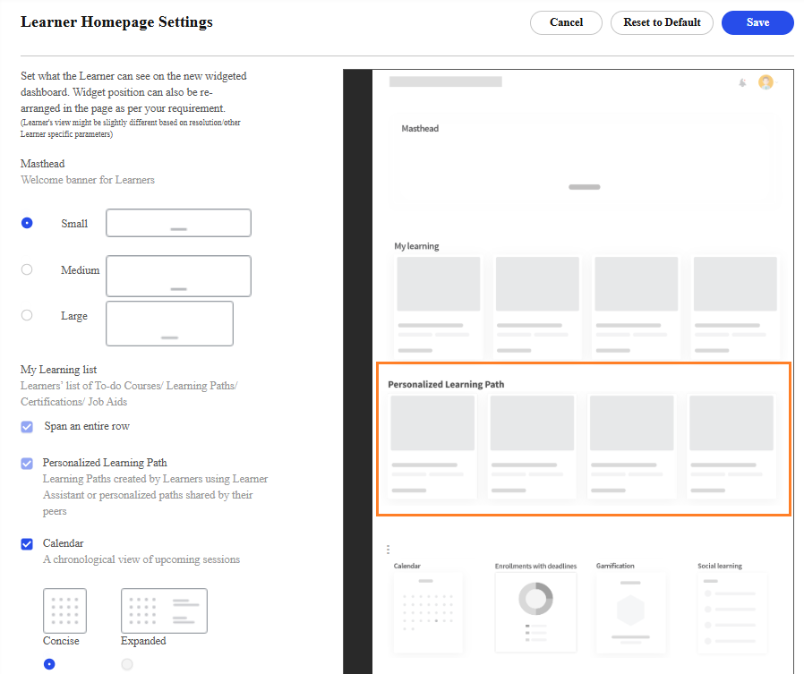

# Admin branding: repositioning homepage PLP and VC strips

## Add and reorder homepage strips in Adobe Learning Manager

Add Personalized Learning Path and Virtual Coach strips to the learner homepage, and drag and drop strips to set the order learners see.

As an administrator, you can add Personalized Learning Path (PLP) and Virtual Coach strips to the learner homepage in Adobe Learning Manager. You can also reorder every homepage strip with drag-and-drop controls in **Admin Branding**. You can now decide which strips learners see first.

You can also add a Personalized Learning Path widget to a custom page.

### About homepage strips

Homepage strips are the widgets (cards) that appear on the learner homepage. In Admin Branding, you control which strips appear and the order in which they appear. In the December 2026 release of ALM, two AI-powered strips are available:

* **Personalized Learning Path strip:** Highlights AI-generated learning paths for each learner.
* **Virtual Coach strip:** Helps learners find and open coaching experiences from the homepage.

### Personalized Learning Path strip

Learners can use the strip to:

* Access AI-generated learning paths.
* Continue previously generated learning paths.
* Discover recommended learning journeys.

### Virtual Coach strip

Learners can use the strip to:

* Discover Virtual Coach experiences.
* Resume coaching activities.
* Start conversational AI coaching from the homepage.

### Reorder homepage strips

You can place any strip in any position. For example, you can show the Virtual Coach strip first, followed by the Personalized Learning Paths, **Recommended**, and **Catalog** strips, and then **Recently Viewed**.

1. In the administrator app, select **Configure** > **Branding** in the left navigation pane.

   

2. Select **Learner Homepage**.
3. In the list of strips, locate the strip you want to move.
4. Drag the strip to its new position.

   

5. Save your changes.

After you publish, the new order appears on the learner homepage.

>[!NOTE]
>
>If the Personalized Learning Path or Virtual Coach strip isn't in the list, make sure it's added to the homepage configuration before you reorder.

## Add a Personalized Learning Path widget to a custom page

You can use the Personalized Learning Path widget outside the homepage. Add it to a custom page to give learners a dedicated place to find personalized learning recommendations.

1. Select **Custom Pages**.
2. Create a page, or edit an existing page.
3. Add a **Personalized Learning Path** widget.

   

   Review the widget.

   

4. Select **Proceed**.
5. Add the widget title and description.

   

6. Select **Add widget**.
7. Save the page.
8. Publish the page.
