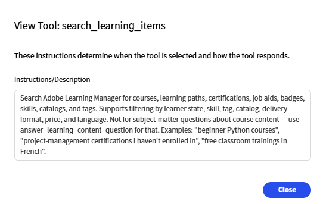

# Configure a Model Context Protocol server

## Overview

Each MCP server registers an OAuth 2.0 client application that authorizes AI clients to act on behalf of your learners. As an administrator, you create the server and copy its credentials, and then you give them to the AI client administrator, who completes the connection. You can revisit a server at any time to edit it, refine its tool descriptions, copy its credentials or delete it.

>[!NOTE]
>
>The server provides read access only to users with the Learner role.

## Create the MCP server

1. Sign in to Adobe Learning Manager as an administrator.
2. Navigate to **AI in Learning** > **MCP Servers**.
3. Select **New MCP Server**.
4. Enter the server details, including a description.

    * **Server name:** Enter a name of up to 50 characters.
    * **Description:** Enter a short description of up to 150 characters.
    * **URL:** Enter your company or application URL.
    * **Redirect Domains:** Enter the domain of each AI client that will connect, such as [http://\*.chatgpt.com](https://encoded-592c9deb-987b-4562-aa3c-9fa3d37d83e9.uri/http%3a%2f%2f*.chatgpt.com) or [http://\*.claude.ai](https://encoded-592c9deb-987b-4562-aa3c-9fa3d37d83e9.uri/http%3a%2f%2f*.claude.ai). This field is required.

    

5. Select **Next**.
6. On the **Available tools** page, review the learner tools that the server exposes. Provide detailed, contextual, and purpose-driven descriptions for MCP tools.Provide detailed, contextual descriptions for each tool. A precise description helps MCP-compatible clients select and invoke the appropriate tool. Include the tool's purpose, supported tasks, expected inputs and typical use cases.

    

    Select **View** for each tool to view the instructions to determine when the tool is selected and how the tool responds.

    

7. Select **Client credentials** in the left navigation pane.
8. Copy the **MCP Endpoint URL**, **Client ID** and **Secret Key**. Select **Copy** next to each value.

    

9. Select **Close**.

>[!NOTE]
>
>The server provides read access only to users with the Learner role.

Give the endpoint URL, client ID, and secret key to your AI client administrator.

## Edit a tool description

A tool description tells the AI client when to select the tool and how the tool responds. You can also add example prompts. Well-written tool descriptions help MCP-compatible clients discover and invoke the appropriate tools more accurately. Include the tool's purpose, supported tasks, expected inputs, and typical use cases.

1. On the **Available tools** page, select the **Actions** menu for a tool.
2. Select **MCP tool configuration** \> **Edit**.

    

3. In the **Edit tool** dialog, update **Instructions/Description**.

    

4. Under **Example prompts**, edit the prompts. To add a prompt, select **Add another example**.
5. Select **Save**.

To return a tool to its original wording, select the **Actions** menu for the tool, and then select **MCP tool configuration** \> **Reset**.

## Edit an MCP server

1. Select **AI in Learning** > **MCP Servers**.
2. Select the server name.
3. Select **Edit**.
4. Update the fields on the **Application details** page, and then save your changes.

## Delete an MCP server

1. Select **AI in Learning** > **MCP Servers**.
2. In the row for your server, select the **Actions** menu.
3. Select **Delete**.
4. In the confirmation dialog, select **Delete**.

>[!WARNING]
>
>Deleting a server removes access to all its tools for connected AI applications. Active sessions may stop working immediately, and you can't undo the deletion.

## Troubleshooting

**Tool changes don't appear right away.** 
Edits to tool descriptions take some time to take effect. Wait and try again.

**An AI client stopped working after a server was deleted.** 
Create a new server and give the new credentials to your AI client administrator.

**The AI client uses the wrong tool.** 
Review any tool descriptions you changed. Select **Reset** to restore the original wording.

## Best practices

* Retain the original tool descriptions unless you have a specific reason to change them.
* Write specific, unambiguous tool descriptions and example prompts when you do edit them.
* Store the secret key securely, and share it only with your AI client administrator.
* Create a separate server for each AI application, so that you can revoke one without affecting the others.
* Confirm that no AI application depends on a server before you delete it.
