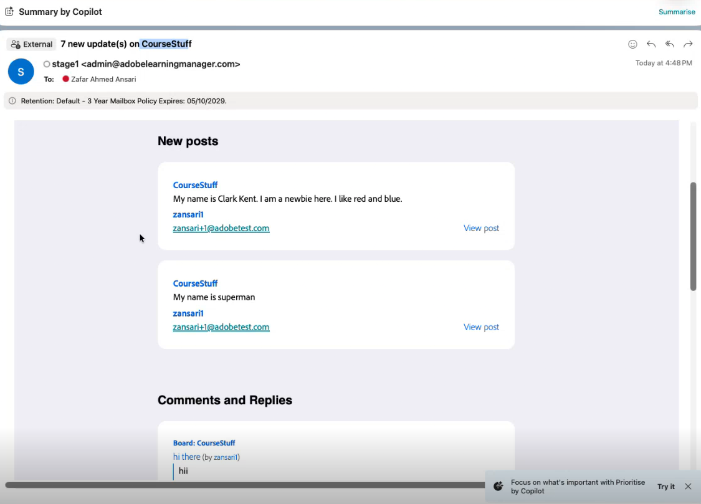
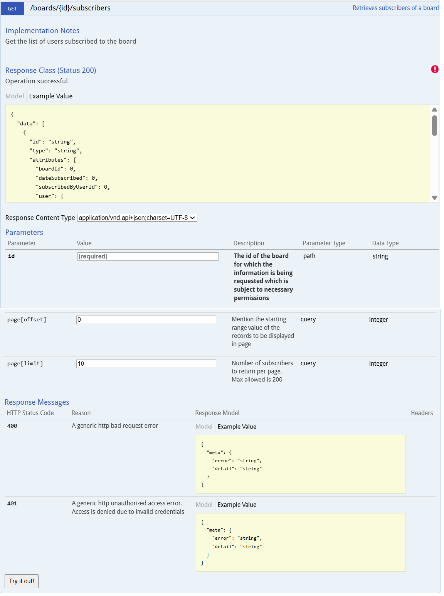
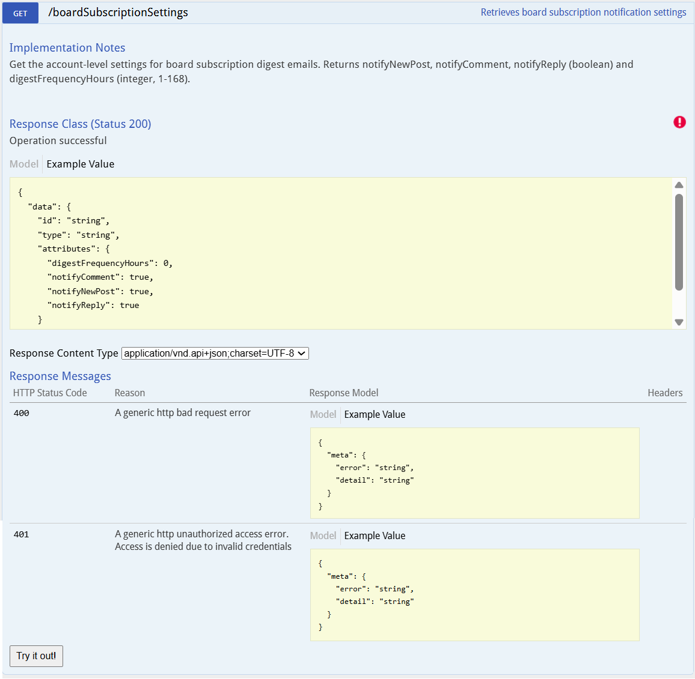

## Overview

Discussion board instructor notifications provide instructors, cohort managers, and other designated users with an email digest of recent activity across the discussion boards they monitor. The feature is useful when one instructor manages multiple cohorts and participates in several boards at the same time.

Instead of opening each board individually, instructors receive real-time in-app alerts and a daily email digest for the boards they're subscribed to. Admins manage board subscriptions through APIs.

## Key capabilities

* Admins can subscribe active Adobe Learning Manager users to selected discussion boards, subject to board visibility checks when notifications are sent.
* Subscribers receive real-time in-app notifications for enabled event types and an email digest grouped by board. Account-level settings control the event types.
* The digest window is fixed at 24 hours.
* Admins can manage subscribers and account-level notification event settings through admin APIs.
* Admins can add subscribers by email address or user ID.
* The digest email lists each new post, comment, and reply with the board name, author, and a direct link, together with a count of updates since the start of the digest period.
* Public APIs support headless implementations.

## Use cases

The following use cases show how instructor notifications help:

|Use case|How the notification helps|
|---|---|
|Monitor multiple cohorts|An instructor responsible for several cohorts can receive summarized activity from the boards associated with those cohorts.|
|Review learner engagement|A cohort manager can monitor new contributions and identify active discussions without checking every board separately.|
|Track follow-up conversations|Comments and replies included in the digest help instructors identify discussions that may require guidance or moderation.|
|Customize notification cadence|A subscriber can receive digests at an interval that suits their workflow, such as every 6, 15, or 24 hours.|
|Support headless workflows|A headless customer can manage subscribers, board associations, feature enablement, and digest intervals through APIs.|

## Important considerations

* A subscriber must be associated with a board and pass the board visibility check at delivery time. If a subscriber loses visibility to a board, the subscription is retained but notifications are suppressed.
* Upvotes and downvotes have an account-level notification setting (notifyVote), which is false by default.
* Admins manage subscribers and account-level event settings through public APIs.
* The digest is intended for instructors and cohort managers who are admins. It isn't sent to learners.
* The digest is a single email with no pagination, so a very active board can produce a long message. For example, a cohort of about 40 learners could generate several hundred comments in 6 hours.
* If your boards have high activity, choose a digest frequency that keeps each email manageable, such as every 6 hours. The number of posts in the email digest is limited to \_\_\_
* The number of subscribers is capped at \_\_\_\_. The email body is also subject to a size limit because the content is sent inline rather than as an attachment.
* Refer to the subscriber API reference for these limits before you subscribe users.

### Subscription model, permissions, and eligibility

* A subscriber is a user who receives notifications from a board. A board subscription is independent of the existing follow relationship with the board user.
* Only Learning Manager admins can use the subscription and settings APIs. The public API uses admin:read to list subscribers and read settings, and admin:write to add or remove subscribers and change settings.
* You can subscribe any Learning Manager user, but the user must exist, be active, and have access to the board to receive notifications. Visibility is rechecked when notifications and digests are sent.
* If a user loses access, delivery is skipped for that board and the subscription is retained. Delivery resumes if access returns.
* Bulk add is supported. Adding a duplicate subscriber is treated as success, so repeated requests don't create duplicates.
* The API returns HTTP 207 Multi-Status with added and failed results for each user.
* An inactive, deleted, or retired board is rejected with HTTP 409.
* A user without board access is reported with NO_BOARD_ACCESS and doesn't block other users in the batch.

## Digest content

### Included events

The digest includes new posts, comments, and replies when their account-level event setting is enabled. It also includes upvotes and downvotes when notifyVote is enabled.

### Excluded events

The digest excludes events whose account-level setting is off. No digest is sent when there's no eligible activity.

### Sample digest email layout

A digest email is sent for each subscribed board that had eligible activity. It is structured as follows:

* **Summary line:** The email opens with the total number of updates on the board (for example, seven updates) and a breakdown by type (for example, new posts and comments), along with the time from which the activity is counted.
* **Board section:** Activity is grouped under the board name. Each post is listed beneath it.
* **Item details:** Each post, comment, or reply shows the name and email address of the user who created it, plus a link to the item.
* **Links:** Selecting a link opens the post, comment, or reply directly. The recipient must be logged in for the link to open.
* **Comments and replies:** These appear in the same email as posts, so instructors can see follow-up conversations along with new topics.

  

## Configure notifications

### Configure settings using APIs

Public API endpoints let admins manage subscribers and account-level notification settings. Admins use admin:read and admin:write OAuth scopes. Settings cover new posts, comments, replies, and votes. All settings are false by default.

Two APIs are involved: the SubscriptionSettings API, which applies at the account level, and the subscribers API, which applies per board. Use the SubscriptionSettings API to set the digest frequency in hours and turn posts, comments, and replies on or off for the digest. A GET request on the settings returns the account's current configuration. For example, an account with a digest frequency of 1 hour receives a digest email every hour.

To see who is subscribed to a board, call the subscribers API with that board's ID. The response lists every subscriber for the board. You can add subscribers by email address or user ID.

### Manage subscribers

Admins manage which active Learning Manager users are subscribed to which boards. A subscription is separate from the existing board follow relationship. A user must have visibility to a board to receive its notifications, which means the user should be logged in. Losing visibility suppresses delivery but doesn't remove the subscription.

### Enable the feature

To enable instructor notifications, complete the following steps:

1. Use the relevant API setting to turn on discussion board subscriptions.
1. Select the instructors, cohort managers, administrators, or other users who need to receive activity digests.
1. Use an API to subscribe each user to the required discussion boards. A user can be associated with multiple boards.
1. Specify how often to generate **the digest** for the subscriber, such as every 6, 15, or 24 hours.

After you complete these steps, the system collects new posts, comments, and replies created during the configured interval. At the end of the interval, subscribers receive a summarized notification covering the eligible activity on subscribed boards.

Learn more about the [API changes in December 2026](/help/migrated/api-changes-dec-2026.md).
