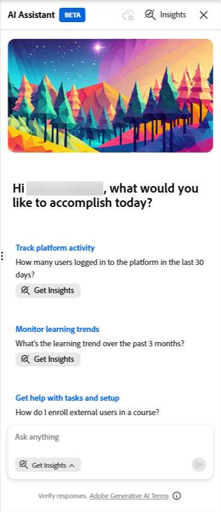
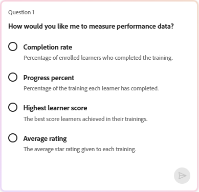
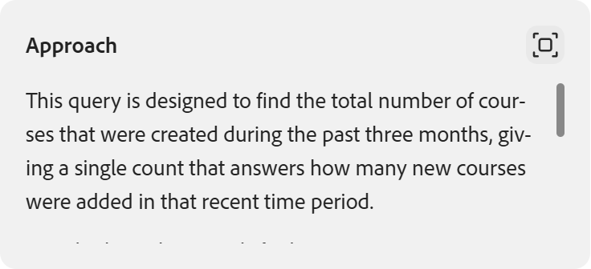
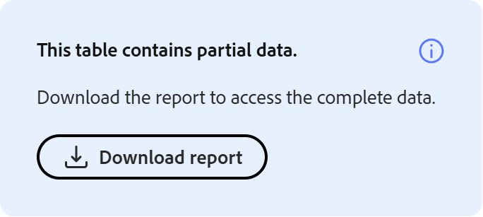
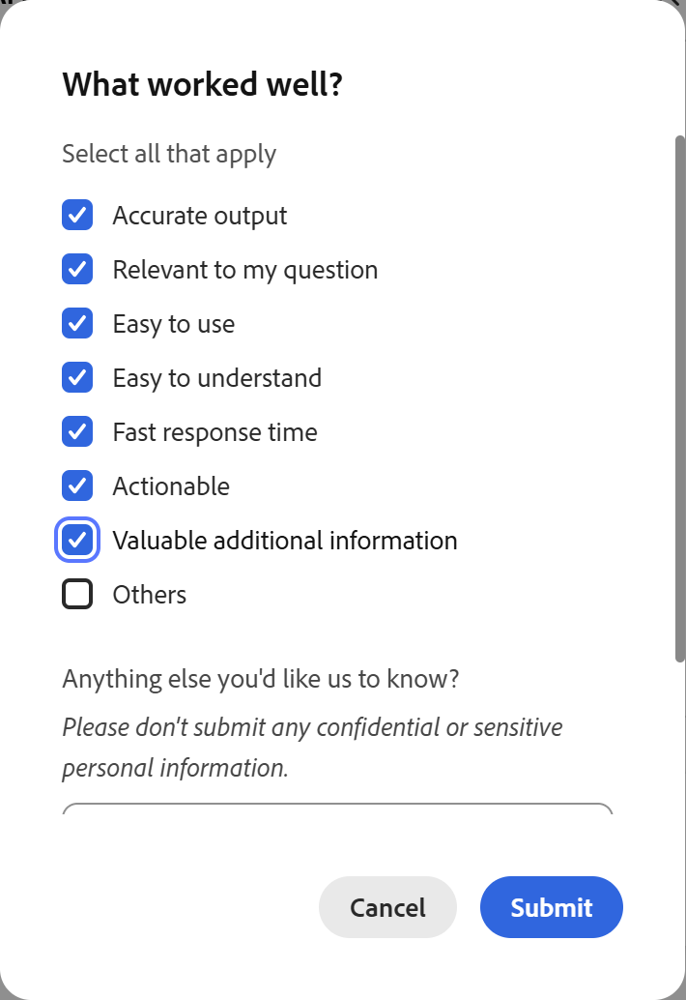
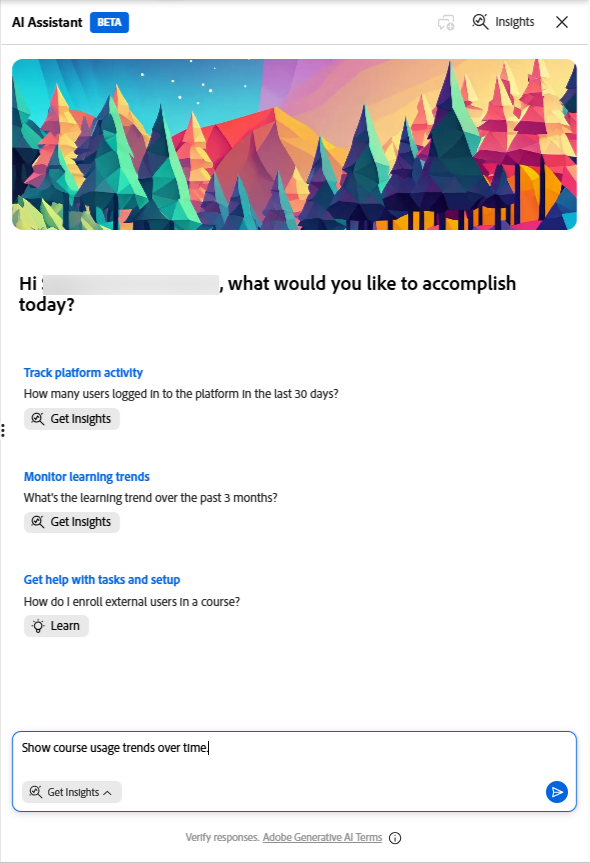
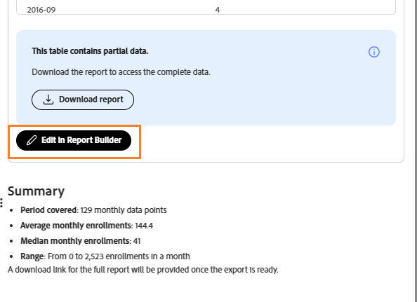
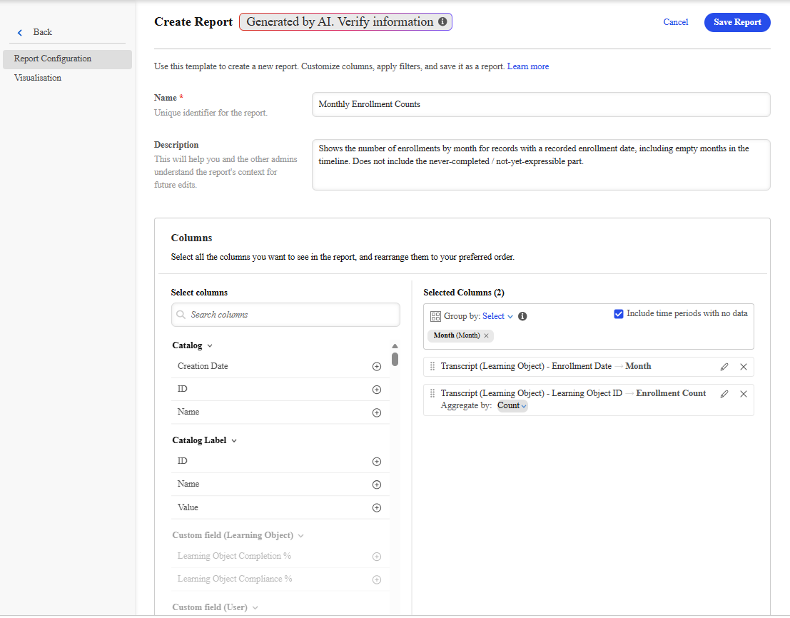

# What is Insights Agent?

Insights Agent is an AI-powered feature in Adobe Learning Manager that lets administrators query learning data using natural language. Instead of downloading reports and manipulating spreadsheets, you type a question, such as "How many courses were created in the last 3 months in the account? Give me a month-on-month report.", and Insights Agent retrieves and presents the data directly. You can view results as text, bullets, or tables, or download them as a CSV file.

Insights Agent is designed to reduce the steps between having a data question and getting an answer. Administrators who currently rely on Excel pivots, BI teams, or multiple combined reports can use Insights Agent to get answers faster.

## What Insights Agent can do

You can use Insights Agent to:

- Check completion and compliance metrics by region, department, or user group
- Analyze enrollment trends across courses or Learning Paths
- View progress data for a specific course or Learning Path

Every query returns a formatted table or downloadable CSV file, along with a plain-language explanation of how the results were calculated.

## What data Insights Agent does not support

The following data types are outside the scope Insights Agent currently:

- Feedback and survey data
- Gamification points and badges
- Audit history and change logs

Queries that reference these data types will not return results. For example, "How many gamification points were awarded last quarter?" or "Which learners have earned a compliance badge?" will return an error or incomplete data.

## How Insights Agent works

When you enter a question, Insights Agent processes it in four stages:

1. **Interpretation**: The agent parses your question to identify what data is needed. If any part of the question is ambiguous, the agent asks you a clarifying question before proceeding

2. **Approach**: The agent describes the steps it took to find your answer. This section helps you verify that the data was retrieved the way you intended, especially for complex queries.

3. **Results**: The agent presents your data as text, bullets, or a table depending on the nature of the results. A plain-language summary is included with the results. When results contain 50 or fewer rows, the summary includes analytical insights about the data. When results contain more than 50 rows, the summary provides column-level statistics.

4. **Download**: You can download the results as a CSV file. Large reports may take additional time; the agent notifies you when the file is ready.

The **Approach** section is particularly useful for complex queries. It shows the logic the agent used, similar to what a BI analyst would explain if they ran the query manually. Reviewing the approach helps you confirm that the output is reliable before you act on it.

## Ask questions using Insights Agent

Use Insights Agent in Adobe Learning Manager to query learning data with plain-language questions and get results as text, tables, or downloadable CSV files.

Insights Agent is available to admins from the AI assistant panel in Learning Manager. The panel is resizable. You can expand it to make results easier to read. By default, the **Get Insights** mode is selected when you open the panel. A separate **Learn** mode is also available for instructional questions about how to use the product. **Learn** mode answers instructional questions about how to use Learning Manager. For example, "How do I create a learning path?" It does not query learner data.

### Ask a question

When the **Get Insights** mode is selected by default, you can immediately start querying learning data without needing to adjust the mode each time you access the assistant. However, if you ever switch to the **Learn** mode for instructional questions, make sure to re-select **Get Insights** before submitting a query.

1. Select the AI assistant icon in Learning Manager to open the assistant panel. The **Get Insights** option is already selected by default.

    

2. Type your question in the text field. Use plain language. For example: **How many courses were created in the last 3 months?**

3. Select **Send** or press **Enter** to submit your question.

### Review the response

After you submit your question, Insights Agent processes your request and returns a response with up to four parts:

1. **Disambiguation (if needed):** If your question contains an ambiguous term, such as "learning activity" or "performance", or "Give me performance data from last three months", the assistant displays a list of options and asks you to select one before it proceeds. Select the option that best matches what you're looking for. After the initial question, you cannot type additional instructions. Selecting from the provided options is the only interaction available until you start a new query using the query interface. You can only respond to disambiguation by selecting from the provided options; free-text follow-up is not available in this release.

    

2. **Approach:** The **Approach** section describes the steps the agent took to retrieve your data. It appears as a scrollable panel below the question. Select the expand icon to view the full approach. Reviewing this section helps you confirm that the logic matches your intent, especially for complex queries. For example, if you ask for "all learners enrolled in the last year," the agent may return each learner's most recent enrollment rather than every enrollment record. The **Approach** section explains the decisions the agent made when retrieving your data. If the logic doesn't match your intent, start a new query with more specific terms.

    

3. **Results:** The Insights Agent generates results as text or a table. For data points that are best interpreted in a tabular format, the Insights Agent returns a table. The Insights Agent does not generate charts or graphs. To visualize the data, download the CSV and open it in your preferred tool. A plain-language summary is included with the results. When results contain 50 or fewer rows, the summary includes analytical insights about the data. When results contain more than 50 rows, the summary provides column-level statistics. For example, "Which courses do not have less than 5 enrolments that were created in the last 1 year, and who are the authors?"

    

And the response contains the following summary:

***Summary***

- *Matched courses: 102*
- *Enrolment count range: 24 to 2019*
- *Average enrolments per matched course: 589.6*
- *Median enrolments per matched course: 553.5*

*A download link for the full report will be provided once the export is ready.*

>[!NOTE]
>
>The format of the summary varies based on the nature of the data. The following is one example of a summary response. Your actual summary will differ depending on the query.

>[!NOTE]
>
>Insights Agent is probabilistic. If you run the same query twice, the response phrasing or result ordering may differ slightly.

### Download the report

Select **Download report** to export your results as a CSV file. For large result sets, the download may take additional time. The agent displays a message when the file is ready; you also receive a notification.

## Start a new query

Each Insights Agent session handles one question at a time. After you review your results, select **New question** to ask a different question. You can also select **New chat** at any point, including before you have received a response, if you want to abandon the current query and start fresh. You cannot type a follow-up question in the same session or ask the agent to refine or expand on the results it returned.

>[!TIP]
>
>If you want to explore related data, start a new query that incorporates what you learned from the first. For example, after seeing enrollment totals by region, start a new query to deep dive into under performing regions.

## Provide feedback

After each response, select the thumbs-up or thumbs-down icon to rate the result. You can also specify whether the output was inaccurate, difficult to understand, or took too long to return. This feedback helps improve the agent over time.

## Best practices

- Start with a specific question rather than a broad one. "What is the completion rate for the Safety Training course in the North America user group?" returns more useful results than \"Show me completion data."
- Use exact Adobe Learning Manager terms when naming content and learner groups. The query writing guide lists the correct terms to use.
- If the agent asks a clarifying question, treat it as a signal to refine your original query next time. The more specific your question, the fewer clarifications are needed.
- Review the **Approach** section before acting on results to confirm the agent's logic matches your intent.
- **Specify whether to include waitlisted learners.** By default, enrollment count queries return only learners with an active, confirmed enrollment — waitlisted learners are excluded, consistent with the enrolled-learner list available from the course or learning path page. If you want waitlisted learners included in the count, say so explicitly in your query. For example: "How many learners are directly enrolled in the Safety Training course, including waitlisted learners?" The Approach section will indicate whether waitlisted learners were included in the results.
<!--
- **Specify whether to include or exclude waitlisted learners**. By default, enrollment count queries include learners who are on a waitlist alongside active, confirmed enrollments. If you need only active participants, explicitly exclude waitlisted learners in your query. For example: "How many learners are directly enrolled in the Safety Training course, excluding waitlisted learners?" The agent will disclose in the Approach section that the exclusion was applied. Without this instruction, enrollment totals may include a significant proportion of waitlisted learners who have not yet started the content.
-->
- **Direct and indirect enrollment counts**: When you query enrollment or completion data for a course or learning path, Insights Agent distinguishes between direct enrollments (learners enrolled specifically in that course or learning path) and indirect enrollments (learners who accessed the same content as part of a Learning Path or certification). If you ask specifically for direct or indirect enrollments, the agent returns the correct count for each type. If your query does not specify direct or indirect, the agent may return a combined count. To get separated counts, include the distinction explicitly in your query. For example: "How many learners are directly enrolled versus indirectly enrolled in the Safety Training course?"

## How Insights Agent differs from Report Builder

Both features use the same underlying learning data, but they work differently. Insights Agent is conversational. You describe what you want, and the agent retrieves it. Report Builder is structured. You select datasets, columns, and filters to build reusable reports.

| **Use case** | **Recommendation** |
|---|---|
| Ask a quick data question | Insights Agent |
| Explore data without knowing the schema | Insights Agent |
| Build a structured, repeatable report | Report Builder |
| Combine multiple datasets with custom joins | Report Builder |
| Schedule report subscriptions | Report Builder |
| Combine datasets with custom joins or advanced data modeling | Report Builder |

## Write effective queries for the Insights Agent

The quality of your query directly affects the quality of the results Insights Agent returns. A well-formed query includes three ingredients: context, for example, what content and which learners, scope, for example, status, time range, and user state, and columns, for example, the exact fields you want in the output. Learn how to use the correct terminology, query structure, and example queries as starting points.

### The three-part query formula

Every effective Insights Agent query contains these three components:

| **Component** | **What could mean** | **Example** |
|---|---|---|
| **Context** | The content and learners you're asking about | "...the New Hire Onboarding learning path, for Sales Associate learners in Location 101..." |
| **Scope** | Enrollment status, time range, and user state | "...who are enrolled but not yet completed, in the last 90 days..." |
| **Columns** | Every field you want in the output | "...show name, email, location, and enrollment date" |

Missing any one of these components may lead to ambiguous results or a clarifying question from the agent.

### Use the correct ALM terms

Insights Agent matches your query against Adobe Learning Manager's data model. Using the wrong term can return incorrect or no results. Use the terms in the left column below.

| **Use this term** | **Not this** |
|---|---|
| **Learning Path** | Program / track / curriculum |
| **Course** | Module / class / lesson |
| **Certification** | Badge / certificate |
| **Learner** | Student / employee |
| **Session** | Class / scheduled date |
| **User group** | Team / department / cohort |
| **Active field** | Custom field / attribute |
| **Enrollment** | Registration / assignment |
| **Completion** | Finished / done / passed |
| **Catalog label** | Category / tag group |

Insights Agent is case-insensitive, but exact term matching improves accuracy.

### Query using your organization's custom terminology

If your administrator has renamed standard terms using Product Terminology in **Settings > General**, Insights Agent recognizes your organization's custom terms in place of the defaults listed above. For example, if your organization renamed **Course** to **Chapter**, you can ask "How many chapters were completed last month?" and Insights Agent understands the question and labels the results using **chapters** in the response and column headers.

Custom terminology applies everywhere inside the Insights Agent chat window, including how your query is interpreted, the Approach explanation, the results summary, and table or column headers shown in the chat. **The downloaded CSV file does not reflect custom terminology.** Column headers and content in the exported file use the default Adobe Learning Manager terms, regardless of how your organization has customized them.

- Insights Agent recognizes both the singular and plural forms of a custom term, as configured in the Product Terminology CSV file.
- You can still use the default Adobe Learning Manager term in your query even after your organization customizes it. Insights Agent recognizes the default term and responds using your organization's custom term. For example, if your organization renamed **Course** to **Chapter**, you can still ask "How many chapters were completed last month?" using the original term. Insights Agent understands the question and responds using your organization's custom term, **chapters**, in the response.
- If your query includes a misspelled or unrecognized term, Insights Agent asks a clarifying question and suggests the closest matching term or terms available in your account.
- If your administrator resets the custom terminology, Insights Agent no longer recognizes the previously customized terms and reverts to the default terms.

>[!NOTE]
>
>Custom terminology support does not extend to modules and tabs that Insights Agent does not currently query, such as Social Learning, Job Aids, Discussion Forum, Gamification, and Announcements.

<!--
### Query using your organization's custom terminology

If your administrator has renamed standard terms using **Product Terminology** in **Settings** > **General**, Insights Agent recognizes your organization's custom terms in place of the defaults listed above. For example, if your organization renamed **Module** to **Training**, you can ask "How many Trainings were completed last month?" and Insights Agent understands the question and labels the results using **Training** in the response and column headers.

- Insights Agent recognizes both the singular and plural forms of a custom term, as configured in the Product Terminology CSV file.
- You can still use the default Adobe Learning Manager term in your query even after your organization customizes it. Insights Agent recognizes the default term and responds using your organization's custom term.
- If your query includes a misspelled or unrecognized term, Insights Agent asks a clarifying question and suggests the closest matching term available in your account.
- If your administrator resets the custom terminology, Insights Agent no longer recognizes the previously customized terms and reverts to the default terms.

>[!NOTE]
>
>Custom terminology support does not extend to modules and tabs that Insights Agent does not currently query, such as Social Learning, Job Aids, Discussion Forum, Gamification, and Announcements.
-->

### Anchor your content

Providing a content anchor helps the agent know which learning items to look at. You can anchor by any of the following:

| **Anchor type** | **Example** |
|---|---|
| Name | "...the New Hire Onboarding learning path" |
| Catalog | "...all learning paths in the Onboarding catalog" |
| Catalog label | "...all courses where catalog label Region = North" |
| Tag | "...all courses tagged Compliance" |
| Skill | "...all courses mapped to the Customer Service skill" |
| Compliance label | "...all compliance-labeled certifications" |
| Content type | "...all published courses" / "...all certifications" |

### Anchor your learners

If a query is related to a learner, use one of these methods:

- **Active field value** — "learners where active field Job Title = Sales Associate" or "learners where active field Location = 101"
- **User group** — "learners in the Sales Associates user group"
- **Session** — "learners enrolled in the 15 June session of the Workplace Safety course"

### Define your scope

Omitting scope details may lead to broader results than intended.

| **Scope type** | **Options** |
|---|---|
| Enrollment status | enrolled / completed / not enrolled / overdue |
| Time range | all time / last 30 days / last 90 days / specific date range |
| User state | active users only (default) / add "include deleted users" for inactive |

### Name every output column

If you don't specify columns, Insights Agent chooses them for you. Name every field you want in the output.

| **Vague** | **Specific** |
|---|---|
| "Show location numbers" | "For each location: total learners, enrolled count, not-enrolled count" |
| "Show completion rates" | "For each learning path: name, total enrolled, total completed, completion %" |
| "Show me who failed" | "Show learner name, email, course name, and completion status for learners who have failed" |

### Example queries

Use these as starting points. Adapt them by replacing the content names, user groups, and time ranges that apply to your account.

**Completion and compliance**

- "What is the completion rate for the Safety Training course in the North America user group?"
- "Show completion rate by user group for all compliance courses. Include user group name, total enrolled, total completed, and completion %."
- "What is the compliance rate for all learners where active field Job Title = VP?"

**Enrollment analysis**

- "How many learners are enrolled in the New Hire Onboarding learning path, by location?"
- "Show enrollments by region for the last 90 days. Include region name and enrollment count."
- "List all learners enrolled in the Workplace Safety course but not yet completed — include name, email, and enrollment date."

**Program and course progress**

- "What is the completion status breakdown for the Leadership Development learning path? Show completed, in progress, and not started counts."
- "How many learners completed the Data Privacy course last month?"

**Organizational views**

- "Show completion rate for all compliance type labeled certifications, grouped by department. Include department name, total enrolled, and completion %."
- "What is the enrollment distribution by region for the last 30 days?"

### Common mistakes to avoid

| **Avoid** | **Do this instead** |
|---|---|
| No content anchor ("show me everything") | Name the specific path, course, catalog, tag, or skill |
| Vague metric ("why are completions low?") | Ask a measurable question: "Which learning paths have completion rate below 30%, by location?" |
| Not specifying user state | Add "active users only" or "include deleted users" explicitly |
| Asking for predictions | Ask what the current data shows, not what will happen |
| Asking about unsupported data (feedback, skills, badges) | Use existing reports in the Reports section |
| Asking multiple questions in one query ("Show enrollments by region and also list who hasn't completed Safety Training") | Ask one focused question per query. The agent may answer only part of a compound query, with no guarantee the rest is addressed. |

## Limitations in the release

**Queries submitted in non-Latin scripts are not supported**

Insights Agent supports queries written in English and Latin-alphabet languages such as French and Spanish. Queries submitted using non-Latin scripts, including Japanese, Chinese, Arabic, Korean, Hindi, and Russian are not processed. The agent will display a message indicating the query could not be completed. If you submit a query in one of these languages, start a new query and rephrase it in English.

## Create a report from an Insights Agent answer {#create-report-insight-agent-answer}

In Adobe Learning Manager, you can ask Insights Agent a question in plain language and open the answer as a report in Report Builder. You can then edit the report and reuse it, so you don't have to rebuild it from scratch.

### What is the Insights Agent integration with Report Builder

Insights Agent and Report Builder are two ways to reach the same data in Adobe Learning Manager. Both run on the same data platform.

* **Insights Agent** allows you ask questions in natural language.
* **Report Builder** allows you build a report by selecting data sets, columns, aggregations, and filters. You can also use it to create recurring reports, subscribe to reports, and edit existing reports.

The integration connects the two. You start with a question, review the answer, and open it in Report Builder. There, you can modify the report and continue working with it as you would with any other report. Currently, this integration is available to admins.

Not every Insights Agent answer can become a report. Insights Agent opens an answer in Report Builder only when the report keeps the intent of your question.

### How the integration works

When you ask a question, Insights Agent generates a data query and retrieves the corresponding result. If the query can be translated into Report Builder constructs, Adobe Learning Manager creates a draft Report Builder report based on the generated query.

Insights Agent:

* Generates a query from your question.
* Maps the generated query to Report Builder datasets and fields.
* Creates a draft report.
* Validates the report against the original question.
* Opens the report in Report Builder for review.

### Create a report from an Insights Agent answer

1. Launch Insights Agent.
2. Enter your question in plain language. Wait for the answer. Insights Agent prepares the report in the background, so the conversation continues without interruption.

   

3. Review the generated response after Insights Agents disambiguates and/or provides an approach on how it generated the response.
4. Select **Edit in Report Builder**.

   

   Report Builder opens the generated report along with the columns and automatically applies group by or aggregate functions, if necessary. The name and description of the report are also generated automatically.

   

5. Review the generated report. Report Builder maps the fields from the answer to its own fields, for example, the course name and description. If Insights Agent could not convert part of your question, the report lists those items as gaps next to the report.
6. Edit the report if needed. For example, add or change columns, aggregations, or filters.
7. Save the report. Select **Save Report**.

The report opens in Report Builder with the converted fields and the matching data. You can now edit it and manage it like any other report.

### Edit the generated report

After the report opens in Report Builder, you can:

* Add or remove columns.
* Update filters.
* Modify aggregations.
* Change sorting.
* Save the report.
* Share the report.
* Add visualizations.
* Create dashboards.

### How Insights Agent converts an answer into a report

Insights Agent and Report Builder are designed differently. An answer in Insights Agent can therefore include data that Report Builder can't fully represent. To handle this, Insights Agent converts each answer in stages.

| Stage | What happens |
|---|---|
| Query | Insights Agent works out the query that answers your question. Report Builder starts from the same query at the same time, so your conversation is never blocked. |
| Field mapping | The query is mapped to Report Builder data sets and fields. A working report is built from that mapping. |
| AI draft | AI drafts the report and verifies it. |
| Review | The report is checked against your original question. Validation runs at the same time. |
| Correction | If validation finds errors, they are fixed automatically. |
| Final check | The report is checked once more against Report Builder. |
| Gap listing | Any part of your question that Report Builder fields can't express is listed beside the report. |

### How Insights Agent decides whether an answer can open in Report Builder

Insights Agent follows two rules: preserve the intent of your question, and be open about what it couldn't convert.

* **Preserve intent.** Insights Agent lets you open an answer in Report Builder only when the report still serves the core of your question. If the conversion loses that intent, you can't move to Report Builder.
* **Disclose gaps.** If part of your question can't be expressed in Report Builder, Insights Agent doesn't drop it silently. It lists the part as a gap beside the report. If anything looks risky, the report stays available so you can review it yourself.

Insights Agent decides whether a missing field or calculation is central to your question, based on its intent.

| Situation | Result |
|---|---|
| Report Builder has fields for every part of your question | The report is created and ready to review. |
| Part of your question can't be expressed in Report Builder | The part is listed as a gap. The report remains available for review. |
| A field in the answer isn't available in Report Builder, and the field is minor to your question | You can open the report in Report Builder. The field is listed as a gap. |
| A field in the answer isn't available in Report Builder, and the field is central to your question | You can't open the answer in Report Builder. For example, skill name or skill ID. |
| The answer uses a calculated field that Report Builder doesn't support. The calculation can be one of two types: a complex calculation that creates a new field, or an aggregation calculation built on top of existing RB fields. The first type can't be converted to RB, but the second can. | The calculation is listed as a gap. If it is central to your question, you can't open the answer in Report Builder. |
| The question is complex, for example with multiple joined queries | The converted report can be less accurate. If it still serves your intent, it opens so you can verify it. |

# Create a report from an Insights Agent answer

In Adobe Learning Manager, you can ask Insights Agent a question in plain language and open the answer as a report in Report Builder. You can then edit the report and reuse it, so you don't have to rebuild it from scratch.

## What is the Insights Agent integration with Report Builder

Insights Agent and Report Builder are two ways to reach the same data in Adobe Learning Manager. Both run on the same data platform.

- **Insights Agent** lets you ask questions in natural language.

- **Report Builder** lets you build a report by selecting data sets, columns, aggregations, and filters. You can also use it to create recurring reports, subscribe to reports, and edit existing reports.

The integration connects the two. You start with a question, review the answer, and open it in Report Builder. There, you can modify the report and continue working with it as you would with any other report. Currently, this integration is available to admins.

Not every Insights Agent answer can become a report. Insights Agent opens an answer in Report Builder only when the report keeps the intent of agent's response and your question.

## How the integration works

When you ask a question, Insights Agent generates a data query and retrieves the corresponding result. If the query can be translated into Report Builder constructs, Adobe Learning Manager creates a draft Report Builder report based on the generated query.

Insights Agent:

1.  Generates a query from your question.

2.  Maps the generated query to Report Builder datasets and fields.

3.  Creates a draft report.

4.  Validates the report against the agent's response and original question.

5.  Opens the report in Report Builder for review.

## Create a report from an Insights Agent answer

1.  Launch **Insights Agent**.

2.  Enter your question in plain language. Wait for the answer. Insights Agent prepares the report in the background, so the conversation continues without interruption.

3.  Review the generated response after Insights Agents disambiguates and/or provides an approach on how it generated the response.

4.  Select **Edit in Report Builder**.

Report Builder opens the generated report along with the columns and automatically applies group by or aggregate functions, if necessary. The name and description of the report are also generated automatically.

**Note**: The **Edit in Report Builder** option also appears when Insights Agent finds no data for your question. You can create the report and modify it later. Data can appear after you create the report, so the report remains empty until matching data exists.

5.  Review the generated report. Report Builder maps the fields from the answer to its own fields, for example, the course name and description. If Insights Agent could not convert part of your question, the report lists those items as gaps next to the report.

6.  Edit the report if needed. For example, add or change columns, aggregations, or filters.

7.  Save the report. Select **Save Report**.

The report opens in Report Builder with the converted fields and the matching data. You can now edit it and manage it like any other report.

## Edit the generated report

After the report opens in Report Builder, you can:

- Add or remove columns.

- Update filters.

- Modify aggregations.

- Change sorting.

- Save the report.

- Share the report.

- Add visualizations.

- Create dashboards.

## How Insights Agent converts an answer into a report

Insights Agent and Report Builder are designed differently. An answer in Insights Agent can therefore include data that Report Builder can't fully represent. To handle this, Insights Agent converts each answer in stages.

| **Stage** | **What happens** |
|----|----|
| Query | Insights Agent works out the query that answers your question. Report Builder starts from the same query at the same time, so your conversation is never blocked. |
| Field mapping | The query is mapped to Report Builder data sets and fields. A working report is built from that mapping. |
| AI draft | AI drafts the report and verifies it. |
| Review | The report is checked against the worked out query and your original question. Validation runs at the same time. |
| Correction | If validation finds errors, they are fixed automatically. |
| Gap listing | Any part of your question that Report Builder fields can't express is listed beside the report. |

## How Insights Agent decides whether an answer can open in Report Builder

Insights Agent follows two rules: preserve the intent of agent's response and your question, and be open about what it couldn't convert.

- **Preserve intent.** Insights Agent lets you open an answer in Report Builder only when the report still reflects the core of the Insights Agent response. If the conversion loses that intent, you can’t move to Report Builder.

- **Disclose gaps.** If part of your question can't be expressed in Report Builder, Insights Agent doesn't drop it silently. It tries to list the most prominent parts as gaps beside the report. If anything looks risky, the report stays available so you can review it yourself.

Insights Agent decides whether a missing field or calculation is central to your question, based on its intent.

**Note**: Insights Agent checks the conversion mainly against its own response, and only secondarily against your question. If the response doesn’t fully answer your question, you can still convert it to a report in Report Builder. Review the report before you rely on it.

| **Situation** | **Result** |
|----|----|
| Report Builder has fields for every part of the Insights Agent response | The report is created and ready to review. |
| Part of the Insights Agent response can’t be expressed in Report Builder | The part is listed as a gap. The report remains available for review. |
| A field in the response isn’t available in Report Builder, and the field is minor to the response | You can open the report in Report Builder. The field is listed as a gap. |
| A field in the response isn’t available in Report Builder, and the field is central to the response | You can’t open the response in Report Builder. For example, skill name or skill ID. |
| The response uses a calculated field that Report Builder doesn’t support. The calculation can be one of two types: a complex calculation that creates a new field, or an aggregation calculation built on top of existing Report Builder fields. The first type can’t be converted, but the second can. | The calculation is listed as a gap. If it is central to the response, you can’t open the response in Report Builder. |
| The response is complex, for example with multiple joined queries | The converted report can be less accurate. If it still reflects the intent of the response, it opens so you can verify it. |
| Insights Agent finds no data for your question | The **Edit in Report Builder** option still appears. You can create the report and modify it later. The report shows data when matching data becomes available. |

## Troubleshoot report conversion

| **Issue** | **Solution** |
|----|----|
| You can't open the answer in Report Builder. | A field or calculation that is central to your question isn't available in Report Builder. Rephrase your question without that field or calculation, and ask again. |
| The report has fewer columns than the answer. | Check the gaps listed beside the report. Items listed there couldn't be converted. |
| The report doesn't match what you expected from a complex question. | Review the report against your original question. Break the question into smaller questions and convert each answer separately. |
| Insights Agent says it found no data, but **Edit in Report Builder** is still available. | This is expected. You can create the report anyway, modify it in Report Builder, and check it again when new data is available. |
| The report opens empty in Report Builder. | No matching data exists for your question yet. Modify the report, or open it again after new data is available. |

### More like this

*    [Create reports with Report Builder](/help/migrated/administrators/feature-summary/alm-create-report.md)
*    [Create dashboards from Report Builder reports and visualize report data with charts](/help/migrated/administrators/feature-summary/report-builder-visualization.md)
*    [Use Insights Agent for reporting](/help/migrated/administrators/feature-summary/insights-agent.md#create-report-insight-agent-answer)
*    [Share and subscribe to reports](/help/migrated/administrators/feature-summary/download-share-subscribe-report.md)
*   Visualize report data with charts