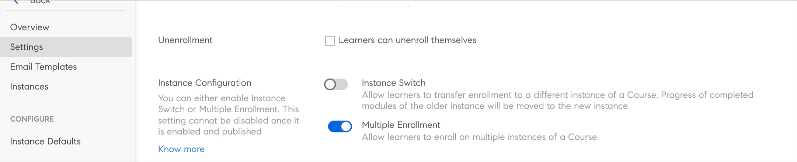
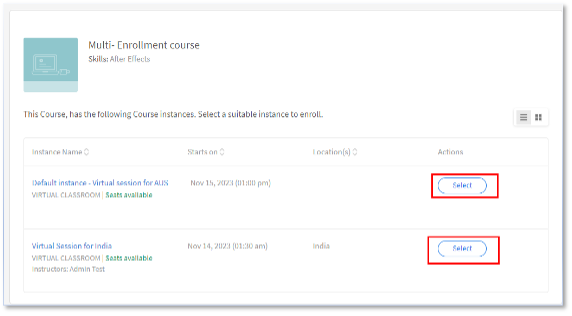
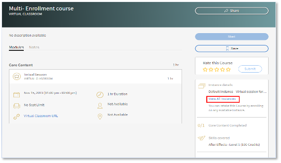
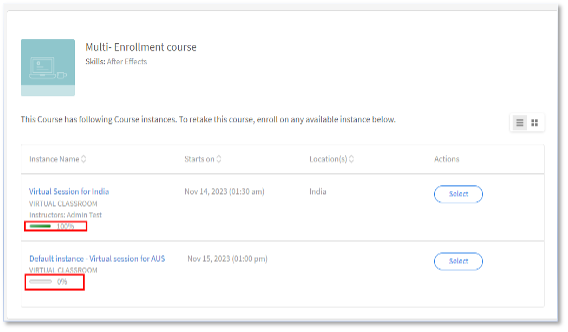
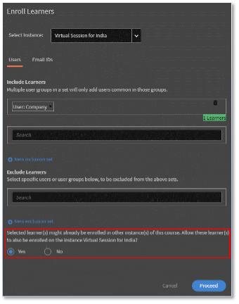

# Multiple enrollment in Adobe Learning Manager

In Adobe Learning Manager, each course can have different instances. As an account Administrator, one of your primary duties is to create different instances of VILT sessions across different time zones, and possibly create sessions for specific user groups.

Before the July 2023 release, when an Admin enrolled a learner, they could enroll in only one instance. If a learner wished to take a course in different instances, the Admin would create many courses, one for each instance.

Adobe Learning Manager's multi-enrollment feature helps an Admin avoid such scenarios.

## Manage instances

>[!INFO]
>
>In this training, you will learn how to edit instance details and instance properties.    

If you're unable to launch the training, write to <almacademy@adobe.com>.

## What is multi-enrollment

Multi-enrollment enrolls a learner multiple times in a course through various available instances.  A learner can enroll in multiple course instances irrespective of the state they're in-enrolled, completed, or yet to start. When the Author enables the [!UICONTROL Multiple Enrollment] toggle, a learner can then enroll in multiple instances of the course.

*Launch Multiple Enrollment from Settings*

The progress of each instance can be tracked individually, and a report can be exported to track the progress of each instance.

## Important points

* Multi-enrollment is applicable only when a course has multiple instances.
* Once the multi-enrollment option is enabled and users are enrolled in multiple instances, new rows are created for each course in the Learner Transcript report (one row for each instance and each learner)
* If reporting automation is set up that anticipates only one row per course, you must make the necessary adjustments to the reporting automation before enabling the Multi-Enrollment feature.
* Admin APIs do not support multi-enrollment scenarios. Please reach out to your CSM if you have any requirements.

## How to enable Multi-enrollment

1. Log in to your Adobe Learning Manager account as an author. 
1. Select the course on which you want learners to enroll multiple times. 
1. In the left panel, select **[!UICONTROL Settings]** > **[!UICONTROL Edit]** > **[!UICONTROL Instance configuration]** > **[!UICONTROL Enable Multiple Enrollment]**.

*Enable Multi-Enrollment*

>[!NOTE]
>
>As an author, you cannot have Instance Switch and Multiple Enrollment enabled simultaneously.

## Learner view

Multiple enrollments are helpful when a learner wants to enroll in a Classroom or VC course or wants to complete a course again before moving on to another course.

For learners who didn't enroll, when they select a course, they will view the screen under the course with multiple instances. Then, they can select each instance and enroll.

*View the instances*

After enrolling in one instance, they can enroll in other instances by selecting the View All Instances option in the right pane.

*Enroll into an instance*

The progress on each instance can be tracked as below:

*Track progress of each instance*

## Multi-Enrollment changes in the administrator

**Enrollment:**

While enrolling the learners, you can enable the following checkbox:

*"Selected learner(s) might already be enrolled in other instance(s) of this course. Allow these learner(s) to also be enrolled on the instance …"*

*Enrollment option for Admins*

If the learner is already enrolled in one instance and you, as an administrator, are trying to enroll the learner in a different course instance, select Yes.

## Reporting

For a learner who is enrolled in two instances of the same course, two rows are created for each course instance. The report also displays the progress of the instances.

# Enable multi-enrollment for adaptive courses

Multi-enrollment lets a learner enroll in more than one instance of the same course at the same time. In Adobe Learning Manager, you can now turn on multi-enrollment for adaptive courses.

## About multi-enrollment in an adaptive course {#about-multi-enrollment}

An adaptive course shows each learner only the modules that match their user groups. With multi-enrollment turned on, a learner can take several instances of that course, such as sessions in different months.

Adaptive courses track waitlists at the module level. A learner can be in progress in instance A and waitlisted in instance B of the same modules.

## Enable multi-enrollment for an adaptive course {#enable-multi-enrollment}

1. Sign in to Adobe Learning Manager as an Author.
1. Select **Courses** from the left navigation.
1. Open an adaptive course or create one.
1. Add the modules. For each content module, select **Add rules** to set the user groups that can see it and the user groups for which it is mandatory.
1. Select **Save**. The multi-enrollment option becomes available.
1. Enable the **Multi-enrollment** toggle.
1. Create the instances you need. For classroom and virtual classroom sessions, set the seat limits.
1. Select **Publish**.

Learners can now enroll in more than one instance of the course.
Article 2
markdown
---
title: Enrollment and completion rules for adaptive learning paths
description: Learn how Adobe Learning Manager evaluates enrollment, waitlisting, and completion for adaptive courses in adaptive learning paths.
---

# Enrollment and completion rules for adaptive learning paths

Authors can add adaptive courses to adaptive learning paths in Adobe Learning Manager. Enrollment, waitlisting, and completion follow rules that combine the section settings and the course settings that your Authors configure.

>[!NOTE]
>
>Add adaptive courses only to adaptive learning paths, not to regular learning paths. This helps ensure that all behaviors and edge cases are supported.

## How an adaptive learning path evaluates a learner {#evaluate-learner}

Adobe Learning Manager evaluates visibility at the section level and at the course level. The section rule decides whether a learner sees a section and the adaptive courses in it. The module rules inside each adaptive course then decide whether the learner is enrolled in the course.

Changing a learner's user groups doesn't enroll them in the learning path. If the learner is already enrolled in the path, a user group change that makes an adaptive course visible enrolls them in the adaptive course automatically. The learner receives an enrollment notification and email.

## Enrollment evaluation rules {#enrollment-evaluation-rules}

When you enroll a learner in an adaptive learning path, Adobe Learning Manager checks the path in this order:

|Order|Check|Result|
|---|---|---|
|1|Section visibility|Adobe Learning Manager checks a course for enrollment only if its section is visible to the learner.|
|2|Course eligibility|If the course has no mandatory module for the learner, the learner isn't enrolled in the course. The course doesn't count toward learning path completion.|
|3|Sections with no eligible course|If a section contains only adaptive courses and the learner is eligible for none of them, Adobe Learning Manager skips the section.|
|4|Learning path enrollment|If none of the mandatory sections apply to the learner, the learner isn't enrolled in the learning path.|

If the learner is already enrolled in an instance of the course that belongs to the learning path instance, Adobe Learning Manager uses that enrollment.

After enrollment, the following rules apply:

* If a learner was skipped for a course because it wasn't visible to them due to a change in user group or completion criteria, they're automatically enrolled later when later rule changes make the course visible or mandatory.
* A user group change or a course change can unenroll a learner from an adaptive course. If no mandatory content remains in the path, the learner is unenrolled from the path.
* When a section-level user group rule is changed on an adaptive learning path, learners who newly become eligible for a course within that section do not receive the expected auto-enrollment email and notification for the corresponding adaptive course inside the learning path. The learner only sees the updated visibility and enrollment after manually reloading the page.

## Waitlist behavior in adaptive learning paths {#waitlist-behavior}

Waitlisting works at the session level, not the instance level. This applies to adaptive courses in learning paths as well.

|Scenario|Behavior|
|---|---|
|No adaptive course in the path has a classroom or virtual classroom module|No waitlisting applies.|
|An adaptive course has a classroom or virtual classroom module and the learning path isn't mapped to any instance.|The course defaults to **No instance**. The learner can enroll in any instance and is waitlisted only on sessions that are full.|
|An instance is selected before enrollment, when the learning path is mapped to a course instance.|The learner is enrolled in that instance and is waitlisted only on sessions that are full.|

To manage waitlisted learners, open the adaptive course and select **Learners** > **Waitlist** tab. For an adaptive course in a Flex learning path or an adaptive learning path, waitlisted learners appear only on the **Waitlist** tab of the course and not under the learning path.

## Refresh completion and rollback behavior {#refresh-completion}

Adobe Learning Manager doesn't revoke completion automatically when user groups or rules change. A completed learner stays completed until you refresh completion.

* Run **Refresh Completion** on the learning path. You can't refresh an adaptive course on its own for learners who take it through the path.
* Each adaptive course recalculates first, based on the learner's current mandatory modules. The learning path then recalculates based on the current mandatory sections and the refreshed course status changes.
* If the course or path is no longer complete, the learner's status changes to in progress. The original completion remains on the Learner Transcript as a historical record.
