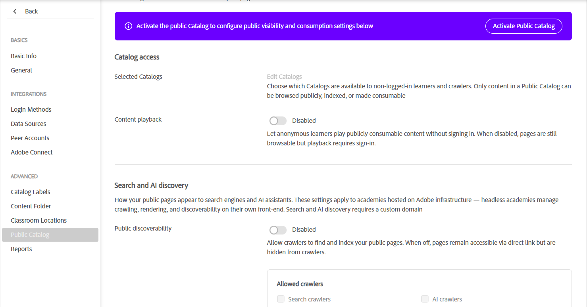
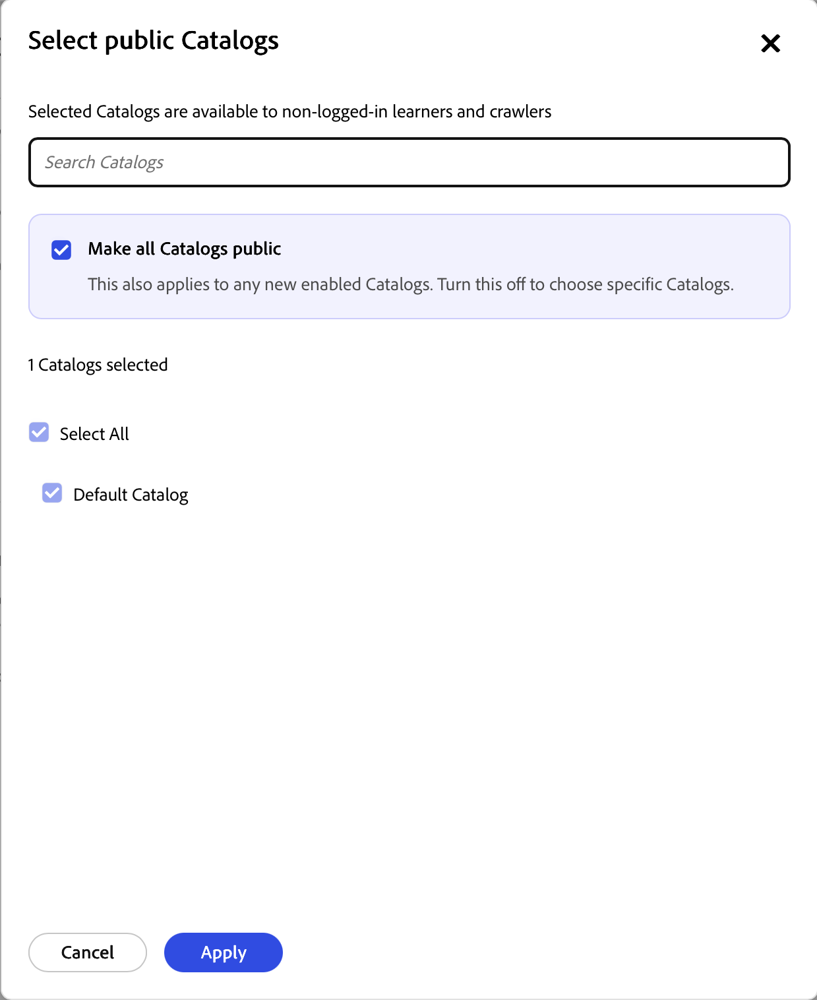
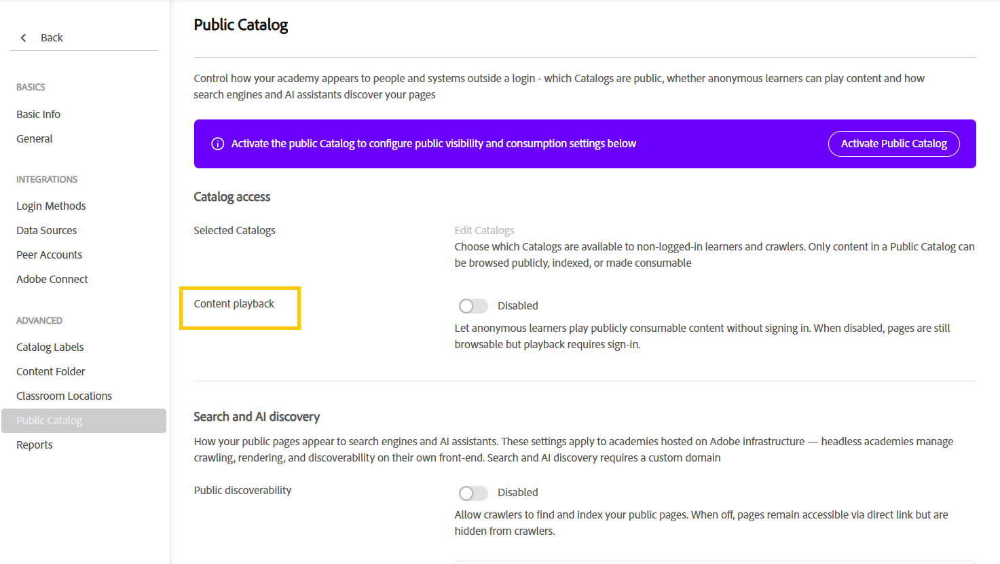

# Non-logged in enhancements

## Overview

Adobe Learning Manager has always let anonymous visitors browse catalogs and course overviews. Playing any content, however, required a login. For customer-education academies, that gate sits at the exact moment a prospect has found a relevant course and wants to evaluate it, so every gated play is a lost lead.

These non-logged-in enhancements are additional enhancements that remove that gate in a controlled way. Administrators choose which catalogs are public. Authors choose which courses and modules anyone can play without an account. Learning Manager publishes crawlable, AI-readable pages so that people can find the academy through search engines and AI assistants such as Claude and ChatGPT. Anonymous usage is metered per visitor and reported separately from logged-in usage.

Public content refers to content that the account has chosen to expose to visitors.

>[!NOTE]
>
>Public content consumption is off by default for every account. Content that isn't marked as publicly consumable stays behind login.

## Why this matters

Two shifts make the login gate more costly than it used to be:

* **Discovery has moved upstream of the LMS.** Learners increasingly find training through search engines and AI assistants. Gated content isn't crawled, indexed, or cited in AI answers, so academies are absent from the channels where learners now start looking.
* **Competitors have closed the gap.** Most competitors publish publicly accessible, search-indexed course pages with automatic canonical tags and submitted sitemaps. Some competitors offer SEO controls such as meta descriptions, custom URL slugs, and redirects for courses and learning plans in public catalogs.

Without a native capability, customers rely on third-party tools or ask anonymous visitors to log in with a dummy email address, which is a workaround at best. Closing the gate natively supports three goals for customer education:

* **Discovery and acquisition.** Public, crawlable course and content pages turn the academy into an organic acquisition channel.
* **Conversion funnel.** Letting learners sample real content before registering creates a natural path from anonymous visitor to registered learner.
* **Monetization.** Metering anonymous usage per monthly active user (MAU) makes this a packaged, sellable capability rather than a giveaway.

## Goals

* Allow content in already-visible courses to be consumed without login.
* Create a conversion funnel from anonymous to registered learner.
* Optimize pages for discovery by search engines and AI assistants.
* Scale to support high-volume anonymous traffic.
* Let administrators expose only specific catalogs publicly.
* Create a business model around non-logged-in consumption.
* Provide account-level analytics on ungated consumption.

## Use cases

The following are the use cases where the enhancements help:

| Scenario                                   | Need                                                                                                               | How this feature helps                                                                                                           |
|------------------------------------------------|------------------------------------------------------------------------------------------------------------------------|--------------------------------------------------------------------------------------------------------------------------------------|
| Product launch promotions                      | Share ungated promotional content during product launches.                                                             | Authors mark promotional modules as publicly consumable. Visitors play them without registering.                                     |
| Ungated video on a customer academy            | Provide ungated video access                                                                                           | Video modules can be played without login, so the customer can consolidate into Learning Manager.                                    |
| Open community academy with a gated credential | Keep most content open, and require login only to earn a badge or skill. Plans to use AEM Sites with Learning Manager. | Make most modules public and leave the final quiz module gated. Headless and AEM Sites integrations can use the same public content. |
| Organic discovery                              | Be found through search engines and AI assistants.                                                                     | Public catalog pages are pre-rendered for crawlers and include structured metadata.                                                  |

### Typical learner journey

1. A learner searches the web or asks an AI assistant and lands on a course overview page in the academy.
2. The learner plays a module that the author marked as publicly consumable. No account is needed.
3. The learner reaches a gated module, selects Enroll, or tries to earn a credit. Learning Manager prompts them to sign in or sign up.
4. After signing in, the learner returns to the same course and enrolls as a registered learner.

## Who does what

| Role                    | What they do                                                                                                                                                                        |
|-----------------------------|-----------------------------------------------------------------------------------------------------------------------------------------------------------------------------------------|
| Administrator               | Activates the public catalog, chooses which catalogs are public, turns on public content consumption, sets Search and AI discoverability options, and downloads public catalog reports. |
| Author                      | Marks courses and modules as publicly consumable and, if the administrator allows it, customizes search and AI metadata for a course.                                                   |
| Anonymous learner           | Browses the public catalog, plays public modules, and signs in or registers when ready.                                                                                                 |
| Search engine or AI crawler | Reads pre-rendered pages, robots.txt, and the sitemap to index public courses.                                                                                                          |
| Customer web team           | Builds headless or AEM Sites pages that use the public API, SEO metadata, and Experience Builder widgets.                                                                               |

## What's included

| Area                      | What you get                                                                        |
|-------------------------------|-----------------------------------------------------------------------------------------|
| Public catalog                | A selectable list of catalogs exposed through the Training Data Access (TDA) connector. |
| Public content consumption    | Account, course, and module-level controls for ungated playback.                        |
| Anonymous learner experience  | Direct playback from the course overview, with prompts to sign in or register.          |
| Search and AI discoverability | Pre-rendered pages, robots.txt, sitemap, metadata, structured data, and readable URLs.  |
| Reports                       | A Public Catalog Reports section with consumption and monthly active user reports.      |
| Business model                | Server-side visitor metering, with an additive pool of non-logged-in MAU.               |
| Integrations                  | Support for headless, AEM Sites, and custom domains.                                    |

## Key features

*What administrators, authors, learners, and crawlers get with non-logged-in improvements.*

### Public catalog and catalog selection

Previously, the default catalog with all learning objects was exposed to the non-logged-in home page through the TDA connector. That could expose test courses or content the administrator never meant to publish, and it gave no way to expose only a subset. Administrators can now provide a list of catalogs, and the public catalog consists of only those catalogs.

* The TDA connector is now managed from a new **Public Catalog** page in Admin settings. It moved from Integration Admin, together with its existing settings, such as the allowed domains and the URLs used to host training on a headless website.
* The TDA allow-list is the master gate. Anything outside it is excluded from non-logged-in browsing, search engine indexing, robots.txt, and the sitemap.
* Marking a course or module as publicly consumable has no effect unless the course belongs to a catalog on the public list.
* Administrators can choose **Selected catalogs** or **All catalogs** (all enabled catalogs).

### Public content consumption

#### Account-level setting

A global setting turns public content consumption on or off for the account. The default is off.

* Turning the setting off disables consumption only. Browsing and learning object metadata continue to be available, but content indexing is blocked.
* Learners who are playing content when the setting is turned off can finish the current module.

#### Course and module level

Authors control exactly what is public. On the course edit page, an author can mark individual modules as publicly consumable, or mark the whole course. If a course contains modules that can't be made public, it will be displayed as "Not Applicable" in Author app.

* For learning paths and certifications, public consumption follows each constituent course's setting. A change to the list of consumable courses reflects in the learning path or certification the same way other module-level changes do.
* An author can revert a module to gated at any time. Crawlers de-index it automatically.
* The administrator's account setting always takes precedence over module settings.

#### Supported content

| Content                                                            | Public consumption                                                          |
|------------------------------------------------------------------------|---------------------------------------------------------------------------------|
| Static content such as PDF and documents, video, and Captivate modules | Supported. Authors see a checkbox for each of these modules.                    |
| Other module types, including activities                               | Not applicable. The author interface shows them as not applicable.              |
| Classroom, virtual classroom, and other instructor-led sessions        | Only self-paced content is supported.                                           |
| Prework and test-out modules                                           | Only core content can be public.                                                |
| Third-party licensed content                                           | Excluded, because the licensing model is incompatible with ungated consumption. |
| Acquired catalog content                                               | Excluded.                                                                       |

>[!NOTE]
>
>Public modules play in full. A public module is not a preview. If you want a trailer-style experience, create a dedicated short module and mark only that module as public.

### Anonymous learner experience

* Visitors browse the catalog and open course overviews as they do today. In non-logged-in mode, the overview shows limited metadata only, with no progress indicators or personalized data. Search and filtering work as they do today for catalog browsing.
* On the course overview, playable modules appear in a distinct color (blue). Modules that aren't public show a lock icon and black text. The lock icon is also used for ordered modules in the logged-in experience, but ordering isn't honored for anonymous visitors, so the two never appear together.
* Selecting a public module launches the player immediately. The player runs in minimal mode, without notes or bookmarks, and offers a choice to register, log in, or continue without logging in.
* Selecting a gated module, or selecting Enroll or Sign up, takes the visitor to the sign-in or sign-up page. After signing in, the visitor returns to the same course through the existing redirect URL.
* A visitor who tries to open a module that isn't supported for public playback sees an error.
* The course table of contents lists all modules, as it does today.
* Prompts to register appear at natural moments: module completion, an attempt to open a gated module, and certificate or credit eligibility.

Public playback starts quickly. Content is served from a protected location through a dynamically generated URL, and the anonymous player skips many of the API calls that the logged-in player makes.

Non-logged-in consumption is available to learners on native Learning Manager in a browser, headless implementations, and AEM Sites. The mobile app and Microsoft Teams aren't supported.

### Search and AI discoverability

Discoverability helps search engines and AI assistants find, understand, and cite public courses. It works only for accounts that use a custom domain, not on the default cpcontents.adobe.com domain. The settings are visible to every account, because headless customers can set SEO fields at course level and use them in their own pages.

#### Account-level settings

* Allow or block search crawlers and AI crawlers separately. These settings drive the robots.txt file.
* Opt in to indexing of non-logged-in content, which determines whether crawlers can index the pre-rendered content. This is an account-level toggle only, with no course-level toggle.
* Set a default title and meta description for pages other than course overview and content pages. These act as a fallback.
* Choose whether authors can customize SEO metadata for a course. Metadata is always auto-generated first, and authors can override it when this option is on.

#### Pre-rendered pages for crawlers

Learning Manager pages are rendered in the browser, so a crawler that doesn't run JavaScript would otherwise see an empty page. To solve this, an edge worker identifies whether a request comes from a bot or a human. Bots are routed to a stored, server-rendered HTML page. People continue to receive the normal application.

* The pre-rendered page contains readable content: course information, title, description, and the list of modules. It does not yet include module-level content such as transcripts.
* The design targets crawlers that run JavaScript and those that don't, including GPTBot, Claude, Googlebot, and Applebot.

#### robots.txt and sitemap

* Each non-logged-in academy domain gets its own robots.txt. It allows or disallows each crawler according to the account settings and points to the sitemap.
* Each academy gets a sitemap that lists only courses on the public catalog list. Sitemap entries use the URL with the course slug so that crawlers index readable URLs. The sitemap is submitted to Google.

#### Metadata and structured data

Every course overview page gets the following automatically:

* Exactly one canonical URL.
* A meta title and meta description.
* Open Graph tags for title, description, URL (the canonical URL), image, and type (fixed to Website).
* A Course JSON-LD block in the page head, with the course name, description, provider (organization name and URL), a course instance with online mode, and the number of credits when a certification is associated.

Metadata is never exposed for content that a visitor can't consume. For example, a video transcript isn't added to the JSON-LD if the video can't be played without login.

#### Readable URLs

* Courses, learning paths, and certifications have slug URLs generated from the title, for example a course ID followed by a readable name.
* The slug is decorative. The page resolves from the ID, so an old or changed slug still loads the same page.
* Each public module has its own shareable URL. Opening it launches the player directly, and the same slug support applies.
* Authors can edit the slug of a course overview page when customization is allowed.

#### Author customization

When the administrator allows it, authors see a **Search & AI Metadata** page for a course, learning path, or certification. The page appears only after the course is published.

* Override the meta title and meta description.
* Edit or supplement JSON-LD fields such as description, provider name, and keywords.
* Edit the URL slug.
* Set a redirect target for a retired learning object.
* No field is mandatory. Any field the author hasn't customized keeps its auto-generated value, and crawlers see only one value for each field. Custom values persist when the course name changes.

>[!NOTE]
>
>The Social URL field has been removed from the interface, although the value is still populated on the actual content. Download metadata has also been removed from the administrator page.

#### Public API for headless and AEM Sites

When the TDA connector is enabled, the public API exposes SEO metadata, so third parties can build their own pages with it. The same rule applies as for crawlers: nothing is exposed that an anonymous visitor can't consume.

### Reports

Administrators download reports from a **Public Catalog Reports** section of Reports, kept separate from logged-in reports. Visitors are identified by a random visitor ID that is tied to a browser. It can't be decoded or linked to a registered user.

| Report                  | What it shows                                                                                                                                                                                                                             |
|-----------------------------|-----------------------------------------------------------------------------------------------------------------------------------------------------------------------------------------------------------------------------------------------|
| Consumption report          | Requires a date range. Lists each non-logged-in visit with visitor ID, date and time accessed, content type, module and resource ID, course, and the learning path or certification if linked. Use it to review data against MAU consumption. |
| Monthly active users report | The number of unique non-logged-in users per month, automatically limited to the last 12 months. |

* For long-term analysis, data is kept in aggregate. Session-level data is kept for a short period of 30 to 90 days.
* Any new administrator settings are captured in the Administrator Audit Trail Report.

### Business model and metering

Anonymous usage is metered as non-logged-in MAU. The model is designed so that metering doesn't store tracking data on the learner's device.

* **An additive pool.** A customer gets non-logged-in MAU equal to 10% of their contracted pool, at no extra cost. For example, 100K contracted MAU gives an extra 10K non-logged-in MAU, for a total of 110K. The pool applies only when the customer turns on the TDA connector and enables content consumption.
* **Counted on play.** MAU is consumed when a visitor plays content, not on page view. Counting happens on the server and doesn't depend on a client-side cookie.
* **Fingerprint deduplication.** The server derives a visitor fingerprint from browser and device signals. The same fingerprint within 30 days counts as one MAU. A different browser, device, or network is a new MAU, so one person on three devices can use up to three MAU. This is called out transparently in the contract.
* **Bots don't count.** Crawlers and malicious bots don't consume MAU.
* **Pricing.** Non-logged-in MAU may be priced differently from logged-in MAU, and a contract may use a blended price.
* **When the pool is exhausted,** access isn't blocked. The existing MAU process applies, and customer success managers follow up at renewal.

| Customer type            | Behavior                                                                                                                                                             |
|------------------------------|--------------------------------------------------------------------------------------------------------------------------------------------------------------------------|
| Premium stack                | The non-logged-in limit can equal the logged-in limit, and the MAU logic stays the same. Product management will review this again.                                      |
| Registration Unit (RU) model | Content consumption isn't supported now. SEO and AI discoverability improvements, other than content indexing, are supported. Equivalent pricing is still to be defined. |

A backend flag lets the platform disable fingerprinting if a customer has concerns, for example if they feel a cookie banner would be needed. With the flag on, all incoming traffic shares one fingerprint and downstream workflows run unchanged. This is a last resort for market feedback.

### Headless, AEM Sites, and custom domains

* **Custom domains.** Public catalog pages and content can be served from the customer's own domain, so the customer's brand is what learners and crawlers see. All SEO and AI features work on custom domains.
* **Headless and AEM Sites.** SEO metadata, tags, and files are available to headless and AEM Sites implementations. In non-logged-in integration mode, a learner can play a module if the module is public and its course is exposed through the TDA connector. Otherwise the learner is asked to log in. The same security and licensing rules apply as in native Learning Manager.
* **Experience Builder widgets.** The widgets visible in non-logged-in mode in native Learning Manager are supported across all integration modes. They are delivered as React-based widgets (Categories, Courses, and Paths), not iFrame-based ones.
* **AEM reference site.** The AEM reference site package added back non-logged-in integration mode and e-commerce integration previously. Currently, this is extended with content consumption and the widgets above.

## Set up and use

*Configure the public catalog, choose what is public, and manage metadata.*

### Before you begin

* You are an administrator in Adobe Learning Manager.
* Your catalogs and courses are ready. New catalogs are disabled for public use until you enable them.
* For search and AI discoverability, your account uses a custom domain.

### Activate the public catalog

1. In the **Admin** app, open **Settings** and select **Public Catalog**.
2. Select **Activate public catalog**.

    

3. Confirm the action. Activation can't be reversed, so you are asked to confirm twice.

Learning Manager creates the TDA connector. The allowed domains and the URLs for hosting training on a headless website appear on this page.

### Choose which catalogs are public

1. On the **Public Catalog** page, select the catalogs to expose. Select **Selected catalogs** to pick them, or **All catalogs** to expose all enabled catalogs. In the catalog dialog, **Select All** selects every catalog, including those not yet loaded on screen. The newly created catalogs will be made public when an admin selects **All Catalogs** for non-logged-in consumption.

    

2. Select **Apply**.
3. Select **Save** for the change to take effect.

Enabling or disabling a catalog starts a background task that adds or removes its courses from the public index. The toggle stays locked until the task finishes, and the affected courses aren't searchable or displayed in the meantime.

### Turn on public content consumption

1. On the **Public Catalog** page, turn on Content playback consumption toggle to make modules publicly consumable. It is off by default.

    

2. Save your changes.

Authors can then choose which courses and modules are public.

### Set Search and AI discoverability options

1. In the **Search & AI Discoverability** section, allow or block search crawlers and AI crawlers.
2. Choose whether non-logged-in content can be indexed.
3. Enter a default title and meta description for pages other than course overview and content pages.
4. Choose whether authors can edit metadata. Metadata is always auto-generated, and authors can override it when this option is on.
5. Save your changes.

### Mark courses and modules as public

1. Open the course in the Author app and go to the course edit page.
2. Turn on public consumption for the course.
3. Select the checkbox next to each module that should be public, or mark the whole course. Modules that can't be public are shown as not applicable.
4. Save and publish the course.

The course must belong to a catalog on the public list. Otherwise, the setting has no effect.

### Customize search and AI metadata

This page is available to authors only when the administrator has turned on author editing of metadata, and only after the course is published.

1. Open the published course, learning path, or certification and select **Search & AI Metadata**.
2. Edit the meta title and meta description. Leave any field blank to keep its auto-generated value.
3. Save your changes.

### Download public catalog reports

1. In the Admin app, open Reports and select **Public Catalog Reports**.
2. For the consumption report, choose a date range.
3. Download the report. The monthly active users report covers the last 12 months automatically.

## How it works

*Technical behavior behind public consumption, crawling, and metering.*

### Metadata sync

* Learning object metadata reaches the non-logged-in experience through the TDA connector. The target for publishing or removing content is real-time or near-real-time, with a service level of under 15 minutes. The existing shared stack takes 3 to 12 hours, and the premium stack about 3 hours.
* Any cost implication of the faster sync must be reported to product management by engineering.
* Each catalog toggle starts an asynchronous task that handles the index update. The task also resets the catalog's public consumption flag when a catalog is disabled.

### Playback and access control

* Playback requires a valid session UUID. The readable URL is public for SEO, but playback is gated by the UUID.
* Public content can't be reached outside the course overview context, and learners can't open a non-public module by guessing a URL.
* Content that is only for logged-in learners must not be reachable from the non-logged-in path, including through SEO metadata.
* No progress is captured for anonymous learners, and nothing is written to the learning record store (LRS). No session cookie is set for progress tracking.

### Bots and crawlers

* Malicious and unknown bots are blocked, and legitimate crawlers are allowed.
* A CAPTCHA is triggered after a threshold of requests per time period at the content consumption level.
* Existing bot handling for catalog browsing is evaluated and extended to content consumption.
* Pre-rendered and structured-data endpoints are rate limited, because legitimate crawlers are low-volume and identifiable. No further IP protection is applied to content that is exposed ungated.

### Visitor fingerprinting

* The visitor ID is a random, unique string generated from browser signals. The same browser on the same machine always produces the same ID, for example one for Chrome and another for Safari. A different machine produces a different ID.
* The ID can't be decoded or linked to a registered user.
* No persistent client-side cookie is used for metering, which keeps the compliance posture clean.

### Behavior when settings change

| Situation                                         | What happens                                                                                                                                                     |
|-------------------------------------------------------|----------------------------------------------------------------------------------------------------------------------------------------------------------------------|
| An administrator turns off public content consumption | Browsing and learning object metadata stay available. Content indexing is blocked. New launches stop immediately, and active sessions can finish the current module. |
| An author reverts a module to gated                   | Crawlers receive a 410 response and de-index the page. Visitors see sign-in and sign-up prompts.                                                                     |
| Course consumption is turned off                      | Module-level public settings are removed from the course and reverted. The administrator setting is always honored.                                                  |
| A course isn't on the public catalog list             | Marking its modules public has no effect, and the course is not consumable publicly.                                                                                 |
| A catalog is disabled                                 | Its public consumption flag is also disabled. The change completes in a background task.                                                                             |
| A course is renamed                                   | The slug updates, and the old URL still resolves. Custom SEO values persist.                                                                                         |
| A learning object is retired                          | If a redirect target is set, its public URL returns a 301 redirect to the target. If not, the URL returns 410 and is de-indexed.                                     |
| A visitor signs in or registers                       | Only the logged-in MAU is counted. No progress transfers, and the visitor must enroll again, as in the existing behavior.                                            |
| A signed-in user has no access to a catalog           | Same as today when a user opens a course link without access.|

### Performance

Public-facing pages should pass Google's Core Web Vitals assessment on desktop.

| Metric                         | Target                                                 | Current (p75)                       |
|------------------------------------|------------------------------------------------------------|-----------------------------------------|
| Largest contentful paint, mobile   | 2.5 seconds or less                                        | 6.7 seconds                             |
| Largest contentful paint, desktop  | 2.5 seconds or less                                        | 3.8 seconds                             |
| Cumulative layout shift            | Below 0.1, with no visible shifts after the initial render | Failing                                 |
| Interaction to next paint, desktop | 200 ms or less                                             | 233 ms                                  |
| First contentful paint             | 1.8 seconds or less                                        | 2.2 seconds desktop, 2.7 seconds mobile |

* Deliver images in the most efficient format and size for the device and browser.
* Avoid JavaScript and CSS that block the first visible render.

### Scale

* The system is sized for 5% of Learning Manager's total monthly traffic. This assumes 30% of customers use the feature, 10% of their traffic is non-logged-in, plus a buffer.
* It also scales to 10% of the maximum supported concurrency of the logged-in stack. Anonymous traffic can spike during marketing campaigns.
* Existing non-logged-in rate limits continue to apply. Limit values are to be published in the documentation.

### Upgrade and compatibility

* **Existing TDA accounts.** Everything continues to be exported unless the administrator limits it. The catalogs that are currently exposed remain exposed on the day of launch.
* **New catalogs.** Catalogs created after the release are disabled for public use until an administrator enables them.
* **Narrowing the list.** If an administrator filters catalogs, learning objects outside the filter are removed from the exported data. Removal is near real-time.
* **Public consumption setting.** The default is off for all existing accounts.
* **TDA connector location.** The connector moved from Integration Admin to the Public Catalog page.

### Limitations

* Full feature parity with the logged-in experience. Anonymous learners don't get notes, bookmarks, social features, or gamification.
* Progress persistence across sessions, and transfer of progress to a registered account.
* Classroom and virtual classroom sessions, activities, and other non-self-paced content.
* Third-party licensed content and acquired catalog content.
* Limits or handling based on marketing qualified accounts (MQA).
* Mobile app and Microsoft Teams.
* Content consumption for customers on the RU model.

### Best practices

* Review your catalogs before activating the public catalog, so test courses aren't exposed.
* Decide which modules are public deliberately. Many academies keep most content open and gate only a credential or quiz module, which turns completion into a reason to register.
* Use dedicated short modules if you want a trailer-style preview, because public modules play in full.
* Keep auto-generated metadata unless you have a specific reason to override it, and customize titles and descriptions where you want to target search intent.
* Allow AI crawlers only if you want your courses to appear in AI-generated answers.
