# Visualizations in Report Builder

Visualizations in Adobe Learning Manager Report Builder turn a saved report into charts and dashboards. You can compare groups, spot trends, and share results without reshaping data in a spreadsheet tool.

## About visualizations in Report Builder

A visualization is a chart, or a dashboard of charts, built from a report you saved in Report Builder. You choose which report columns to plot, and Report Builder draws the chart from the report data. You can plot columns directly, or plot summarized data from a report.

* **Build charts for a report.** Open the report, select **Visualization**, and create charts.
* **Group charts on a dashboard.** Choose reports as a data source, then add charts from them.
* **Share and view.** Share a dashboard with Administrators, who view and filter it read-only.

Charts work in two modes. In configure mode, you create or edit the chart. In view mode, you filter what the chart displays without changing how it is built.

## Chart types and when to use them

Choose the chart type by the question you want to answer.

|Chart type|Use it to|Example|
|---|---|---|
|**Line**|Show how a value changes over time. You can add a secondary Y axis.|Enrollments by creation month|
|**Bar or column**|Compare values across categories. Grouped, stacked, and 100% stacked layouts are available.|Learners by enrollment status|
|**Pie**|Show each category's share of a whole. Segments under 1% are grouped into an **Others** segment.|Enrollments by catalog|
|**Big number**|Highlight one key metric.|Total completions this quarter|
|**Table**|Show exact values. You can choose a subset of columns, and show one date column as rows instead of columns (column-to-row view).|Learning time spent per user, per month|

Line charts built from trend reports, such as enrollments by month, show the current snapshot of your data grouped by date. They don't show how the data looked at each past date. View Report Builder concepts and terminology for more information.

## Visualization terms

|Term|Meaning|
|---|---|
|Report|A saved Report Builder configuration of columns, filters, and grouping. Charts are built from reports.|
|Chart-level filter|A filter you set when you create or edit a chart. It limits the data the chart plots.|
|Page-level filter|A filter a viewer applies to all charts on a page or dashboard. It can narrow, but not widen, the report's own filters.|
|Report Builder dashboard|A page of charts that you build in Report Builder.|

<!-- TO VERIFY (carried over from source): clarify how Report Builder dashboards relate to the dashboards on the existing Reports page. -->

To build your first chart, view [Create a chart from a report](#create-chart-from-report). To check size restrictions, view Chart and dashboard limits.

## Create a chart from a report {#create-chart-from-report}

Create a chart from a saved report in Adobe Learning Manager Report Builder to see enrollment, completion, or time-spent data at a glance. You configure the chart once, and it draws from your report data each time you open it.

### Before you create a chart

Confirm the following:

* **Save the report**. The option to add a chart appears on the Report Builder page after you save the report.
* **Use your own report**. Duplicate a shared report to create your own copy, then use it to create charts.
* **Check the size**. A report with more than 10 million rows can't be plotted. A summarized report with more than 10,000 data points isn't plotted. View Chart and dashboard limits.
* **Know your columns**. The chart's X axis (dimension) and Y axis (measure) come from your report's columns. To summarize the report itself, use Group by and aggregates. View Apply group by and aggregations for more information.

### Configure a chart

1. Log in to Adobe Learning Manager as an Administrator.
2. Select **Reports**, then select **Report Builder**.
3. Select the **Reports** tab, then open a saved report. For this example, select a user login trend report, which shows the number of users who logged in to the learning platform on each date.
4. In the left navigation, select **Visualization**. A panel opens with Setup and Style tabs.

   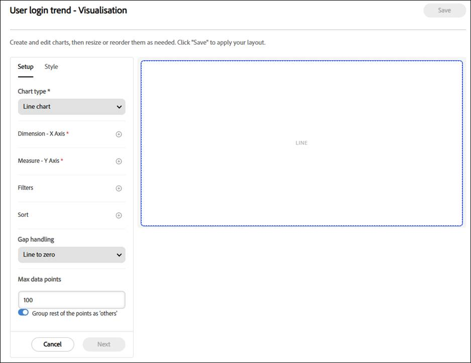

5. In **Chart type**, select a type, such as **Line chart**. This field is required.
6. Next to **Dimension - X Axis**, select the add icon, then select the report column. For a date column, also select a **Date granularity**, such as day or month.

   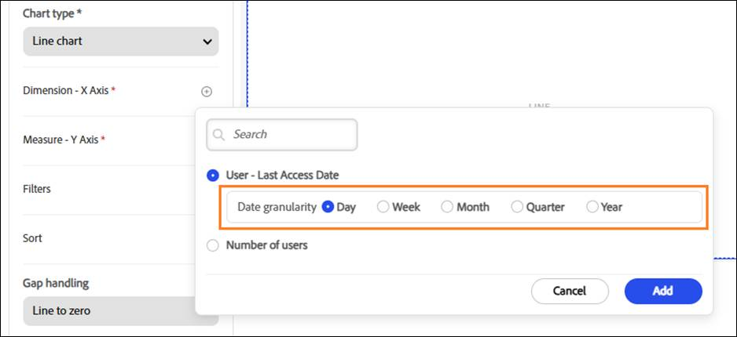

7. Select **Add** to add the date dimension.
8. Next to **Measure - Y Axis**, select the add icon, then select the report column and how to aggregate it, such as **Count**.

   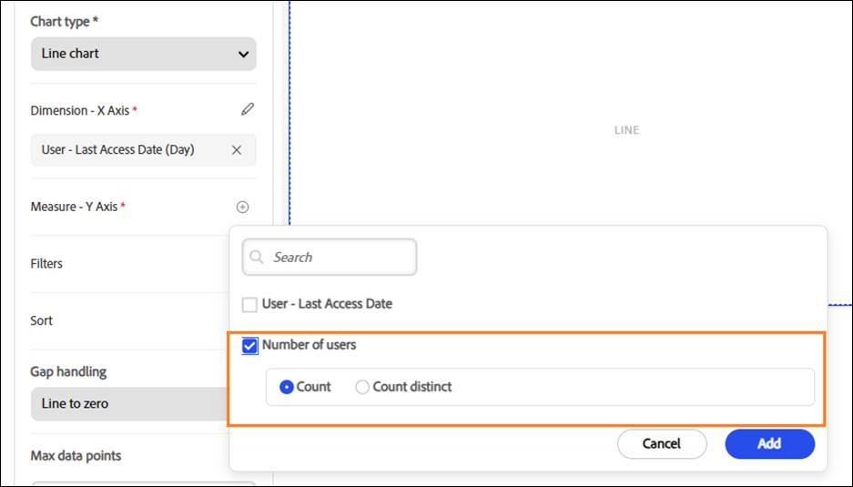

9. Select **Add** to add the measure.
10. Optionally, select **Add filter** to limit the plotted data to a range, such as the last 30 days. Select **Add**.

   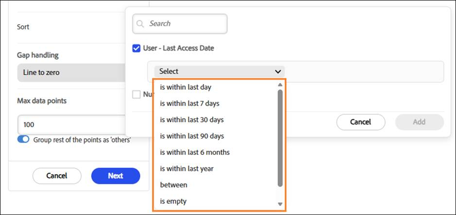

11. Optionally, add a **Sort** column, then select **Ascending** or **Descending**. Select **Add**.

   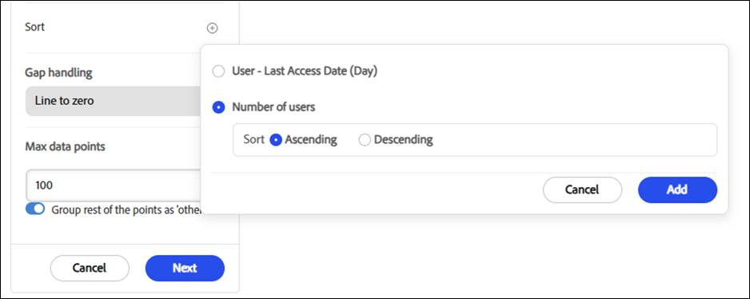

12. For a line chart, optionally set **Gap handling for missing data**. Gap handling defines what the chart should do when one or more observations in a series have no numeric value, such as NULL, NA, NaN, or an empty cell. Suppose the data is:

   |X|Value|
   |---|---|
   |Jan|10|
   |Feb|15|
   |Mar|NA|
   |Apr|NA|
   |May|25|

   There are three common behaviors.

   |Gap handling|Conceptual result|Report Builder|
   |---|---|---|
   |**Line to zero**|`10 -> 15 -> 0 -> 0 -> 25`|Treats missing values as 0.|
   |**Skip**|`10 -> 15 25`|Doesn't plot the missing points but breaks the line.|
   |**Connect**|`10 -> 15 ─────> 25`|Doesn't plot the missing points but connects the valid observations on either side.|

   The important distinction is that Connect is not interpolation. If March and April are missing, connecting February directly to May only draws a visual line between the two known values. It does not create actual March and April values.

13. In the **Max data points** field, enter the number of data points to be plotted on the graph. The default is 100 points, with a limit of 10,000.
14. Select the toggle **Group rest of the points as 'others'**. If **Max data points** is set to 150, Report Builder displays up to 150 individual data points, and aggregates everything beyond that limit into one additional data point/category called **Others**. For example, if your query returns 200 points:

   * 150 points are displayed individually.
   * The remaining 50 points are combined into **Others**.
   * The chart therefore effectively shows 151 plotted points: 150 + **Others**.

15. Select **Next**. You can now customize your chart.

   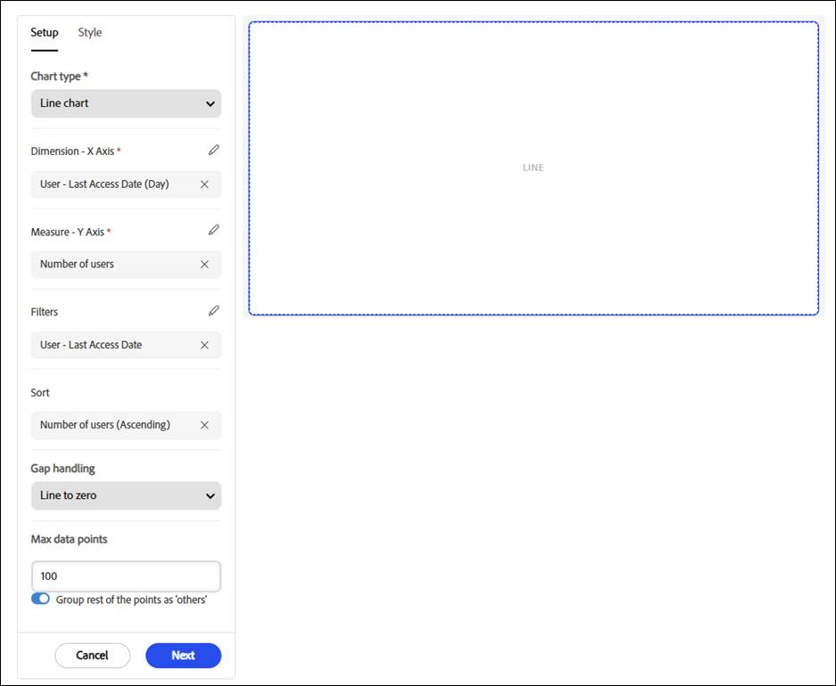

### Customize the chart

Customize a chart in Report Builder to make it clear and easy to read. On the **Style** tab, you can add a title, show or hide axis titles and legends, position and align the legend, and set a color for each series. Style changes affect only how the chart looks. They don't change the data it plots.

1. To show a title above the chart, select **Show title for chart**. To hide it, turn the option off.
2. In **Chart title**, enter a title for the chart.
3. Select **Show title for X Axis** and **Show title for Y Axis** to label the axes.
4. To show a key that identifies each line, select **Show legends**.
5. In **Legend alignment**, select the left, center, or right icon to align the legend.
6. Under **Line color**, select the color swatch next to a series, such as **Number of users**.
7. In the color picker, choose a color from the palette, or use the custom tab to define your own.
8. Repeat steps 6 and 7 for each line you want to recolor.
9. Select **Create** to add the chart. If you're editing an existing chart, save your changes.

   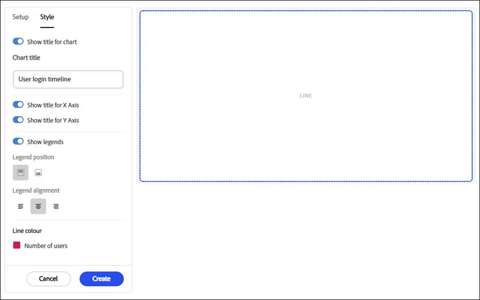

   The chart appears with your titles, legend, and line colors.

>[!TIP]
>
>* Choose colors that contrast clearly with each other and with the background. Keep titles and the legend on so that color isn't the only way to tell the lines apart.
>* The **Legend position**, **Legend alignment**, and **Line color** options apply only when **Show legends** is enabled.
>* Each line in the chart has its own swatch, one per measure you added on the **Setup** tab.

To arrange charts on a single page, view **Create a dashboard from report charts**.

## About pie charts

Use a pie chart in Adobe Learning Manager Report Builder to show how a whole divides into parts, such as the share of employees who completed mandatory training, or the mix of course formats. Each slice shows one category's share of the total.

A pie chart draws one slice per category. The slice size shows that category's share of the total measure. A legend identifies each slice, and slices can show both the value and the percentage.

Use a pie chart to show parts of a whole across a few categories, when viewers need proportion more than exact values. To compare many categories, use a bar chart. To show change over time, use a line chart.

### Create a pie chart {#create-pie-chart-steps}

Before you begin, save a report that you own. Include one column for the categories and one column to measure.

1. Select **Reports**, then **Report Builder**. On the **Reports** tab, open the saved report.
1. In the left navigation, select **Visualization**.
1. In **Chart type**, select **Pie chart**.
1. Next to **Dimension - Segment**, select the add icon, then select the column that defines the slices. For example, **Transcript (Learning Object) - Status**.
1. Next to **Measure - Value**, select the add icon, then select the column and aggregate that size the slices, such as **Count**.
1. Optionally, in **Max data points**, enter the most slices to draw. The default is 100.
1. To combine minor categories, turn on **Group small slices**.
1. Select **Next** to customize the pie chart.

### Customize the pie chart

1. To show a title, turn on **Show title for chart**. Turn it off to hide the title.
1. In **Chart title**, enter a title, such as "Mandatory Compliance Completion".
1. In **Chart style**, select **Pie** for a solid circle, or **Donut** for a ring.
1. Select **Show legends** to display the legend on the chart.
1. In **Legend position**, select where the legend appears.
1. In **Legend alignment**, select left, center, or right.
1. Select **Create** for a new chart. When you edit an existing chart, select **Save**. Then select **Save** on the **Visualization** page.

   The pie chart or the donut chart gets created.

   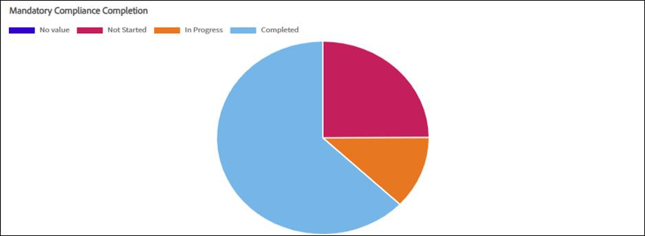

## Create a bar chart

Use a bar chart in Adobe Learning Manager Report Builder to compare a measure across categories, such as training status by team or learning time by customer. Bars are easy to compare and rank, and you can group or stack them to add a second breakdown.

### About bar charts

A bar chart draws one bar for each category on the X axis. The bar's length shows the measure on the Y axis, such as a count of learners. You can draw bars vertically (columns) or horizontally.

Use a bar chart to:

* Compare values across categories, such as teams, partners, or customers.
* Rank categories from highest to lowest.
* Show a second breakdown inside each bar, such as status within each partner.

### Before you create a bar chart

* Save the report, and use a report you own.
* Include a column for the categories, and a column to measure.
* Keep the report within the limits in Chart and dashboard limits.

### Create a bar chart {#create-bar-chart-steps}

1. Select **Reports**, then **Report Builder**. On the **Reports** tab, open the saved report.
1. In the left navigation, select **Visualization**.
1. In **Chart type**, select **Bar chart**.
1. Next to **Dimension - X Axis**, select the add icon, then select the column that defines the categories. Select **Add**.

   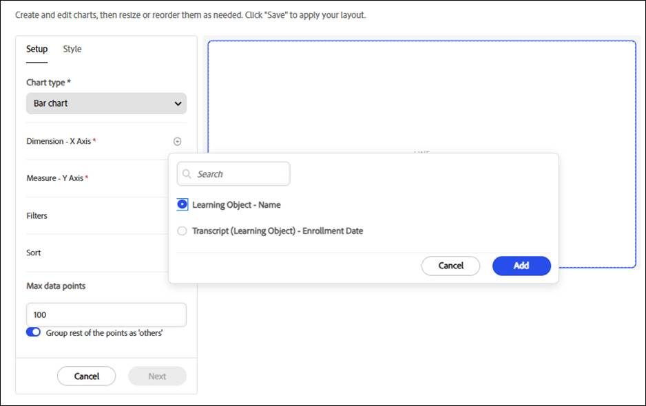

1. Next to **Measure - Y Axis**, select the add icon, then select the column and how to aggregate it, such as **Count**. Select **Done**.

   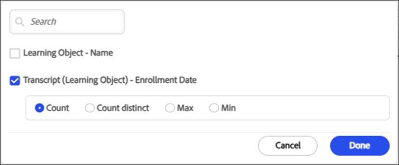

1. Optionally, add **Filters** to limit the data, and set **Sort** to order the bars by a column.
1. Select the toggle **Group rest of the points as 'others'**. If **Max data points** is set to 150, Report Builder displays up to 150 individual data points, and aggregates everything beyond that limit into one additional data point/category called **Others**.
1. Select **Next** to customize the bar chart.

### Customize the bar chart

Use the **Style** tab to set the title, orientation, grouping, legend, and colors. Style settings change how the chart looks, not the data it plots.

1. Select the **Style** tab.
1. To show a title, turn on **Show title for chart**. In **Chart title**, enter a title, such as "Most Popular Courses".
1. To label the axes, turn on **Show title for X Axis** and **Show title for Y Axis**. Turn an option off to hide that title.
1. In **Chart style**, select **Vertical** for columns, or **Horizontal** for bars that run sideways. Horizontal bars leave more room for lengthy category names.
1. In **Bar grouping**, select one of the three icons to set how multiple series share a category: grouped, stacked, or 100% stacked.
1. To identify each series, turn on **Show legends**.
1. In **Legend position**, select where the legend appears. In **Legend alignment**, select left, center, or right.
1. Under **Bar color**, select the swatch next to a series, then choose a color.
1. Select **Create** for a new chart. When you edit an existing chart, select **Save**.

Bar grouping matters only when a bar has more than one series, such as two measures. Keep the legend on and show data labels, so color isn't the only way to tell series apart.

## Create big number representation

Use a big number in Adobe Learning Manager Report Builder to show one key metric as a large, easy-to-read figure, such as total learners, overdue enrollments, or active users. Big numbers work well at the top of a dashboard, where viewers check key figures first.

### About big numbers

A big number is a tile with two parts: a value and a label. The value is a single number calculated from your report, such as a count or a sum. The label tells viewers what the number means. A big number has no axes, legend, or categories.

Use a big number to:

* Show a headline figure that someone checks regularly.
* Give context to a dashboard before the detailed charts below it.

### Create a big number

Before you begin, save a report you own. Decide the one number you want, and which column and aggregate produce it.

For example, training administrators report each month on how much training the organization completed. Leaders want one headline figure, not a list of enrollments, and administrators want to refresh it without rebuilding the report.

1. Select **Reports**, then **Report Builder**. On the **Reports** tab, open the saved report.
1. In the left navigation, select **Visualization**.
1. In **Chart type**, select **Big Number**.
1. In the **Measure-Dimension** field, select **Transcript (Learning Object) - Status**. Then apply an aggregate count. Select **Done**.

   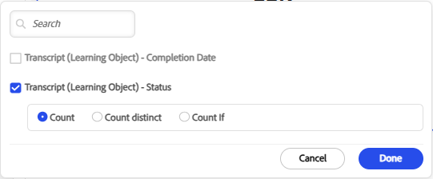

1. Select the number of digits to be shown after the decimal point that will appear in the big number. You can elect at most two digits after the decimal point.
1. In **Display unit**, select how large numbers are shortened. Select K for thousands, M for millions, B for billions, or None to show the full value. Auto selects the appropriate unit automatically. Select **Next**.

   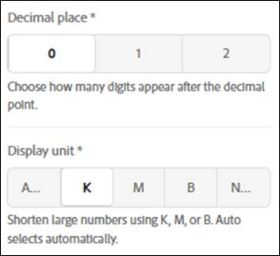

### Customize the big number

Use the **Style** tab to customize the legend properties of the big number.

1. In **Legend title**, enter the text that names the number. For example, enter "Total Course Completions".
1. In **Legend position**, select one of the two icons to set where the title appears.
1. In **Legend alignment**, select left, center, or right.
1. Select **Create** for a new chart. When you edit an existing chart, select **Save**.

   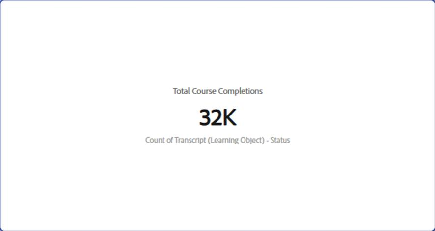

## Create table or pivot charts

Use a pivot table in Adobe Learning Manager Report Builder to summarize a number across two categories, such as how many learners in each manager's team have completed, started, or not started required learning. You can also switch to a pivot-style view, where dates or categories run across the top of the table, so each learner or course fits on one row.

### About pivot or table charts

A pivot table is a grid with one category down the side, one category across the top, and a number in each cell. Each cell shows the measure for one row value and one column value. You build it with three settings on the **Setup** tab.

|Setting|What it does|In the example|
|---|---|---|
|**Dimension - Columns**|The values of this field become the column headings across the top.|Transcript (Learning Object) - Status: Completed, In Progress, Not Started|
|**Dimension - Rows**|The values of this field become the row labels down the left side, one row for each value.|User - Manager Name|
|**Measure - Value**|The number in each cell. You choose a column and an aggregate, such as **Count**. It appears as the column name followed by *Aggregated by: Count*.|Count of learners|

A dimension is a field you group by. A measure is a number you calculate.

### Before you create a table chart

* To use column-to-row view, group the report by the column you want as headings, such as a date.
* If you group by more than one date column, you pick one of them for the headings.

### Create a table chart

1. Select **Reports**, then **Report Builder**. On the **Reports** tab, open the saved report.
1. In the left navigation, select **Visualization**.
1. In **Chart type**, select **Table / Pivot**.
1. Next to **Dimension - Rows**, select the add icon, then select **User - Manager Name**.
1. Next to **Dimension - Columns**, select the add icon, then select **Transcript (Learning Object) - Status**.
1. Next to **Measure - Value**, select the add icon. Select the learner column, then select the aggregate **Count unique** so each learner is counted once.
1. Next to **Measure - Value**, select the add icon. Select the learner column, then select the aggregate **Count**.

   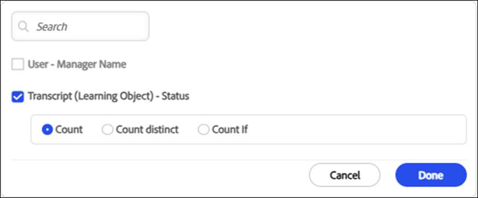

1. Turn **Show grand total for columns** and **Show grand total for rows** on or off. These two settings control whether a pivot table/chart includes grand totals across its row and column dimensions. **Show grand total for columns** displays an additional total that summarizes values across all columns for each row. **Show grand total for rows** displays an additional total that summarizes values across all rows for each column.
1. To combine the remaining rows into one, turn on **Group rest of the points as 'others'**.
1. Select **Next**.

### Customize the table

Use the Style tab to add the chart title, color table header, and color table rows.

1. In **Chart title**, enter the title you want to display, for example, **Status of Learning**.
1. Select **Header row color** to apply a background color to the header row.
1. Enable **Highlight alternate rows** to apply alternating colors to rows for easier readability.
1. Select **Color 1** and choose the first color for the alternating rows.
1. Select **Color 2** and choose the second color for the alternating rows.
1. Select **Save** to apply the style settings to the chart.

## Build a dashboard

A dashboard in Adobe Learning Manager Report Builder puts charts from one or more of your reports on a single page. Build one when you answer the same questions repeatedly, such as how many people completed training this month, or which teams are behind.

### About Report Builder dashboard

A dashboard is a page of charts. You choose the reports it draws from, called its data source, then add charts from those reports. Charts always come from reports, so create them first on each report's **Visualization** page. You can use only reports you own. Scoping applies to every chart on the dashboard.

### Create the dashboard

Select **Reports > Dashboards**. The page lists all reports created by you.
