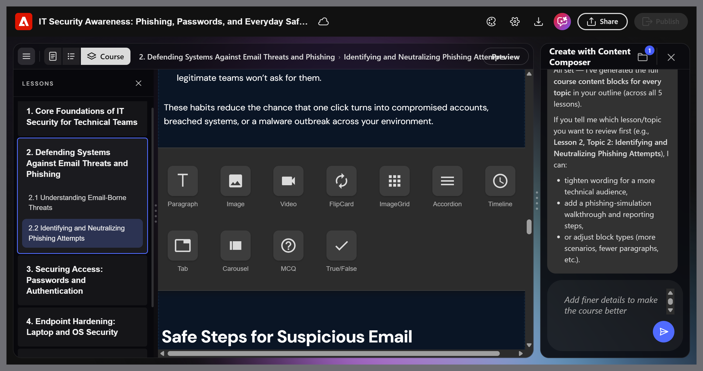
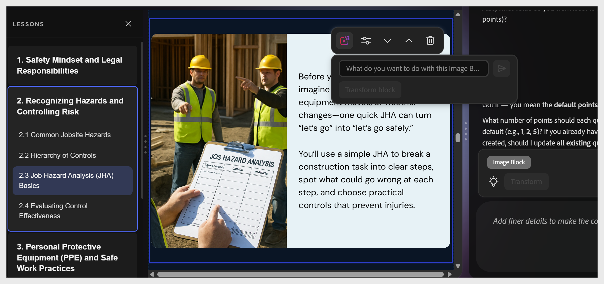

# Add a content component

Select between two existing elements. The + button appears. Select it to open the component picker.

Available components:

<table>
  <thead>
    <tr>
      <th>Component</th>
      <th>Use for</th>
    </tr>
  </thead>
  <tbody>
    <tr>
      <td><strong>Paragraph</strong></td>
      <td>Body text and explanations</td>
    </tr>
    <tr>
      <td><strong>Image</strong></td>
      <td>Illustrations, screenshots, diagrams</td>
    </tr>
    <tr>
      <td><strong>Video</strong></td>
      <td>Embedded MP4 or linked video</td>
    </tr>
    <tr>
      <td><strong>Flip Card</strong></td>
      <td>Term or definition pairs, reveal interactions</td>
    </tr>
    <tr>
      <td><strong>Image Grid</strong></td>
      <td>Multiple images in a grid layout</td>
    </tr>
    <tr>
      <td><strong>Accordion</strong></td>
      <td>Expandable sections, step-by-step procedures</td>
    </tr>
    <tr>
      <td><strong>Timeline</strong></td>
      <td>Sequential events or process steps</td>
    </tr>
    <tr>
      <td><strong>Web Object</strong></td>
      <td>Embed external web content, a webpage, interactive tool, survey, or web application, directly inside a topic slide</td>
    </tr>
    <tr>
      <td><strong>Tab</strong></td>
      <td>Parallel content — comparisons, regional variants</td>
    </tr>
    <tr>
      <td><strong>Carousel</strong></td>
      <td>Swipeable series of images or content cards</td>
    </tr>
    <tr>
      <td><strong>MCQ</strong></td>
      <td>Inline ungraded knowledge check</td>
    </tr>
    <tr>
      <td><strong>True/False</strong></td>
      <td>Inline ungraded true or false check</td>
    </tr>
  </tbody>
</table>

>[!NOTE]
>
>Use **Accordion** for step-by-step procedures where learners benefit from controlling their pace. Use **Flip Card** for term or definition content.

## Add a Web Object to a Content Composer course

A Web Object displays external content in an inline frame within the course. Learners interact with the content without leaving the course. Use it for interactive tools, embedded forms, surveys, or any web-based resource that supports iframe embedding.
 
### Add a Web Object
 
1. Open your course in Content Composer and navigate to the topic where you want to add the Web Object.
2. Select between two existing elements on the topic slide. The **+** button appears.
3. Select **+** to open the component picker.
4. Select **Web Object**. The block appears on the canvas.

### Configure the Web Object
 
Select the **Settings** icon on the Web Object block toolbar to open the configuration panel.
 
### Set the content source
 
Under **Content**, select how the external content is loaded:
 
- **URL** — enter the web address of the page or tool you want to embed. The content loads inside the course in an inline frame.
- **Embed code** — paste an embed snippet from a third-party service. Use this for tools that provide their own embed code, such as interactive forms, surveys, or media players.
- **System** — select content from a connected system or integration.

### Set the frame height
 
In the **Frame height** field, set the height of the embedded content frame in pixels. Use the **+** and **−** controls to adjust the value. The default is 498 px.
 
Adjust the frame height to match the natural height of the embedded content. Setting it too low adds a scroll bar inside the frame; setting it too high adds blank space below the content.
 
### Configure load and display options
 
- **Auto load** — when selected, the web content loads automatically when a learner reaches the slide. Clear this option for content-heavy pages to avoid slowing down the course. When Auto load is off, learners select the frame to trigger the load.
- **Block title** — toggle on to display a heading above the Web Object block. Use this to give learners context about the embedded content before they interact with it.

## Move content blocks within a topic

You can reorder content blocks within a topic using either the edit options in the toolbar or the AI.

