# Creating, modify, and publish courses

To learn how to create courses, certifications, and learning programs in Learning Manager, read this article.

Authors can create learning objects such as courses, certifications, and learning plans. Learners can consume these learning objects, while administrators can track learners' progress.

## Courses in Learning Manager {#coursesincaptivateprime}

Adobe Learning Manager enables authors to create courses using one or more modules related to virtual training, self-paced training, classroom training, and activities. Administrators can further use these courses to create course instances, enroll learners, assign badges, and enable feedback for these courses. They can also create learning programs, learning plans, and certifications using these courses.

Authors can use e-learning content that is created using any eLearning tool. Other supported course formats include video files, PDF, doc, docx, PPT, and PPTX.

## Create a course - Basic workflow {#createacoursebasicworkflow}

To create a course, follow the steps below:

1. Log in to Adobe Learning Manager as an Author, as only authors have the rights to create courses. Now, on the Getting Started page, click **[!UICONTROL Create Courses]**.
1. On the **Course Overview** page, enter the name of the course. Now, enter a short description for this course, which is displayed on the course card. This description must not be more than 140 characters. Then enter the detailed overview for the course, which is displayed on the Course Details page. The description must not exceed 1500 characters.

   As an author, you can see the description of the modules while adding the module to a course.

1. To make your course available in other languages, click Add New Language from the upper-left corner of the page. Select the language or languages in which you want to make your course available. Click **[!UICONTROL Save]**. For more information, see [Add content for different languages](/help/migrated/authors/feature-summary/content-library.md).
1. **Modify course settings**-

   1. On the Course Settings page, choose a skill for the course. From the Skill drop-down list, choose the required skill. Then, from the Level drop-down list, choose the required level.
   1. Choose the course skills, level, and set the credits for the skill. Add more skills, if required.
   1. From the **Enrollment Type** drop-down list, choose the type of enrollment.

   The following are the types of enrollments:

   * **Manager nominated:** Only managers can nominate these courses. A learner cannot enroll to these types of courses.
   * **Manager approved:** Managers approve these courses. Learners can sign up for these courses, but they are not enrolled directly to these types of courses without Manager's approval. A notification request is sent to Managers when learners sign up for these types of courses. Upon Manager approval, these courses are listed as enrolled for learners.
   * **Self-enrolled:** Learners can directly enroll themselves to these types of courses.

1. To save the changes, click **[!UICONTROL Save]**. To publish the course, click **[!UICONTROL Publish]**.

## Create a course - Advanced workflow {#createacourseadvancedworkflow}

1. Log in to Adobe Learning Manager as an Author, as only authors have the rights to create courses. Now, on the Home page, select **[!UICONTROL Create Courses]**. The Courses Catalog page opens and a list of courses appear.
2. Select **Add** on the upper right. A page opens to create a new course.
3. Enter a name for the course and a short description. This description is displayed on the course card. This description must not be more than 140 characters. Then enter the detailed overview for the course, which is displayed on the Course Details page. The description must not exceed 1500 characters.
4. To make your course available in other languages, select **Add New Language** from the upper-left corner of the page. Select the language or languages in which you want to make your course available. **Select** **[!UICONTROL Save]**. For more information, see [Add content for different languages](/help/migrated/authors/feature-summary/content-library.md).
5. **Modify course settings**-

   a. On the Course Settings page, choose a skill for the course. From the Skill drop-down list, choose the required skill. Then, from the Level drop-down list, choose the required level.
   b. Choose the course skills, level, and set the credits for the skill. Add more skills, if required.
   c. Add the custom compliance labels to the course, if required. See [Add compliance labels to course/learning path/certification](/help/migrated/authors/feature-summary/courses.md#add-compliance-labels-to-courselearning-pathcertification). 
   d. From the **Enrollment Type** drop-down list, choose the type of enrollment.

   The following are the types of enrollments:

   * **Manager nominated:** Only managers can nominate these courses. A learner cannot enroll to these types of courses.
   * **Manager approved:** Managers approve these courses. Learners can sign up for these courses, but they are not enrolled directly to these types of courses without Manager's approval. A notification request is sent to Managers when learners sign up for these types of courses. Upon Manager approval, these courses are listed as enrolled for learners.
   * **Self-enrolled:** Learners can directly enroll themselves to these types of courses.

6. Choose if you want to set a price for your course or make it free. If you want to make the course paid, choose the option **[!UICONTROL Paid]**, and specify a price. The price then appears on the Course card and the Course overview page for a learner.

   >[!NOTE]
   >
   >This is only enabled when Adobe Commerce connector is configured.
   
7. If you want to provide the ability for learners to unenroll themselves from your course, enable the check-box **Learners can unenroll themselves**.

8. **Instance Configuration**

   If you enable this option, learners who are in the state, In Progress,  can visit other instances and enroll there. A learner can then retain the progress of the previous instance.

   After publishing the course, if you come back to the Settings page, the option is no longer editable.

   You can enable the option for the following course types:

   * Self-paced
   * Virtual Classroom
   * Classroom
   * Activity
 
   >[!NOTE]
   >
   >While duplicating a course, if you had enabled the option Instance Configuration in the source course, the option remains disabled in the destination course.

   **Instance Switch isn't supported for**:

   * Paid courses
   * Manager-nominated enrollment-type courses.

   Instance switch configuration will not be propagated to peer accounts if shared through the catalog, the option remains disabled in the destination course.

9. **Multiple enrollments**

   Using this, you can enroll learners in more than one course instance at one or different periods.

   Enable the toggle **Multiple Enrollment** to switch between various course enrollments of a learner. If you've enabled Instance Switch, you cannot use Multiple Enrollment.

10. Select the pre-requisite courses that must be completed before taking up your course. Click the Courses field and choose from the list of courses.
11. Enable the **Enable** **Prerequisites** check-box if you want the pre-requisite courses to me made mandatory.
12. Add keywords as tags related to your course. These tags help the learners to locate your course easily during search. All these tags are automatically added based on the modules that we have added. If you have other tags that you want to add to this course, you can go ahead and enter it.
13. Add keywords as tags related to your course. These tags help the learners to locate your course easily during search. All these tags are automatically added based on the modules that we have added. If you have other tags that you want to add to this course, you can go ahead and enter it.
14. In the Auto Retire field, select a date when the course retires. The Administrator must enable the Auto Retire option first.
15. To save the changes, select **[!UICONTROL Save]**. To publish the course, click **[!UICONTROL Publish]**.

## Configure Gradebook for a course {#configuregradebookforacourse}

Set up weighted scoring for a course in Adobe Learning Manager so that each learner receives an aggregate score calculated from their module performance, and so that course completion can be tied to achieving a minimum score threshold.

Gradebook is configured at the course level when creating a new course. It cannot be added to an existing published course.

>[!NOTE]
>
>For learners to see the Gradebook in a course, an administrator must first enable **Gradebook visibility** at the account level.

### Enable Gradebook for a course

* Sign in to Adobe Learning Manager as an author.
* In the left navigation, select **Courses** and then select **Add** to create a new course.
* Enter the course name, description, and other required details.
* In the **Modules** section, locate the **Gradebook** toggle. 

    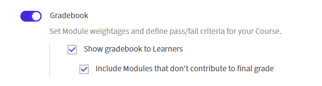

* Select the **Gradebook** toggle to enable it. Two options appear beneath it. Both are on by default:
  * **Show Gradebook to learners:** Learners see a **Gradebook** tab in the course player showing their module scores, weightage breakdown, and aggregate result. Turn this off to calculate grades internally without exposing them to learners.
  * **Include modules that don't contribute to final grade:** Non-scorable modules (PDF, video, audio, and similar) appear in the Gradebook. The non-scorable modules do not contribute to the final score of the learner.

### Add modules and assign weightage

After enabling Gradebook, add your content modules and assign a weightage percentage to each scorable module. Weightage percentages must add up to exactly 100 before you can save the configuration.

1. Select **Add Modules**.
2. In the module picker, select the modules you want to add and select **Add**. The modules appear in the **Content** section. Scorable modules, SCORM, Captivate content, AICC, xAPI, native quizzes, Activity modules, classroom sessions, and virtual classroom sessions, display a **Weightage** input field. Non-scorable modules show a dash in the weightage column.
3. Enter a percentage value in the **Weightage** field for each scorable module. A **Total weightage** indicator updates as you type and must reach exactly **100%** before you can save. 

    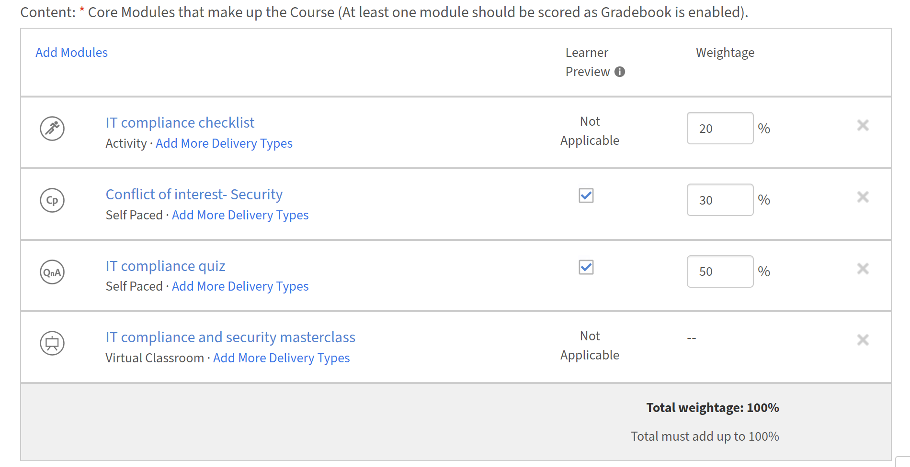

4. For modules with multiple delivery types: weightage can only be assigned if **all** delivery types in the module support scoring. If any one delivery type does not support scoring, the entire module cannot be weighted.

>[!NOTE]
>
>The scoring scale does not need to match across delivery types. A classroom session scored out of 100 and a SCORM module scored out of 10 can coexist in the same Gradebook. The formula normalizes each contribution automatically.

### Add a team-based submission module in Adobe Learning Manager

Add a team-based file submission module so one team member can upload a file for the whole team, and choose how it is reviewed and scored.

A team-based file submission module lets one learner submit a file on behalf of a team. The instructor evaluates it once, and the outcome applies to every team member. You must add the module before you publish the course.

### Add the module to a course

1. Sign in to Adobe Learning Manager as an author.

1. In the author app, create a course or open an unpublished course.

1. Add a new activity module.

1. Select the file submission activity type.

1. Select the team-based option. The individual option is the earlier file submission module for single learners.

   -submission-and-rubric-based-assessments-image4.png "Team-based option")

1. Select the instructor or instructors.

1. Set the module duration.

A course can have team-based and individual submission modules together. All team-based modules in a course instance share the same teams.

### Choose the review and scoring options

1. Open the team-based file submission module.

1. Choose whether **Reviewer approval is required**.

   * If you turn it on, an instructor must approve or reject each submission before the module completes.
   * If you turn it off, the module completes for all team members as soon as the team submits.

1. Choose a scoring method:

   * Select manual scoring to let the instructor enter one overall score.
   * Select criteria-based scoring to calculate the score from the points on each evaluation plan option. This method requires an evaluation plan.

      -submission-and-rubric-based-assessments-image5.png)

>[!CAUTION]
>
>After you publish the course, you can't remove the module, change its settings, or use multiple delivery types for it.

### Add an evaluation plan to a file submission module

Create an evaluation plan for individual or team submissions by adding objective and subjective questions to a file submission module.

An evaluation plan is the set of questions that instructors use to assess a submission. Each module has one evaluation plan, and you can't reuse it in another module. You can add an evaluation plan to an individual file submission module or to a team-based submission module. Add it before you publish the course.

#### Turn on the evaluation plan

1. Turn on the evaluation plan.

1. Enter a description of the assessment.

1. Choose whether learners can view the evaluation plan before they submit. This is off by default. Learners see the assessment description and each criterion's description. They don't see the answer options, points, or weightage.

   -submission-and-rubric-based-assessments-image6.png "Evaluation plan settings")

#### Add evaluation parameters to the evaluation plan

You can add up to 100 evaluation parameters. Each parameter is either objective or subjective.

1. Select **Define parameters**. Enter the parameter text in the Parameter/Question field.

   -submission-and-rubric-based-assessments-image7.png "Define parameters")

1. Select the parameter type:

   * **Objective:** The instructor selects from answer options. Add the options.

     -submission-and-rubric-based-assessments-image8.png "Objective parameter")

   * **Subjective:** The instructor writes a descriptive response.

     -submission-and-rubric-based-assessments-image9.png "Subjective parameter")

1. For an objective parameter with criteria-based scoring, enter whole-number points for each option. Negative numbers are allowed. Each option needs a point value.

1. Choose the parameter settings:

   * **Required:** The instructor must respond to the parameter. Parameters that aren't required show an optional tag to the instructor.
   * **Allow reviewer remarks:** The instructor can add remarks to the parameter. This option appears for objective parameters only.

1. To let instructors add one comment for the whole evaluation plan, turn on overall remarks.

1. Repeat for each question.

1. Select **Save**.

>[!NOTE]
>
>Subjective parameters don't have points.

#### Calculate the overall score

When you choose criteria-based scoring, Adobe Learning Manager calculates the overall score from the points on the options that the instructor selects. Only objective evaluation parameters count. Subjective evaluation parameters don't contribute to the score.

* **Without a ceiling:** The overall score is the sum of the points for the selected options.
* **With a ceiling:** The overall score is the sum of the points, divided by the maximum possible points, multiplied by the ceiling, and rounded to a whole number. The ceiling can be any whole number from 1 to 100. The default is 100.

Because an option can have negative points, the calculation can produce a number below 0. When that happens, Adobe Learning Manager sets the overall score to 0. The overall score is never below 0.

For example, suppose the maximum possible points are 12 and the ceiling is 10. If the selected options add up to 6, the overall score is 5. If they add up to 10, the overall score is 8, which is 8.33 rounded. If they add up to −3, the calculation gives a number below 0, so the overall score is 0.

To choose between manual and criteria-based scoring, follow the scoring steps in Add a team-based submission module.

#### Add evaluation parameters for each locale

The locales of a module follow the locales of the course. Add the evaluation parameters manually for each locale that the course uses. Instructors see the evaluation parameters in their content locale.

#### Publish the course

Publish the course when the plan is complete. New instances of the course get the same plan. After you publish, you can edit only the text of the evaluation parameters and options. You can't change the configuration, add settings, or turn the plan on or off.

### Set the minimum passing score

* In the course editor, locate the **Passing criteria** section.
* In the **Minimum aggregate score across modules** field, enter a percentage between 0 and 100.
* A value of **0** means the course completes based on required module completion alone, with no aggregate score threshold.
* Any value above 0 means the learner must complete the required modules AND meet or exceed this aggregate score.
* In the **Mandatory Modules** field, enter the required number or select it from the dropdown. 

    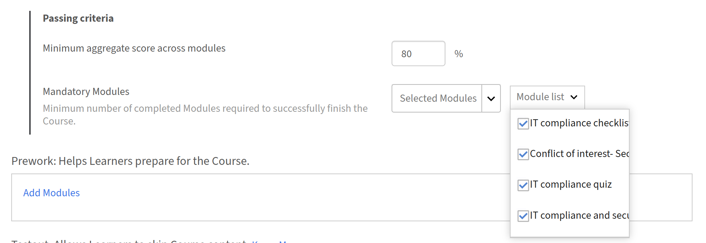

* Select **Save**.

The minimum passing score is visible to learners in the **Gradebook** tab so they know the threshold before they start.

### Configure score settings for modules with multiple attempts

When a module allows multiple attempts, choose which attempt score is used in the Gradebook calculation.

* In the course editor, locate a module that has multiple attempts enabled. 

  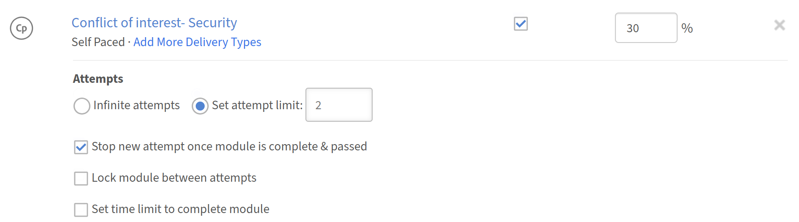

* Locate the **Score to be used** setting next to that module.
* Select **Latest** or **Highest**:
  * **Latest:** the most recent attempt score is always used. A lower score on a later attempt replaces a higher earlier one.
  * **Highest:** the best score from any attempt is retained. A lower score on a later attempt does not reduce the stored score. 
  
  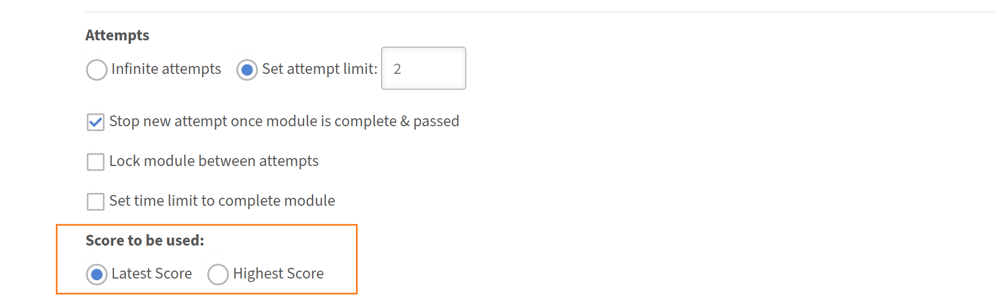

* Select **Save**.

### Publish the course

After configuring all Gradebook settings, publish the course using the standard workflow. Select **Save**, then select **Publish** to make the course available to learners.

### Best practices

* Assign weightage that reflects the relative importance of each module. Give higher percentages to modules most critical to the learning objective.
* Enable **Show Gradebook to learners** unless there is a specific reason to hide scores. Learners who can see their weightage and running score are better positioned to prioritize their effort.
* Set the minimum passing score before learners enroll. Changing it after active enrollments may affect in-progress completions.
* Use **Highest** for the multiple-attempts setting when modules are assessments learners are expected to retry. Use **Latest** when you want to capture current knowledge level rather than best performance.
* Verify the **Total weightage** indicator shows exactly 100% before saving.

# Set up automatic team creation in Adobe Learning Manager

Set the automatic team creation rules for a course so Adobe Learning Manager divides enrolled learners into teams before an instance starts.

Automatic team creation acts as a fallback when instructors haven't created teams manually. You can turn on automatic team formation for any course that has a team-based file submission module, even if the account setting is off. If your administrator turned on the account setting, new courses start with the account's schedule, and you can adjust it during course setup.

The course must include a team-based submission module. Each instance needs a start date.

## Set the team rules for a course

1. In the author app, open a course that has a team-based submission module.

1. Open the course settings, and then find the **Automatic team formation for team submissions** setting. It appears only when the course has at least one team-based file submission module.

1. Select **Enable**.

   -submission-and-rubric-based-assessments-image10.png "Enable automatic team formation")

1. Review the **Team formation schedule**. If your administrator turned on the account setting, it shows the number of days they set. Teams are created that many days before the instance start date.

1. Optional: To change the number of days for this course, select **Edit**, select **Yes** on the warning, and then enter a new number.

   -submission-and-rubric-based-assessments-image11.png "Edit warning")

1. Change the value to a different one.

   -submission-and-rubric-based-assessments-image12.png "Team formation schedule value")

1. Review the **Team formation schedule**. It starts with the account value. To use a different lead time, enter a new number of days.

1. Choose how to form teams. Enter 1 or higher. A team can have up to 100 members.

   * Select **Members per team** and enter the number of learners for each team.

     -submission-and-rubric-based-assessments-image13.png "Members per team")

   * Select **Number of teams** and enter the total number of teams.

     -submission-and-rubric-based-assessments-image14.png "Number of teams")

1. Save your changes, and then publish the course.

>[!WARNING]
>
>After you publish, you can't turn automatic team formation on or off for the course, and you can't change the lead time. You can still change the rule for forming the teams and its value.

-submission-and-rubric-based-assessments-image15.png "Published course settings")

## Set the instance start date

1. Open the course instance.

1. Enter a start date and select **Save**.

   -submission-and-rubric-based-assessments-image16.png "Instance start date")

Teams are created at 12:00 am on the lead-time day, in the time zone of the instance. For example, with a lead time of 3 days, teams are created at 12:00 am three days before the start date. The start date only sets this timing. It doesn't block enrollment.

## Change the team rules after publishing

You can change the rule, **Members per team**, or **Number of teams** at any time. The change applies to all instances but takes effect only where teams haven't been created yet. Teams that already exist are never regrouped.

## Use team-based courses in learning paths

Teams belong to the course instance. If you add a team-based course to a learning path, set the lead time and start date on the course instance, not on the learning path. For how learners are divided, see team settings and limits.

## Troubleshooting

**Teams weren't created for an instance.** Check that the instance has a start date. Automatic creation doesn't run without one. Also check that automatic team formation is turned on for the course. Teams weren't created for an instance that starts soon.

**You can't find the course-level setting.** The setting appears only when the course has at least one team-based module. Add one before you publish.

**You changed the rules, but the teams didn't change.** The rules apply only if teams haven't been created for the instance. To change existing teams, ask the instructor to edit them.

## Configure enrollment window and seat allocation for a Classroom course

You can define when different groups of learners can enroll, allocate a specific number of seats to selected user groups, and automatically promote eligible learners from the waitlist when seats become available.

Authors can allocate seats to user groups only after an Administrator enables the **Group Enrollment** setting. View General settings article for more information.

To configure seat allocation for user groups:

1. Sign in to Adobe Learning Manager as an Author.
1. Select **Courses** from the left navigation.
1. Create a **Classroom** course. View Course modules for more information.
1. Configure the following settings:

   |Setting|Description|
   |---|---|
   |**Seat Limit**|Displays the lowest seat limit configured across the Classroom or Virtual Classroom modules. This field is read-only. To allocate seats to user groups, first set a seat limit in the Classroom or Virtual Classroom module.|
   |**Open Enrollment Date**|Select the date on which everyone, including the selected user groups, can enroll.|
   |**Allocate seats per user group**|Enable this option to reserve seats for specific user groups.<p>**Note:**<ul><li>Reserve 100% of the available seats for specific user groups to ensure that only learners from those groups can enroll in the course.</li><li>You cannot enable or disable this option once the course is published.</li></ul>|
   |**Unallocated seats**|Displays the number of seats that remain available to learners outside the selected user groups.|
   |**Open Enrollment Date for Groups**|Select the date from which members of the selected user groups can start enrolling.|


1. Select **Add Group Allocation**, and configure the following:

   1. **User group**: Select the user group for which you want to reserve seats.
   1. **Seats allocated**: Enter the number of seats to reserve for the selected user group.

   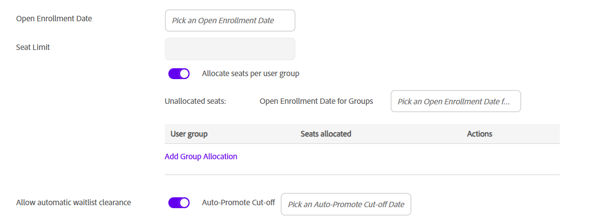

1. Select **Save**.

### Manage user group allocations

After you add a user group, the group and its allocated seats appear in the allocation list. Use the available actions to modify the allocation.

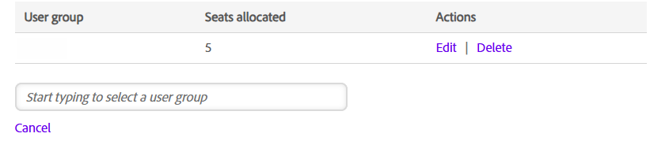

|**Action**|**Description**|
|---|---|
|**Edit**|Modify the number of seats allocated to the user group.|
|**Delete**|Remove the seat allocation for the user group.|

>[!NOTE]
>
>The total number of seats allocated across user groups can't exceed the Seat Limit.

### Configure automatic waitlist clearance

When an Administrator enables Group Enrollment, automatic waitlist clearance promotes the next eligible waitlisted learner when a seat opens. This is enabled by default.

To configure automatic waitlist clearance:

1. Enable **Allow automatic waitlist clearance** in the **Course overview** page.
1. (Optional)Select a date from **Auto-Promote Cut-off** picker.
1. Select **Save**.
   Automatic promotion stops after the cut-off.

>[!NOTE]
>
>* If you also allocate seats per user group, only members of a group are promoted into that group's seats.
>* The **Auto-Promote Cut-off** date applies to both user group and open waitlists. Automatic promotions stop for both waitlists after this date.

## Add compliance labels to course/learning path/certification {#add-custom-compliance-label}

To add the compliance labels to courses, follow these steps:

1. In the author app, go to **[!UICONTROL Courses]**/**[!UICONTROL Learning Paths]**/**[!UICONTROL Certifications]** and select **[!UICONTROL Add]**.
1. Type the name and other details such as description, skills.
1. In the **[!UICONTROL Custom compliance]** text box, type and select the compliance label.
 
   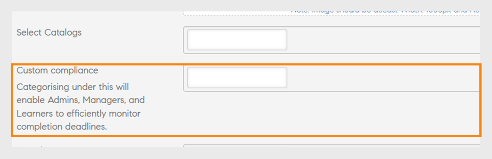
   _Add custom compliance_

   >[!IMPORTANT]
   >
   >Make sure to set a deadline for the course when you're adding Custom Compliance.

   >[!NOTE]
   >
   >A maximum of 50 courses, learning paths, or certifications can have the same value for a custom compliance type label.

1. Save and publish the course/learning path/certification. 
Now the course/learning path/certification is considered as a compliance type. Administrators can add this course to the compliance dashboard and share it with managers to track the progress

>[!NOTE]
>
>Authors can also add the compliance labels to an existing course/learning path/certification by editing them.

## Create an instance {#createaninstance}

To create an instance, do the following:

1. Log in as an **Author**.
2. Navigate to the course for which you want to create an instance and open the course.
3. Select **Instances** on the left navigation panel. The **Instances** page opens. Every course has an instance by default. You can either modify the default instance or add instances. You cannot delete this course instance.
4. To create an instance, click **[!UICONTROL Add New Instance]** on the upper-right corner of the course information. A new instance of the course is displayed.
5. Enter the properties of the instance:

   * In the **[!UICONTROL Instance Name]** field, enter the name of the instance you want to associate with the course. Ensure that you use a unique name for the instance.
   * **Start Date:** This is the start date of the course. Two reminder emails can be sent on two different selected dates to the Learner before this start date. The start date has to be a date before the date of completion. Once you select the start date, this date will be highlighted in blue in the calendar in the **Notificiation Alerts** section of the instance.
      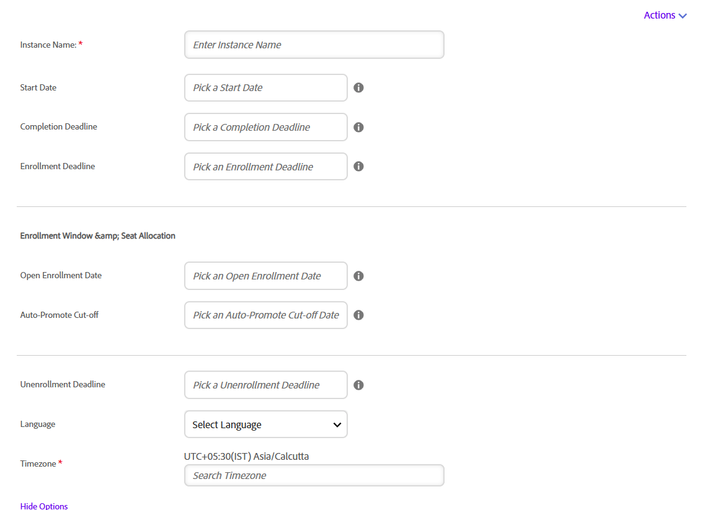
   * Specify the completion deadline for the instance. Learners must achieve course completion status by this date.
      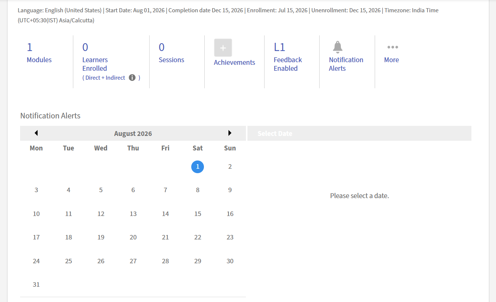
   * **Open Enrollment Date** (Optional): The date from which learners can enroll. If seats are allocated to user groups, this date applies to learners outside those groups.
   * **Auto-Promote Cut-off** (Optional): After this date, automatic waitlist promotion stops for the instance. This field appears when automatic waitlist clearance is enabled.
   * Select **[!UICONTROL Show More Options]** to display other deadline options.
   * **[!UICONTROL Enrollment Deadline]:** This is the date by which a learner is expected to enroll into a learning object in case of self-enrollment.
   * **[!UICONTROL Unenrollment Deadline]:** You can choose to restrict unenrollment by learner himself by having an unenrollment deadline.
   * **[!UICONTROL Timezone]:** Search and then select the **[!UICONTROL Timezone]** from the dropdown.

6. Select **Save**.
   
### Set email reminders before the start date

You can set email reminders only after you save the entire instance information. Once you select **Save**, the instance minimizes itself and goes into the edit mode.

1. Select the **Notification Alerts** box.
2. On the calendar, select a date which is before the start date of the instance for the first reminder.
3. Select **Add reminder** on the right.
4. **Email Template:** Select a template from the drop-down list
5. **Recurrence:** Select a type of recurrence from the drop-down list. Select the blue check mark on the right to save the reminder date. Remember each reminder date has to be saved separately.
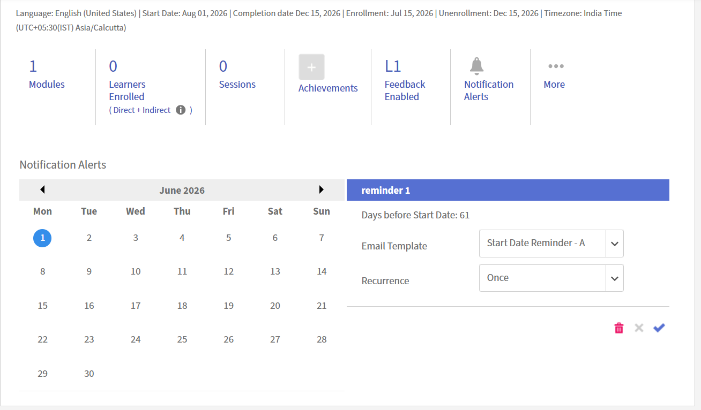
6. Select another date which is also before the start date of the course for the second reminder, repeat the process, and select the blue check mark on the right to save this reminder date as well.
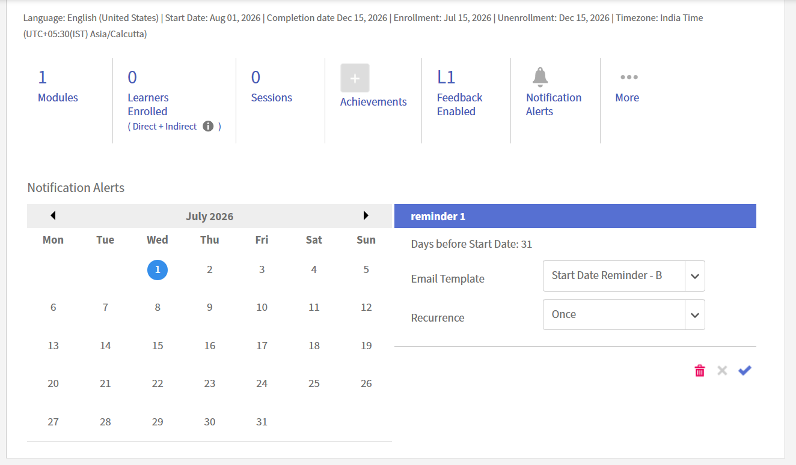

## View properties of the instance {#viewpropertiesoftheinstance}

1. **Modules:** The number of modules created by the author of the course
2. **Sessions:** The number of Virtual Classroom and Classroom modules in the course
3. **Achievements:** The achievements of the learners
4. **Notification Alerts:** The option to send two reminder emails before the start date of the course

### Actions {#actions}

* **Save to Course Settings:** Saves the settings of this instance to the course from where you created the instance.
* **Apply Default Settings:** Applies the default settings found in the **Configure** > **Instance Defaults** page.
* **Retire Instance:** Retired an instance. The instance will not be available anymore.
* **Delete Instance:** Deletes the particular instance.


>[!NOTE]
>
>You cannot delete the default instance or a copy of the default instance. In such cases, the Delete Instance option will not appear under the Action drop-down list.

* **Notify Waitlisted Learners:** Notifies waitlisted learners that there is another instance where they can enroll
* **Email Enrolled Learners:** Sends emails to learners about important announcements

## Gamification points

You can allocate gamification points at the course and course instance levels. With this, you can award points to different courses or instances. Learners are incentivized to take specific courses or prefer a particular course instance over others.

1. At the course instance level, select **[!UICONTROL Gamification Points]**.

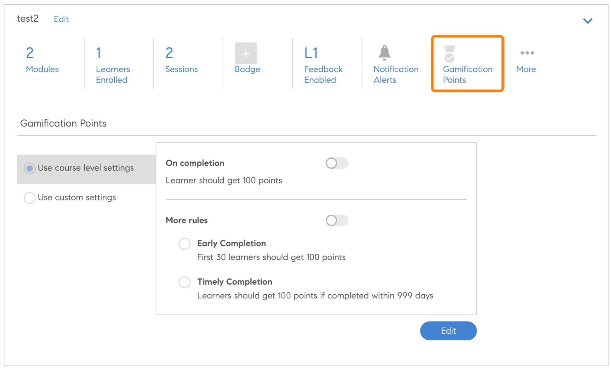

*Set points for gamification*

1. Select **[!UICONTROL Edit]**.
1. If you select Use course level settings, the following options display: 

   * **[!UICONTROL On completion]**: Select this toggle if you want the learner to get 100 points when they complete a course.
   * **More rules**

     * **[!UICONTROL Early completion]**: If you select this, the first 30 learners are awarded 100 points when they complete a course.
     * **[!UICONTROL Timely completion]**: If you select this, learners are awarded 100 points if they complete a course within 999 days.

1. If you select **[!UICONTROL Use custom settings]**, the following options display:

   * **[!UICONTROL On completion]**: Select this toggle if you want the learner to get 100 points when they complete a course.
   * **More rules**

      * **[!UICONTROL Early completion]**: If you select this, you can determine how many learners will be awarded specified points.
      * **[!UICONTROL Timely completion]**: If you select this, you can determine the number of points learners will be awarded if they complete a course within a specified time.

   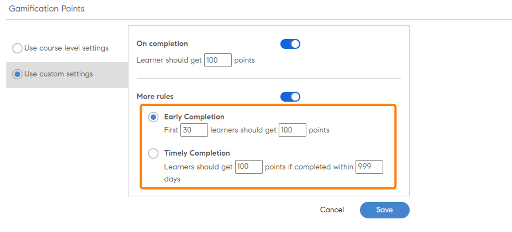

   *Set early and timely completion*

1. Select **[!UICONTROL Save]**.

## Aggregate learning resources

An author can decide if they want to aggregate the learning resources at the Learning Plan level or let them remain at an individual course level.

As an author, select **[!UICONTROL Learning Path]** > **[!UICONTROL Settings]**. Click **[!UICONTROL Edit]**.

In the **[!UICONTROL Resources]** section, the checkbox, Show constituent course resources aggregated at Learning Path level, when enabled displays whether resources present at course level would be shown on Learning Path level.

>[!NOTE]
>
>On the Settings page of a Learning Path, an Admin can also enable this option, which displays resources present at the course level that would be shown on the Learning Path level.

## Scheduling Assistant

Manage conflicts in booking instructors and classrooms. If you want to know at what time and date any instructor is available before assigning him to the course, use the Scheduling Assistant.

While creating a course, for a VC or CR course, click Scheduling Assistant.

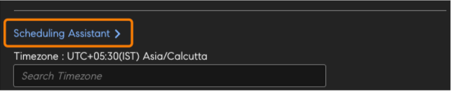

*Launch scheduling assistant*

The Scheduling Assistant window launches.

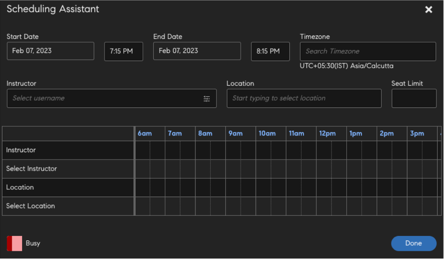

*The Scheduling Assistant dialog*

On the Scheduling Assistant, you can:

* Search instructors by their names.
* Search instructors by their skills.

### Search instructors by their names

On the Instructor field, type the name of the instructor or search for a partial instructor name. A list of instructors appear, from which you can choose an instructor.

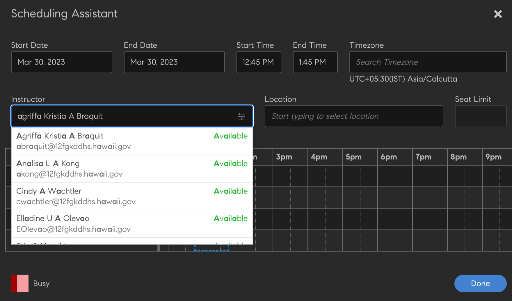

*Search for instructors*

Multiple instructors can be selected but only one instructor can be assigned at a time. The selected time will be highlighted in the time conflict window. Near the instructor, a cross icon appears, which you click to remove the instructor.

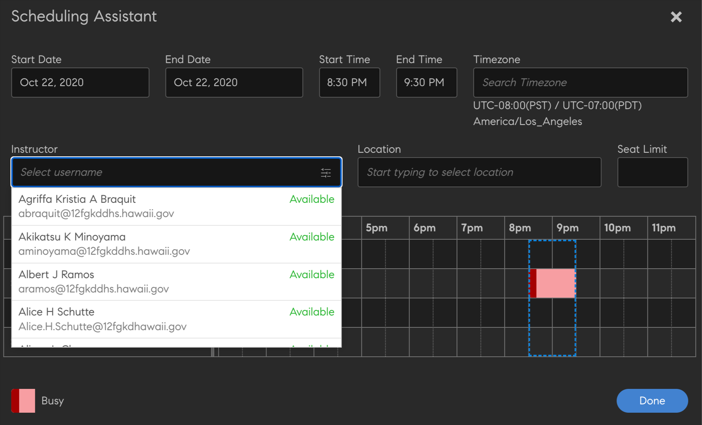

*Search for multiple instructors*

### Search instructors by skills

Search for an instructor with single or multiple skills. The search uses the AND operator.

Skills can be searched by partial or complete skill name only, not by skill level.

On the Assistant, enter the name of the instructor, location, and seat limit.

Also, you can search skill, which would be displayed after clicking on the filter icon present on the right side of Instructor search box. The screenshot below displays the button.

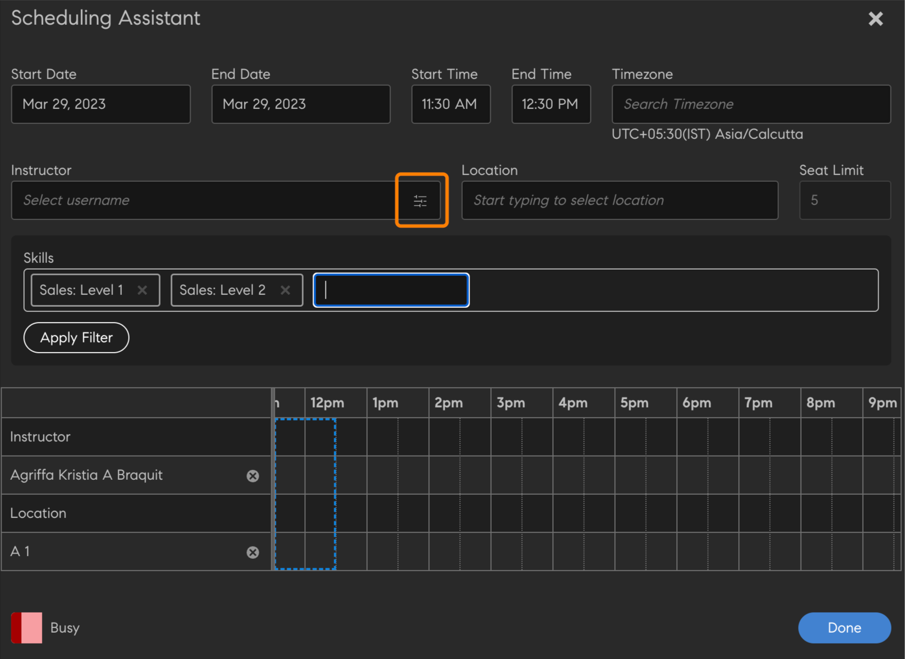

*Search for instructors by skills*

### User group filter

Select the filter in the Instructor field. There is a **[!UICONTROL User Group]** filter an Author or Custom Author can find the right instructor by using the values in the User Group.

If both filters are applied, a list of instructors displays who belong to the user group and has the selected skills.

This applies to Scheduling Assistant on the Courses or Instances page.

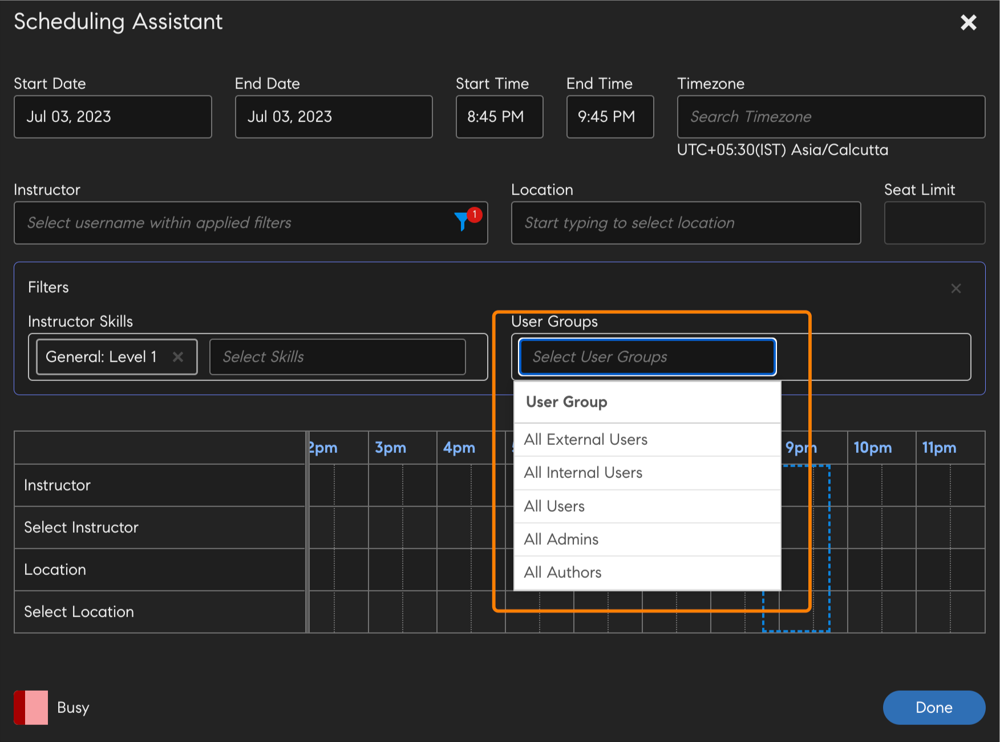

*Filter by User Groups*

### Instance page

You can also access the Scheduling Assistant from the Instance page, as shown below.

The Scheduling Assistant is also available on the Instance page as well for admins, and custom admin/author. 

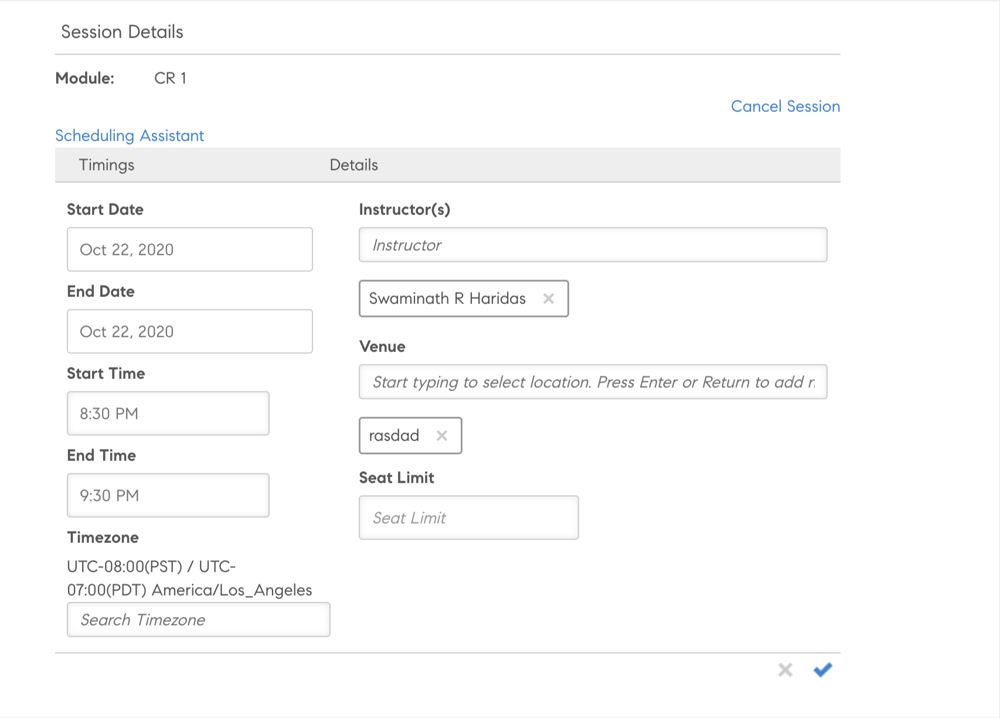

*Schedule instructors from Instances page*

### Search for a location

You can search for a location by specifying both the classroom name and the location region name on both the module and the Scheduling Assistant pages.

## Rich Text Formatting

While creating a Course, Learning Program, Certification, or Job Aid, Authors can input different types of content such as text, image, or apply various text formatting options.

When creating a course, you can see the Rich Text Editor in the Course Overview field. You can format your content, add images, add hyperlinks, and so on.

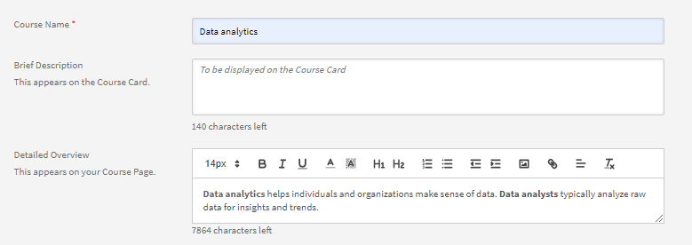

*Launch the Rich Text Editor*

Similarly, you can use the Rich Text Editor to modify the description when creating a:

**Learning Program**

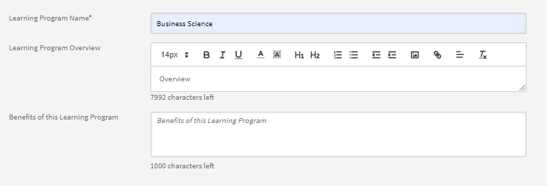

*Use Rich Text Editor for a Learning Program*

**Certification**

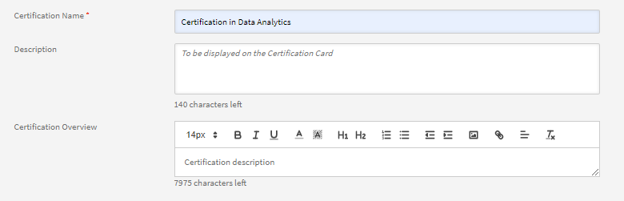

*Use Rich Text Editor for a Certification*

**Job Aid**

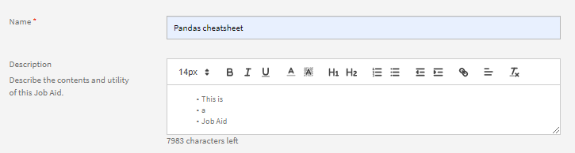

*Use Rich Text Editor for a Job Aid*

In addition, you can use the Rich Text Editor for other languages. 

## Rich text description support for headless user Interface

### Why is CSS required?

Rich text is composed of HTML markup. Rendering the markup as-is would result in default styling applied by the browser. This often doesn't go well with the style guidelines of the company. A CSS is required to meet the guidelines.

### Default style

The attached CSS stylesheet contains the styling that is applied by Learning Manager. The styling is tweaked considering majority of the usecases. Download the attached CSS file and import it to your webapp according to your conventions and build system. The CSS classes defined are namespaced under ql-editor class and they don't interfere with your existing styles.

### Customize styles

The default styling may not meet everyone's needs. The customisations can be done by overiding CSS supplied. All the styling is wrapped under ql-editor as descendant selectors. The following classes are used:

* Indenting: **li.ql-indent-$number**. $number varies from 1-9
* size: **ql-size-small**, **ql-size-large**, **ql-size-huge**

* alignment: **ql-align-center**, **ql-align-justify**, **ql-align-right**

* color: **ql-color-$color**. $color = white, red, orange, yellow, green, blue, purple
* background: **ql-bg-$color**. $color = black, red, orange, yellow, green, blue, purple
* html tags: p, ol, ul, pre, blockquote, h1, h2, h3, h4, h5, h6

[CSS file to be used for customization.](assets/ql-headless.css)

### API CHANGES TO ENABLE RENDERING RICH TEXT OVERVIEWS

When customers build a headless interface, they have a need to display the learning objects in that custom user interface they are developing. For doing this, one would typically use the [GET /learningObjects](https://learningmanagereu.adobe.com/docs/primeapi/v2/#!/learning_object/get_learningObjects) API that is exposed. Now that Learning Manager supports capturing "rich text" for the overview field, the data model of Learning Objects in the API responses also exposes the same. See the field named "richTextOverview" in the fragment of the model in the API response below. Also note that the field exposed earlier ("overview") remains unchanged for backward compatibility.

```
{ 
 "data": [ 
 { 
 "id": "string", 
 "type": "string", 
 "attributes": { 
 … 
 "localizedMetadata": [ 
 { 
 "description": "string", 
 "locale": "string", 
 "name": "string", 
 "overview": "string", 
 "richTextOverview": "string" 
 } 
 ], 
 … 
 }, 
 "relationships": { 
 … 
 } 
 } 
 } 
 ] 
} 

```

Customers who are already using the overview field remain unaffected in their headless interface will see just plain text as before. If customers want to take advantage of the rich text overview, they will have to create richly formatted overviews for their learning objects in the Author UI and after that Learning Manager will start returning the rich text overview as well, in addition to the plain text (as before) in the API response model.

However, to render this rich text in their UI, the customer will need to include a CSS. This is explained in detail in the following sections.

## Allow multiple attempts {#allowmultipleattempts}

Once the admin has enabled multi attempts, as an author you can configure multi attempts for an interactive e-learning module at a course or module level.

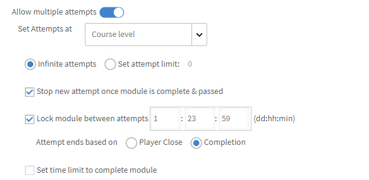

*Configure multi attempts for an interactive e-learning module*

<table>
 <tbody>
  <tr>
   <td>
    <p><b>Option</b></p></td>
   <td>
    <p><b>Description</b></p></td>
  </tr>
  <tr>
   <td>
    <p>Set Attempts at</p></td>
   <td>
    <p>You can set the number of attempts for a module to infinite or provide a definite limit.<span style="font-size: 0.8125rem;">The attempt information will be shown to the learner once it is enabled. The learner can choose to reattempt the module by clicking on the 'Reattempt' button.</span></p></td>
  </tr>
  <tr>
   <td>
    <p>Stop new attempt once module is completed or passed</p></td>
   <td>
    <p>To configure when to stop learners from selecting the new attempt option, enable the check-box "Stop new attempt once module is completed or passed". The 'Reattempt' option will be removed from the learner view once they successfully complete the module.</p></td>
  </tr>
  <tr>
   <td>
    <p>Lock module between attempts 0:0:1 Format: Days/Hours/Minutes</p></td>
   <td>
    <p>You can lock modules for a specific time between attempts, by enabling the check-box "<b>Lock module between attempts 0:0:1 Format: Days/Hours/Minutes</b>". When a module is locked, the learner cannot visit the module until the lock time provided elapses. </p>
    <p>ou can define the end criteria of an attempt by selecting the '<b>Player close</b>' or '<b>Completion</b>' check-boxes.</p></td>
  </tr>
  <tr>
   <td>
    <p>Player Close</p></td>
   <td>
    <p>Every module launch is treated as a new attempt if the criteria is selected as '<b>Player Close</b>'. A learner is prompted with module lock details and attempt details on closing the player.</p></td>
  </tr>
  <tr>
   <td>
    <p>Completion</p></td>
   <td>
    <p>If the end of an attempt is based on <b>Completion</b>, then it will be calculated based on the content success criteria. Learners are not allowed to re-attempt the module until the content sends the completion information. Module lock and attempt details are communicated to the learner once an attempt ends.</p></td>
  </tr>
  <tr>
   <td>
    <p>Set time limit to complete module</p></td>
   <td>
    <p>Authors can set a time limit to complete a module by the enabling the check-box, "<b>Set time limit to complete module</b>".</p>
    <p>Every player launch is considered as a new attempt and the learner is prompted with the time details during launch.</p>
    <p><b>Note:</b><span style="font-size: 0.8125rem;">The attempt will end automatically once the time elapses. Closing the player as well will end the current attempt.</span></p></td>
  </tr>
  <tr>
   <td>
    <p>Multi attempts at Module level</p></td>
   <td>
    <p>Selecting an attempt at 'Module level' from the 'Set Attempt at' drop-down list allows you to configure the options at individual module level.</p></td>
  </tr>
 </tbody>
</table>

## Course modules {#coursemodules}

### Add modules {#addmodules}

You can now add Content, Prework, and Testout modules. **Content** modules are the main modules that make up the course. **Prework** modules include some basic information, which can help learners get ready for the course. These modules are not mandatory for the learners to complete. **Testout** modules help learners skip the content and take the test if they are already aware of the content and want to take the test to fulfill the compliance requirement.

To add a content module, perform the steps below:

1. Click **[!UICONTROL Add Modules]**. You can see four options to add modules. The first option is to add Self Paced Modules. These are the modules that you create and add to the module library in Adobe Learning Manager. These second option is to set up the Virtual Classroom. The third one is to set up a Classroom Module, and the fourth is Activity Module.

   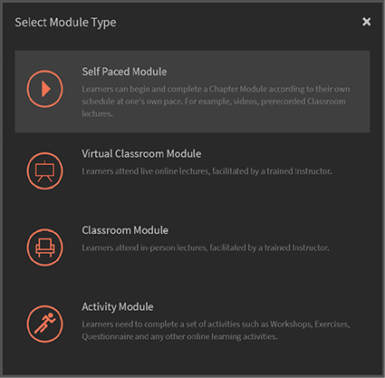

   *Add a module for a course*

   **Self Paced Module:** In this mode, you can start and complete a course module at your own pace. You can set your own schedule.

   After you click the option, you can see the list of self-paced modules that have been already added to your module library. Here you can either scroll through the list and select the ones you want to add, or you can search for the modules by typing the module's name in the search field or the module tags.

   After you have selected the modules, click **[!UICONTROL Add]**. These modules now appear under the Content section.

   You can also rearrange the modules. Drag any module and move it up or down and arrange the modules in a proper sequence.

   **Virtual Classroom Module:** In this mode, learners can attend live online lectures, facilitated by a trained instructor. Enter the title, description, and set the duration of the session. You can also specify the conference url and the instructors to conduct the session. To save the changes, click **[!UICONTROL Done]**.

   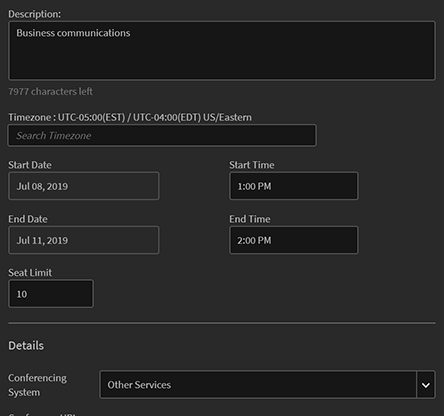

   *Add a VC module*

   When creating a course using the Virtual Classroom configuration dialog box, set the **Conferencing System** to the Teams connection that you created. Select whether you want a meeting organizer for the event.

   If you select **Yes** for a meeting organizer, you must enter the name of the organizer. Type the name and select the organizer.

   **Lobby bypassing**

   * If you select **Yes**, any learner can join the meeting.
   * If you select **No**, a request is sent to the organizer to allow or prevent the learner from joining the meeting.

   **Note:** A learner must be available on Microsoft Teams. However, the learner can join Learning Manager as a guest.

   You can also create Live Hub course if the Administrators have enabled Live Hub for an ALM account. For creating the VC session with Live Hub, view [Create a Live Hub session](../../getting-started-with-live-hub/create-a-live-hub-session.md)

   **Classroom Module:** In this mode, learners attend in-person lectures, facilitated by a trained instructor. Enter the title, description, and set the duration of the session. You can also specify the location of the class and the instructors to conduct the session. To save the changes, click **[!UICONTROL Done]**.

   >[!NOTE]
   >
   >Whether you can create a new location here depends on the Allow authors to create locations setting, configured by your Administrator. If it's disabled, you can only search for and select locations the Administrator has already added. View [Add Classroom Locations](../../../migrated/administrators/feature-summary/classroom.md) for more information.

   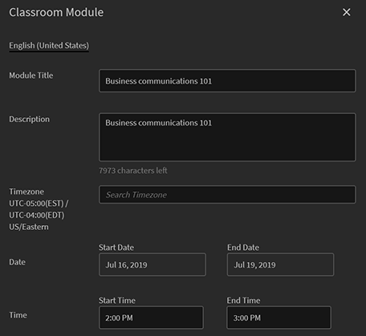

   *Add a classroom module*

   When creating a course, in the Virtual Classroom configuration dialog box, set the conferencing system to the Microsoft Teams connection that you created. Select whether you want a meeting organizer for the event.

   If you select Yes for a meeting organizer, you must enter the name of the organizer. Type the name of the organizer and select the organizer.

   **Lobby bypassing**

   * If you select Yes, any learner can join the meeting.
   * If you select No, a request is sent to the organizer to allow or prevent the learner from joining the meeting.

   **Note:** If a learner wants to join Microsoft Teams as guest, he/she must enter the email. The email must be present in Learning Manager.

   **Activity Module:** In this mode, learners must complete a set of activities, such as, workshops, exercises, questionnaire, and other learning activities. Enter the title, description, and the external url for reference. To save the changes, click **[!UICONTROL Done]**.

   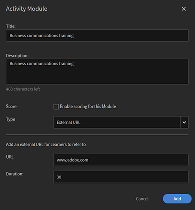

   *Add an activity module*

   You can specify the duration while adding an activity module in a course for activity type File Submission and xAPI-based modules. 

1. Similarly, add modules for Prework and Testout modes.
1. Choose the sequencing type for modules as Ordered or Unordered based on your preference.

   If you choose **Ordered**, the modules appear in the same sequence as you created them. If you choose **Unordered**, the modules are not sequenced. Learners can complete the modules in any order.

1. From the Mandatory Modules drop-down list, choose the number of modules that the learner must take to complete the course.
1. Add a cover image and the banner image for the course. The catalogs are created by the administrator. For more information, see [Catalogs](/help/migrated/administrators/feature-summary/catalogs.md).

   **Note:** The recommended dimensions are:

   * **Cover image:** 300 px x 300 px
   * **Banner image:** 1600 px x 140 px

1. On the top-right corner of the page, click **[!UICONTROL Save]**.

#### Add HTML link in the Activity Module

Authors can add HTML links in the activity module and set the completion criteria. To add an HTML link and set a completion criteria, follow these steps:

1. In the author app, select **[!UICONTROL Create Courses]** on the home page.
1. Select **[!UICONTROL Add]** from the **[!UICONTROL Course Catalog]** screen
1. Type the name and description of the course.
1. In the **[!UICONTROL Module]** option, select **[!UICONTROL Add Module]** > **[!UICONTROL Activity Module]**.
1. In the **[!UICONTROL Activity Module]** prompt, type the name and description.
1. Select the **[!UICONTROL Type]** as **[!UICONTROL External URL]**.
1. Select any of the following options from the **[!UICONTROL Completion Criteria]** option.
   * **[!UICONTROL Learner marks complete]**: The learner has the option to mark the course as complete in the Fluidic Player.
   * **[!UICONTROL On Launching content]**: The course will automatically be marked as complete, when the learner launches it.
 
   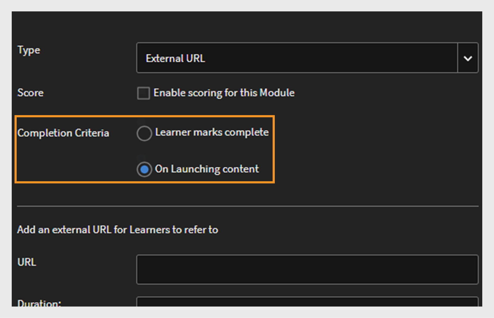
   _Completion criteria_

1. Select **[!UICONTROL Add]** and publish the course.

### Replace the modules in published courses

Adobe Learning Manager provides authors with tools to create, edit, and manage courses composed of multiple content modules. When course content needs to be updated or improved, authors can replace existing modules without disrupting learner progress. 

To replace the modules:

1. Log in to Adobe Learning Manager as an author.
2. Select **[!UICONTROL Courses]** on the left navigation pane. 
3. Select any course and then select **[!UICONTROL Edit]**.
4. Select the module you want to change.
5. Change the title and description.
6. Select the module using the **Content** option.
   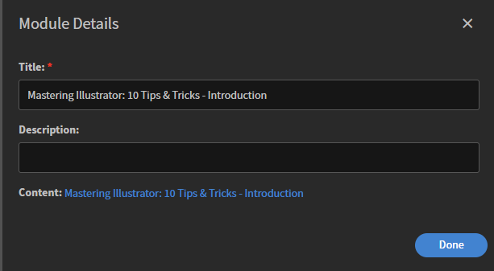
7. Select **[!UICONTROL Done]**.
8. Select **[!UICONTROL Republish]**. 

Learners will keep their progress in other modules but will need to complete the new module to finish the course.

## Checklist {#create-checklist}

Evaluation is an important aspect of any LMS. Online assessments are one of the top ways of evaluating a learner's understanding of a topic. But often, it's necessary to evaluate a person's understanding while she's/he's on the job by observing him/her carry out the necessary tasks.

Consider store employees or warehouse workers undergoing evaluation for the tasks they are supposed to carry out on a day to day basis. It could be the steps carried out to repair a coffee machine or the steps involved in packing a material. Instructors can evaluate employees for such tasks based on a checklist and evaluate them as Pass or Fail in the evaluation activity.

You can create a checklist in multiple languages.

### Create a checklist in multiple languages {#createachecklist}

Only an Author can create a checklist. A checklist is a type of Activity module. While setting up an Activity module, you, an Author, can select an Activity as **Checklist**, as shown below: 

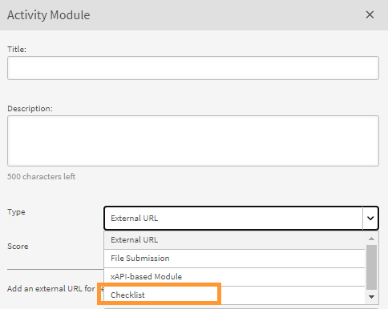

*Create a checklist*

1. Once you choose the option **Checklist**, you see a few additional options.

2. **Checklist Type:** Choose any option, **Yes/No** or **1-5**. If you choose Yes/No, the checklist will contain questions that can only be answered with Yes or No. If you choose 1-5, you can see a Likert checklist, where you can grade a question on a five-point scale.

3. Select **Configure**. The Checklist window appears.
4. Enter as many questions as you want. You can enter the same questions in the additional languages as well.

   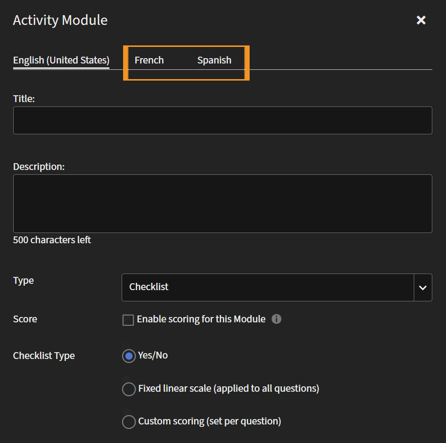
   *Additional languages are available*

   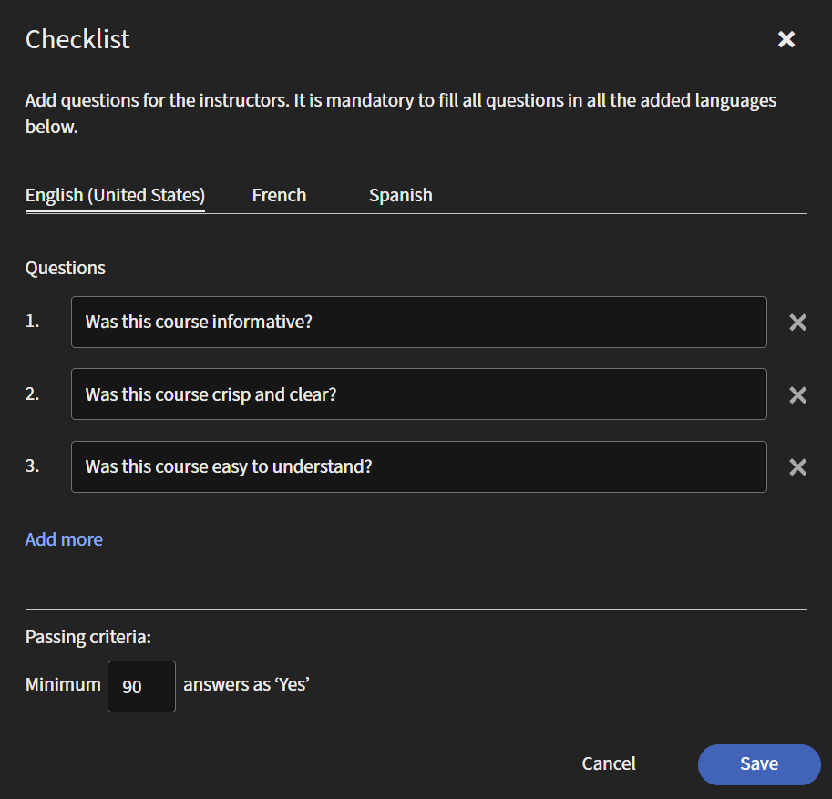
   *For example, questions are entered in French as well*

   >[!NOTE]
   >
   >ALM does not automatically translate the questions for you in those additional languages. You have to translate the questions in the respective languages.

5. Select **Save**. The questions are saved in all the languages.
6. Select all other relevant options and select **Add**. The checklist is created in all the languages that the course is available.


**Pass Criteria:**

<table>
 <tbody>
  <tr>
   <td>
    <p>If you had chosen <b>Yes/No</b>, then...</p></td>
   <td>
    <p>If you had chosen <b>1-5</b>, then...</p></td>
  </tr>
  <tr>
   <td>
    <p>Set the pass criteria as the number of responses as Yes. For example, if you enter 3, then the learner passes the course, if he/she receives at least three <b>Yes </b>responses, when evaluated by an Instructor.</p></td>
   <td>
    <p>Set the pass criteria as a threshold of any number between 1-5. For example, if you enter 2 and 4, then the learner passes the course, if he/she attains at least <b>two </b>evaluations that have score greater than or equal to <b>four</b>.</p></td>
  </tr>
 </tbody>
</table>

Choose an instructor or instructors who will evaluate the learner.

Also, if you have anything to comment or a note, you can add that in the **Note to instructor** text field.

Now, add the checklist questions. Click **[!UICONTROL Add]**. You can only add up to 150 questions.

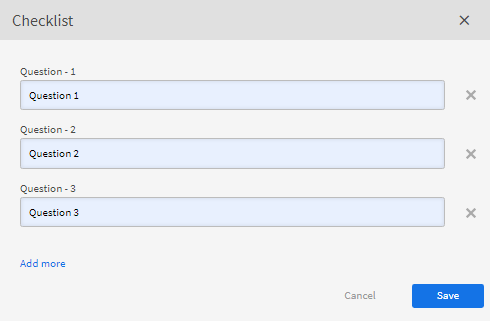

*Add checklist questions*

To add more questions, click **[!UICONTROL Add more]**.


Save the changes, add the module, and publish the course.

### Add skills {#addskills}

On this page, enter the following details:

1. Choose the course skills, level, and set the credits for the skill. Add more skills, if required.

   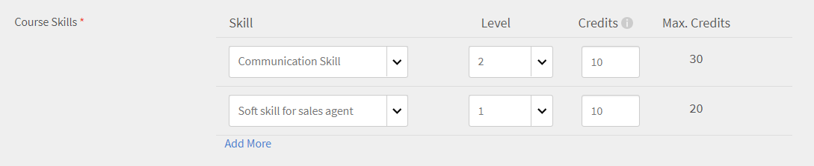

   *Add skills for a course*

1. Choose the type of enrollment. The following are the options:

   * **Manager nominated:** Only managers can nominate these courses. A learner cannot enroll to these types of courses.
   * **Manager approved:** Managers approve these courses. Learners can sign up for these courses, but they are not enrolled directly to these types of courses without Manager's approval. A notification request is sent to Managers when learners sign up for these types of courses. Upon Manager approval, these courses are listed as enrolled for learners.
   * **Self-enrolled:** Learners can directly enroll themselves to these types of courses.

1. If you want to provide the ability for learners to unenroll themselves from your course, enable the check-box **Learners can unenroll themselves**.
1. Select the pre-requisite courses that must be completed before taking up your course. Click the Courses field and choose from the list of courses.

   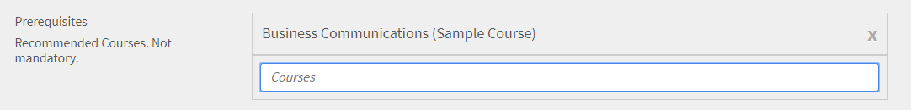

   *Add pre-requisite courses*

1. Enable the **Prerequisites** check-box if you want the pre-requisite courses to me made mandatory.
1. Add keywords as tags related to your course. These tags help the learners to locate your course easily during search. All these tags are automatically added based on the modules that we have added. If you have other tags that you want to add to this course, you can go ahead and enter it.
1. Add the profiles of your target audience for this course by clicking the text area and choosing the profiles from the suggestions.
1. Add resource files for your course as extra material. Drag your materials such as text, or video, or audio files.
1. Now this course will be available for these learners having these profiles as a recommended course. You can also attach additional resources for your learners in this section. Learners will be able to download these files for later reference. Once you are done with all these changes, go ahead and click **[!UICONTROL Save]** on the top-right corner. This will save your course as a draft. Your course is saved as draft, by default.

## Assign instructors for modules {#assigninstructorsformodules}

1. After you create modules for your course, you can assign instructors to the modules. From the Author dashboard, click **[!UICONTROL Course Catalog]**.
1. Click the course whose module you want to assign instructors to.
1. From the **Add Modules** section, click the module to which you want to assign an instructor.
1. In the **Instructor** field, specify the user name of the user to who you want to assign the instructor role.

   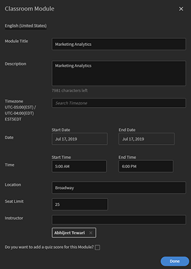

   *Assign an instructor role to a user*

1. To republish the course with the updates, click **[!UICONTROL Republish]**.

### Checklist with commenting


Checklist commenting allows authors to enable **contextual feedback** during checklist-based evaluations.  
When enabled, reviewers (instructors or managers) can add remarks explain evaluation outcomes beyond scores or pass/fail status.

This capability transforms checklists from a purely evaluative tool into a **feedback-driven learning mechanism**, improving learner understanding, transparency, and follow-up actions.

With this, authors can:

* Enable reviewer comments on checklists
* Control whether comments are visible to learners
* Control whether the reviewer's name is shown to learners
* Ensure reviewer comments are captured in learner transcripts and reports

#### Use cases

#### Performance evaluations

Provide clear feedback on observed strengths, gaps, and improvement areas during real-world or role-based assessments.

#### Instructor-led and VILT training

Allow instructors to explain why a learner passed or failed a checklist-based evaluation.

#### Compliance and audit scenarios

Maintain an auditable trail explaining checklist evaluation decisions.

#### Multi-reviewer environments

Help learners identify who evaluated them and follow up for clarification.

#### Enable checklist commenting

1. Open an existing course or create a new course.
2. Add a checklist module or open an existing checklist module for editing.
3. In the checklist configuration panel:
   1. Select **Reviewer remarks**. While reviewing the checklist, reviewers can add their remarks or feedback. Once published, this setting cannot be changed.
   2. (Optional) Select **Show reviewer name to learner**. This allows learners to view the name of the reviewer who has reviewed the checklist module.
4. Save the checklist configuration.
5. Publish the course to make the checklist available for evaluations.

The checklist now supports reviewer comments during learner evaluation.

#### What happens during evaluation

Although authors do not perform evaluations, it's useful to understand how the configuration is used:

* Reviewers see a **remarks field** while evaluating learners
* Reviewers can add contextual comments during submission
* If enabled:
  * Learners see reviewer comments
  * Learners see the reviewer's name

#### Learner experience (when enabled)

* When learners open a completed checklist:
* They see the checklist result (pass/fail or score)
* They see reviewer comments (if enabled)
* They see the reviewer's name (if enabled)

This helps learners clearly understand evaluation outcomes and next steps.

#### Key notes for authors

* Checklist commenting is **optional** and must be explicitly enabled
* Visibility of comments and reviewer identity is **fully author-controlled**
* Works with:
  * Single or multiple reviewers
  * Score-based, Yes/No, and scaled checklists
* No impact on existing checklists unless updated by the author

### Create a multi-language checklist

Multi-language support for checklists allows authors to create **a single checklist module with questions available in multiple languages**.  
When enabled, reviewers automatically see checklist questions in their **selected content language**, ensuring consistent and localized evaluations across global teams.

This eliminates the need to create and manage **separate checklists per language**, reducing duplication and simplifying course maintenance.

With multi-language checklist support, authors can:

* Add checklist questions in multiple languages within the same checklist
* Maintain language parity across checklist questions
* Ensure reviewers see checklist questions automatically localized to their content language
* Download checklist reports in the selected language

#### Use cases

#### Global workforce evaluations

Enable managers and instructors across regions to evaluate learners using localized checklist questions.

#### Standardized assessments across regions

Maintain a single evaluation structure while supporting multiple languages for different geographies.

#### Compliance and operational training

Ensure evaluators clearly understand checklist criteria in their native language, reducing interpretation errors.

#### Reduced content duplication

Avoid creating and maintaining multiple checklist modules for different languages.

#### How to create a multi-language checklist

1. Open an existing course or create a new course.
2. Add a checklist module.
3. In the course settings, add the required **content languages** (for example, English, French, German).
4. Save the course configuration.

#### How to configure checklist questions in multiple languages

1. Open the checklist module configuration.
2. Navigate to the **Configure questions** section.
3. Use the **language tabs** to switch between available languages.
4. For each language:
   * Add the translated version of each checklist question
   * Maintain equivalent meaning and evaluation intent across languages
5. Define checklist criteria (Yes/No, scale-based, or score-based) as required.

Each language version represents the same checklist, not a separate module.

Save the checklist configuration and publish the course. The checklist is now available in all configured languages.

#### Reviewer's experience

* Reviewers see checklist questions in **their selected content language**
* No manual language switching is required during evaluation
* If a reviewer changes their content language, the checklist questions adapt automatically

### Assign weights to checklist questions

Checklist question weightage allows authors to create **score‑based checklists** where individual checklist questions can carry **different maximum scores**.  

Instead of treating all checklist items equally, authors can define weighted questions and set a **minimum total score** required for a learner to pass.

This capability enables more accurate and flexible evaluations, especially for **performance‑based, assessment‑driven, and compliance‑oriented training**.

With checklist question weightage, authors can:

* Create a **score‑based checklist type**
* Assign different **maximum scores** to individual checklist questions
* Define a **minimum total score** required to pass the checklist
* Use an expanded scoring scale (configurable range up to 10)
* View achieved score vs maximum score in reports

#### Use cases

#### Instructor‑led assessments

Evaluate learners using detailed scoring criteria rather than simple Yes/No outcomes.

#### SOP and operational training

Assign higher weight to critical steps and lower weight to minor tasks.

#### Compliance and certification readiness

Ensure learners meet a defined minimum competency threshold before passing.

#### Skill and performance benchmarking

Support structured evaluations where partial completion still contributes to overall scoring.

#### How to create a weighted checklist

1. Open an existing course or create a new course.
2. Add a checklist module or open an existing checklist module for editing.
3. In the checklist configuration panel, choose **Custom scoring** checklist type.
4. This enables per‑question scoring and total score calculation.
5. Add checklist questions as required.
6. For each question:
   * Define the **maximum score** (for example, 5, 10, 20)
7. Ensure question scores reflect their relative importance.

Different questions can have different maximum scores within the same checklist.

#### Define passing criteria

1. Specify the **minimum total score** required to pass the checklist. The system calculates the total possible score automatically based on question weightage.
2. Save the checklist configuration and publish the course.

The checklist is now enabled with weighted scoring for instructor evaluations.

#### Reviewer's experience

* Reviewers see each checklist question with its **maximum score**
* Reviewers assign scores per question during evaluation
* The system calculates:
  * Total achieved score
  * Pass or fail status based on defined criteria

#### Learner's experience

* Learners see checklist completion status (pass/fail)
* If enabled, learners may also see:
  * Reviewer comments
  * Reviewer name
* Scoring logic is applied consistently across evaluations

#### Notes for authors

* Weighted checklists are best suited for **formal evaluations**
* Question scores should be calibrated carefully to avoid skewed outcomes
* Works with:
  * Single or multiple reviewers
  * Reviewer comments (if enabled)
* Existing checklists are unaffected unless explicitly updated


### Allow instructors to mark success

Adobe Learning Manager allows instructors to mark learners' success status in a classroom or virtual classroom module. Authors can grant instructors permission to mark the success status of learners when creating Classroom or Virtual Classroom modules. Instructors can mark the success by marking a learner as Pass or Fail, ensuring that progress is updated accordingly. 

To allow instructors to mark the success of the learner:

1. Log in to Adobe Learning Manager as an author.
2. Select **[!UICONTROL Create Courses]** on the homepage. 
3. Select **[!UICONTROL Add]**. 
4. Type the necessary details and select **[!UICONTROL Add Modules]**. 
5. Select **[!UICONTROL Virtual Classroom Module]** or **[!UICONTROL Classroom Module]**.
6. Type the necessary details and select the dates. 
7. Select **[!UICONTROL Allow Instructor to mark success]** option.

   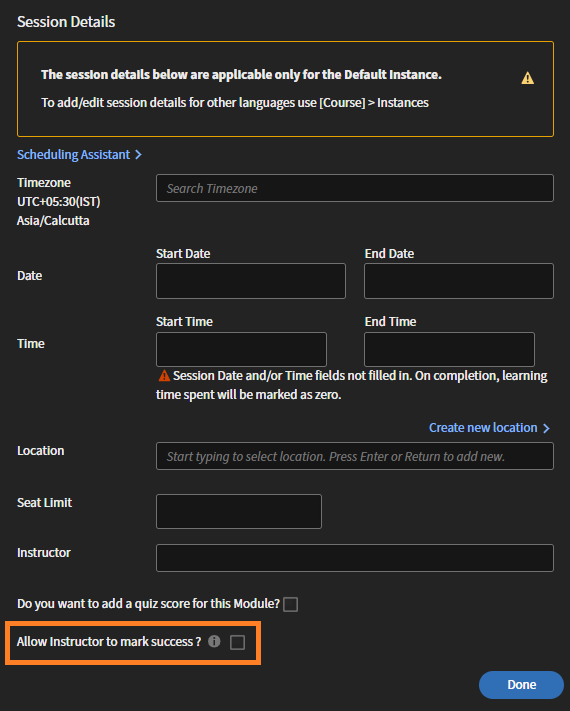
   _Session Details screen with the Allow Instructor to mark success option highlighted for Classroom or Virtual Classroom modules_

8. Select **[!UICONTROL Done]**. 


## Observation checklist

A Checklist module can now be reviewed by managers in addition to instructors. People managers, as well as non-hierarchical managers, such as store managers or location managers, can review and complete the checklist. 

Course authors can add people managers as well as non-hierarchical managers (if applicable) as reviewers by selecting these role options in the "Reviewers" section while setting up a Checklist module. This can be done at a course instance level.

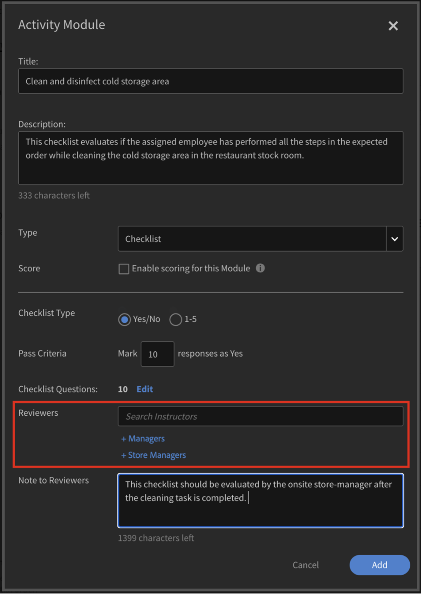

*Add reviewers in an activity module*

Selecting the "**[!UICONTROL +Managers]**" option will automatically enable a learner's manager in the organization hierarchy to review the checklist. You don't need to search and add manager names individually. 

If your account administrator has set up non-hierarchical manager roles (such as location managers or site managers) by using the Active Fields option, those manager roles will be available for you to select and enable them to review the checklist.

You don't need to search and add manager names individually. When learners enroll in the checklist course, it will automatically send a notification to their managers/store managers for review along with any selected Instructor. This workflow makes it simple for authors to not mention individual managers' names.

In the sample screenshot provided above, selecting the "**[!UICONTROL +Store Managers]**" option will automatically enable the non-hierarchial manager aligned to the learner to review the checklist. Note that "store" here will be replaced by the active field defined by the administrator.

Updates to the checklist module also include notifications to instructors and managers when a learner is enrolled in a course that has a checklist module in it. The reviewer gets a notification in the Learning Manager notification center as well as in the instructor/manager dashboard that checklist action is due.

<!--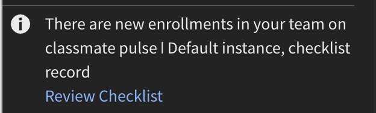-->

The reviewer will be able to view information about all pending checklist review items from the Checklists menu as well as the Notifications menu when they log in as an instructor/manager.

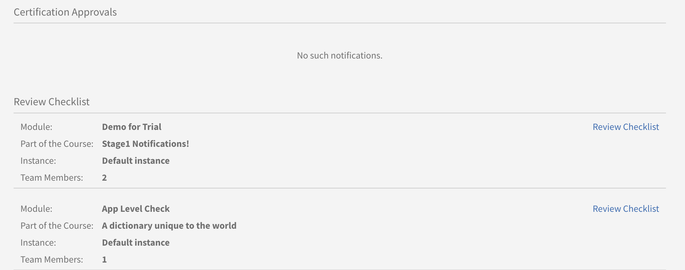

*Approvals for certification*

After clicking Review Checklist, the reviewer can complete the evaluation.

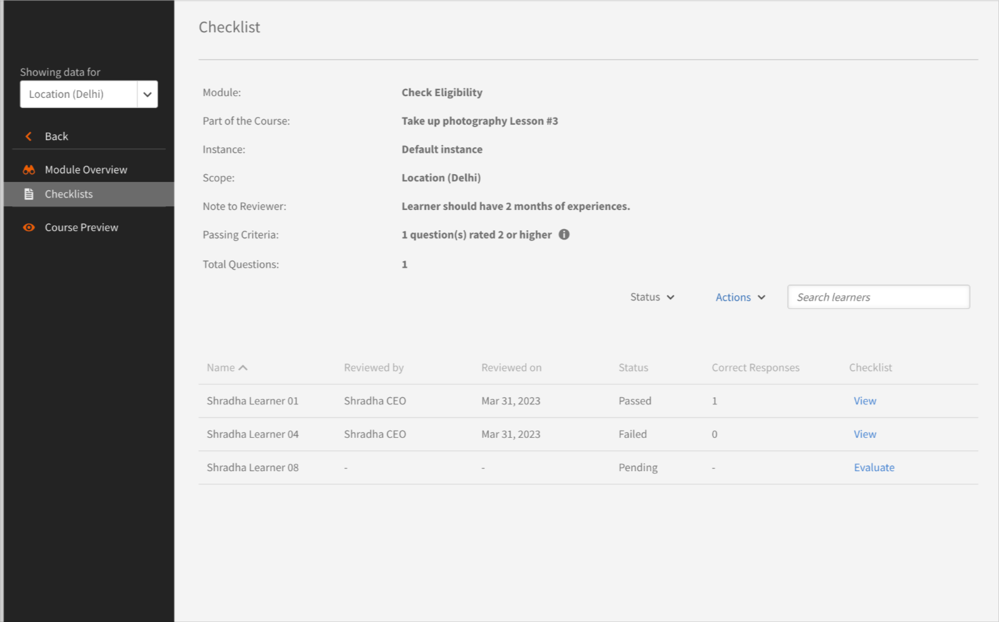

*Review pending checklist review items*

Reporting can be downloaded on checklists, which include detailed information on learner evaluation, reviewer name, role, and e-mail.

The Checklist Report csv has the new and updated fields:

* Reviewer Name instead of Instructor Name
* Reviewer Email instead of Instructor Email
* Reviewer Role- Possible values are Manager, Store/Location Manager, Instructor

## Preview a course {#previewacourse}

Once the course is created and saved as a draft, you can preview the course as a learner, and then publish it to make it available in the course catalog.

To preview the course, click **[!UICONTROL Preview as learner]**.

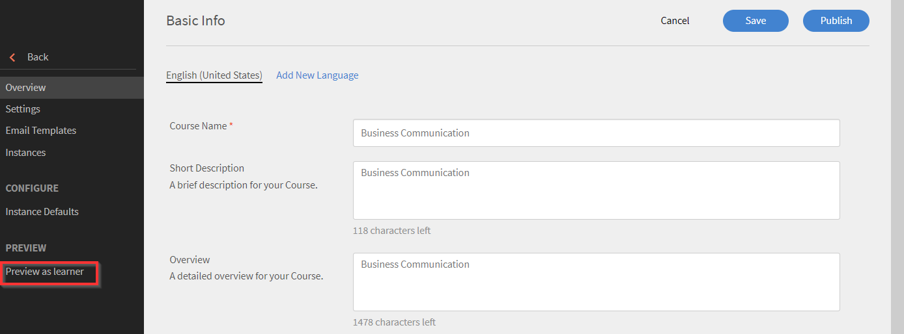

*Preview a course as learner*

This opens the course **Overview** page for you where you can see the modules, their order, and other details related to the course.

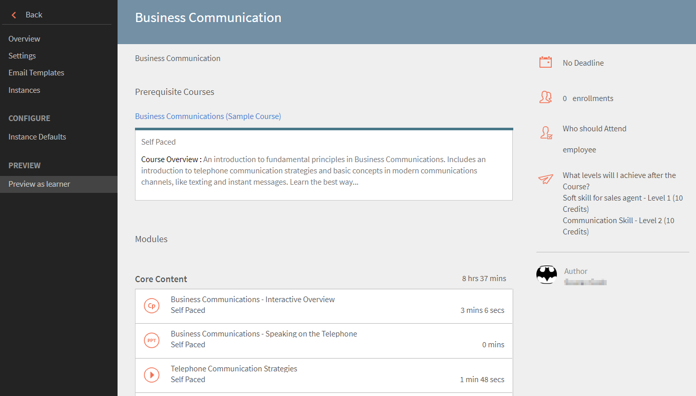

*View modules and other related details*

To see how the learners can experience this course, click each of these modules to start playing it. This starts playing the course in the Fluidic Player.

## Publish a course {#publishacourse}

After previewing the course as a learner, you can publish the course, so that it becomes available for learners to consume. Note that the course is still in a draft mode.

A typical course life cycle looks as follows:

* **Draft** - When an author completes creating a course and saving it. At this state, course is not available yet for learners.
* **Published** - When an author completes publishing a course. At this state, the course is available for learners to enroll. You can also edit a course at this state.
* **Retired** - After publishing a course, an author can move it to a retired state if the author doesn't want the course to appear in course catalog for learners.
* **Deleted** - A course under deleted state is when it is removed completely from the Adobe Learning Manager application. Only authors can delete courses when they are in Draft or Retired states. 

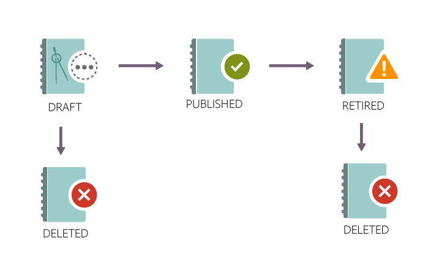

*Workflow of a course lifecycle*

To publish the course that you had created, click **[!UICONTROL Publish]** on the top-right corner of the page.

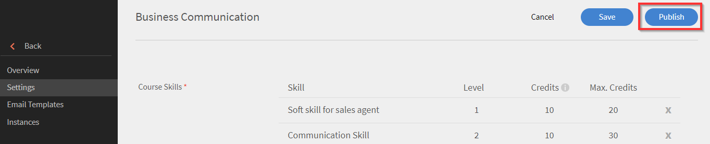

*Publish a course*

On the confirmation pop-up message that appears, click **[!UICONTROL OK]**.

The course is now available in the course catalog.

## View a course {#viewacourse}

You can view a list of all available courses as an author. To view all the courses in Learning Manager account, click Course Catalog. To view all your authored courses in Learning Manager, click **[!UICONTROL My Courses]**.

On the course card, hover on the options, and click **[!UICONTROL View Course]**.

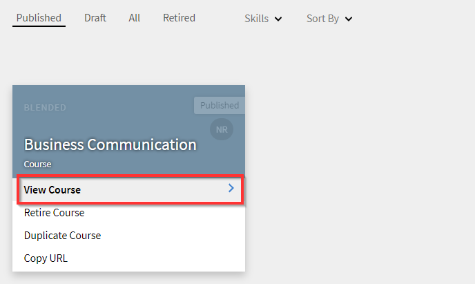

*View a course*

The course information window displays. The course is in a read-only mode. To modify the course, click **[!UICONTROL Edit]**.

## Retire a course {#retireacourse}

Administrators can enable the retire option for Adobe Learning Manager account. This feature lets admins retire a course, making it unavailable for new enrollments while letting currently enrolled learners retain access.

Retiring a course will hide it from learners, even if they are enrolled or have already completed it. If you retire a course, you cannot enroll new learners to the course. Learners who are already enrolled can take the course. 

To enable the Retire option for Adobe Learning Manager account:

1. Log in to Adobe Learning Manager as an administrator.
2. Select **[!UICONTROL Settings]** and then select **[!UICONTROL General]**.
3. Select the any of the retire option from the following:
   * Once retired, enrolled Learners will be able to view and perform actions but not yet enrolled Learners will lose access.
   * Once retired, both enrolled and not yet enrolled Learners will lose access.

Administrators can retire a course from the **[!UICONTROL Courses]** page. 

To retire a course, on the course card, hover on the options, and click Retire Course.

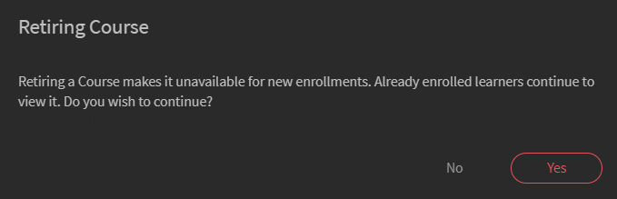

*Retire a course*

On the confirmation pop-up that appears, click **[!UICONTROL Yes]**.

## Duplicate a course {#duplicateacourse}

You can create a copy of the course and then modify the course. If you want to back up your course, you can duplicate the course.

## Search for courses {#searchforcourses}

Adobe Learning Manager makes it easier for you to find the courses of your choice quickly. You can search for your courses in the following ways:

**Search field:** Click the search bar on the upper-right corner of the **Course Catalog** page. Type the course name or any keywords associated with your courses. You can also search using tags that are added during course creation. Tags are searchable inside Search Courses field, which means the tags are displayed in search field as you type.


*Search for courses*

**Filter list of courses:** You can filter the courses by state such as All, Published, Draft, and Retired. Based on your choice, you can view the filtered list of courses and select the required courses.

As an author, you can also sort the courses to better locate your required course. Click **[!UICONTROL Sort by]** and choose alphabetical ascending order, alphabetical descending order, course created date, course updated date, and effectiveness of courses.


*Filter list of courses*

## Enroll learners in a course {#enrolllearnersinacourse}

To enroll learners to the courses, or to allow managers to nominate learners for the courses, you must switch to the Administrator mode, as only administrators have the rights to enroll learners for the courses.

To switch to the Admin mode,

1. Click your profile picture and then select Administrator.
1. In the Admin mode, click **[!UICONTROL Courses]** on the left pane. On this page, you can see all the courses created by all the authors in your Learning Manager account.
1. To enroll the learners, hover over the course card, and you can see the option **Enroll Learners**. Click this option.

   

   *Enroll learners to a course*

1. On the Enroll Learners dialog box, on the top-right corner you an see that the option **Default Instance** is selected. As soon as a course is created by an author, a default instance of the course is created. 

   

   *View default instance of a course*

1. Start typing the name of a learner in the Include Learners field and choose a learner. You can also add user groups here. If you want to enroll all the learners in your Learning Manager account, start typing all. You can also enroll learners in a team.

   

   *Add learhers to a course*

1. If you want to exclude any learner from the course., enter the name of the learner in the **Exclude Learners** field.
1. After you have enrolled the learners, click **[!UICONTROL Proceed]**. On the Enroll Learners dialog box, you can view the summary of the enrollment.

   

   *View course enrollment summary*

1. To enroll all learners in the course, click **[!UICONTROL Enroll]**. These learners are now successfully enrolled for this course. The learners get a notification to go ahead and take the course. To enroll more learners, repeat the enrollment procedure.

## Changes to the Course Instance page for Connect VC modules {#connect-vc}

While retrieving a Connect course, you can create two types of rooms:

* Dynamic
* Persistent

A persistent url is always fixed. But for users who do not have Connect and their own meeting room, then they must use a dynamic meeting room at runtime. People can then join their meeting.


*Dynamic meeting room options*

You can now change the url of the persistent room on the **Course Instance** page.

<!--
|  |  |
|---|---|
-->

## Unenroll learners from a course {#unenrolllearnersfromacourse}

While creating a course, an author can enable the option **Learners can unenroll themselves**, so that learners who are taking the course can unroll from the course.

An Administrator can also unenroll learners from the course.


*Unenroll learners from a course*

For more information see [Unenrolling learners](/help/migrated/administrators/feature-summary/courses.md).

## Add course modules for Captivate and Presenter {#addcoursemodulesforcaptivateandpresenter}

You can also publish the course modules to Learning Manager from Adobe Captivate and Adobe Presenter software using the Publish menu.

1. In Captivate, click **[!UICONTROL Publish]** > **[!UICONTROL Publish to Learning Manager]**.
1. Provide the sub-domain name or email id and click **[!UICONTROL Submit]**. If you have multiple accounts, you are prompted to choose the account.
1. Log in with Adobe credentials. If you do not have an Adobe id, click **[!UICONTROL Create Account]**. After authorization, you are directed to module publishing page.
1. Provide all the basic information about the module and click Publish.

You can see the published module on the Learning Manager modules page. For more information, see [Publish project to Adobe Learning Manager](https://helpx.adobe.com/captivate/classic/publish-project-to-captivate-prime.html).

## Course effectiveness {#courseeffectiveness}

Course effectiveness score helps the authors to evaluate the courses which are not working as per learners needs and modify them accordingly. Course effectiveness is evaluated to understand the usefulness of a course to the learner. It is a combination of results from learner feedback on the course content. The course quiz results for a learner and the manager's feedback evaluating a learner based on learning from the course.

In **My Courses**, an author can view the course effectiveness rating on the course thumbnails as shown in the below snapshot. You can see the rating for this course as 100.

<!---->

The course effectiveness rating value is arrived considering L1, L2 & L3 feedback values. To view the breakup of each feedback, click the course effectiveness value. A pop-up menu appears as shown below.


*Calculation of course effectiveness*

In this sample snapshot, 1 out 1 user received all the three types of feedback, hence the score is 100/100. From this table, you can understand the missing feedback to improve overall effectiveness. To view how course effectiveness is calculated, click the down-arrow at the lower-right corner of the pop-up menu.

<!---->

As per the pie-chart shown above, more weightage is given to L3 feedback from manager.

## Certifications and Learning Programs {#certificationsandlearningprograms}

Both Author and Admin can create certifications and learning programs for learners from the Author app. From the home page, click either Certifications, or Learning Programs to create the respective learning objects.

To know how to create and manage certifications and learning programs, see  [Certifications](/help/migrated/administrators/feature-summary/certifications.md) and  [Learning Programs](/help/migrated/administrators/feature-summary/learning-programs.md).

## Mandatory courses for external certification {#mandatorycoursesforexternalcertification}

In earlier releases of Learning Manager, course completion from learner in External certification was not mandatory to complete a Certificate.

You can now make courses mandatory by enabling the option **Set required courses as Mandatory for Certificate Completion** in the Curriculum tab.


*Set mandatory courses to complete a certificate*

When courses are set as mandatory:

* The submission page of the Manager lists the learners only after the learners complete the courses.
* The learner can only upload a file after completing the course.

## Frequently Asked Questions {#frequentlyaskedquestions}

+++How to remove "seek manager nomination" for a course?

Perform the following steps:

1. Log into Learning Manager as an Author.
1. Open the course.
1. On the left pane, click **[!UICONTROL Settings]** > **[!UICONTROL Edit]**.
1. On the **Enrollment Type** drop-down list, change the enrollment type from **Manager Nominated** to **Manager Approved** or **Self Enrolled**.

1. Once you have changed the type of enrollment, republish the course.

+++

+++How to combine courses?

You can combine courses via a Learning Program.

1. Log in to Learning Manager as an Administrator.
1. On the left pane, click **[!UICONTROL Learning Programs]**.
1. To add a Learning Program, click **[!UICONTROL Add]**.
1. Enter the details of the Learning Program and to save the Learning Program, click **[!UICONTROL Save]**.
1. After creating the Learning Program, click **[!UICONTROL Catalog]**.
1. On a course card, click **[!UICONTROL Add]**, as shown below. Repeat the process for as many courses that you want to add to the Learning Program.


Once you have added all the courses required in the Learning Program, click **[!UICONTROL Publish]**.

In a Learning program, you can only add self-enrolled courses and not Manager Nominated or Manager Approved courses. This is a default behavior in Learning Manager.

+++

+++How to make sure that all learners cannot see all courses?

You can achieve this via catalogs.. A default catalog contains all courses added to Learning Manager by default.

You must disable the default catalog and create custom catalogs.

1. Log in to Learning Manager as an Administrator.
1. On the left pane, click **[!UICONTROL Catalogs]**.
1. Create a Catalog by clicking **[!UICONTROL Create]**. Enter the details and click **[!UICONTROL Save]**.

1. On the newly created Catalog options, you can select different types of learning that you can add, for example, Learning Program, certification, or course.
1. In the Learning Program section, click **[!UICONTROL Add Content]**.
1. On the left pane, click **[!UICONTROL Share Internally]** or **[!UICONTROL Share Externally]** depending on the audience that you want to target.

1. To add a user group, click **[!UICONTROL Add User Groups]**.
1. On the Catalogs page, disable the **D[!UICONTROL efault Catalog]**, and enable the catalog that you have created.


+++

+++How to re-enroll in a completed course?

A course completion cannot be reverted. A learner **cannot be re-enrolled** to a completed course.

+++

+++How can learners view course even after they have completed it?

A learner can view a course after completion by clicking the Revisit button in the course.

Perform the steps below:

1. Login as a learner.
1. Open the course that you have completed.
1. Click **[!UICONTROL Revisit]**.

+++

+++How to add resource file in the course?

While creating a course, you can add video, audio, pdf, or text files to the course that are relevant to the course so that the learner can access additional training material.


+++

+++How to set multiple attempts on module?

**Pre-requisite:** The Administrator must enable the option **Multiple Attempts** in **Settings > General** in the Admin app.

As an Author, on the Course overview page, enable the option **Allow multiple attempts**.

For more information, see the [section on multiple attempts](courses.md#Allowmultipleattempts).

+++

+++Can you download the content that has been uploaded on Adobe Learning Manager to modify the content?

No, the content uploaded on Learning Manager is a published zip file and is not the source file. Therefore, even if the content is downloaded, the content cannot be edited in an authoring tool. You would require a source file to edit the content.

+++
