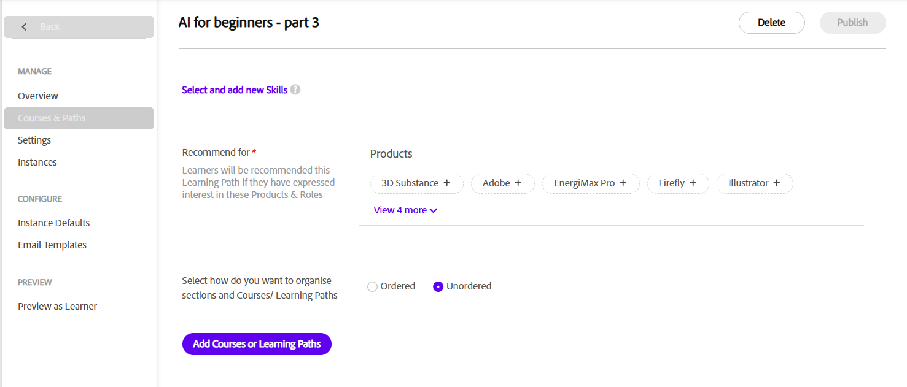
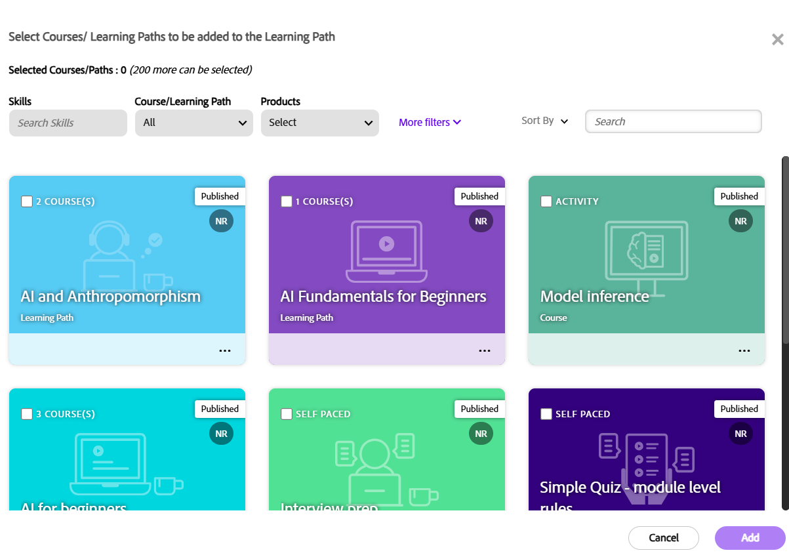

# Create a learning path

An Author can create a learning path for learners to consume. To create a learning path in the Author app:

1. Log in as an **Author**.
2. Select **Learning** > **Learning Paths**.
3. Select **Add**.

   

4. **Learning Path Name**: Enter a name for the learning path.
5. **Learning Path Overview**: Enter a brief overview of the learning path.
6. **Benefits of this Learning Path**: Describe a few benefits of the learning path.
7. **Tags**: Select the appropriate tags from the predefined list.
8. **Unique Learning Object Id**: Enter a unique ID for the learning object.
9. **Enrollment Type**: Select the enrollment type from the dropdown menu.
10. **Pricing Plan**: Select either **Paid** or **Free**. If you select **Free**, the **Learning Path Price** box is deactivated.
11. **Unenrollment**: Select this option to let learners unenroll themselves.
12. **Cover Image**: Select a cover image for the learning path.
13. **Banner Image**: Select a banner image for the learning path.
14. **Select Catalogs**: Select the relevant catalogs from the list.
15. **Compliance Label**: Select the appropriate compliance label from the list.
16. **Labels**: Select the appropriate label from the list.
17. **Credly Badge ID**: Select the appropriate label from the list.
18. **Difficulty Level**: Select the appropriate difficulty level from the list.
19. **Compliance**: Select the appropriate compliance level from the list.

   >[!NOTE]
   >
   >At any point before you save, you can add a new language by selecting the **Add New Language** tab, selecting a language from the list, and then selecting **Save**. English is the default language.

   

20. Select **Save**. A new page with the name of the learning path appears. You can now add skills and products, organize sections, and add courses or learning paths.

   

21. Select **Skill Learners will earn**. In the section that opens, select the skills you want learners to acquire and their levels.

   

22. Select **Add**.
23. Select how you want to organize sections and courses or learning paths. Select either **Ordered** or **Unordered**.
24. Next, select **Add Courses or Learning Paths**. A window with existing courses and learning paths appears. Each tile shows the name, type (course or learning path), publication status and course format. If it is a course, it displays the type such as self-paced, virtual, classroom, or blended. If it is a learning path, the number of courses is displayed.

   

25. Select the courses or learning paths you want to add to the learning path.

   

26. Select **Add**. The courses and learning paths appear on the learning path page.

   

27. Select **Skill Learners will earn**. Select the skills and levels. Select **Add**.
28. Map the learning path to products by selecting products from the list and then selecting their levels.

   >[!NOTE]
   >
   >If you don't select at least one product, you won't be able to publish the learning path.

   

29. Select how you want to organize sections and courses or learning paths. Select either **Ordered** or **Unordered**.
30. Select **Add section title**, and then enter a section title.

   

31. Select **Submit**.
32. Select **Required** to make the learning path mandatory. If you don't select it, the learning path becomes optional.
33. If you want to add another section with a different learning path, repeat steps 24 to 30.
34. **Completion Requirements**: Select **All** or a number from the list to complete the training.
35. Move the courses up or down to change their order.
36. To remove a course from the learning path, select **X** on the course card.
37. Select **Publish**. To view the newly published learning path, go back to the **Learning Paths** page.
