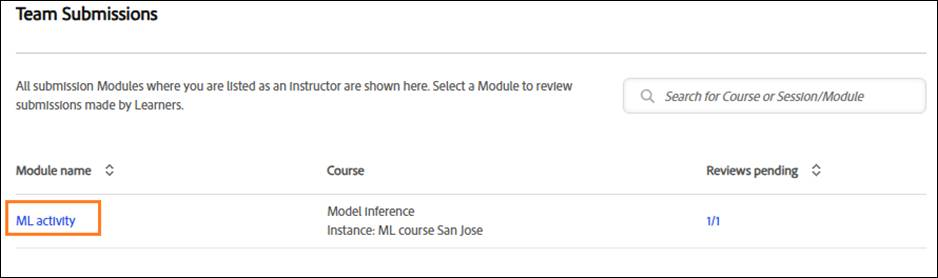
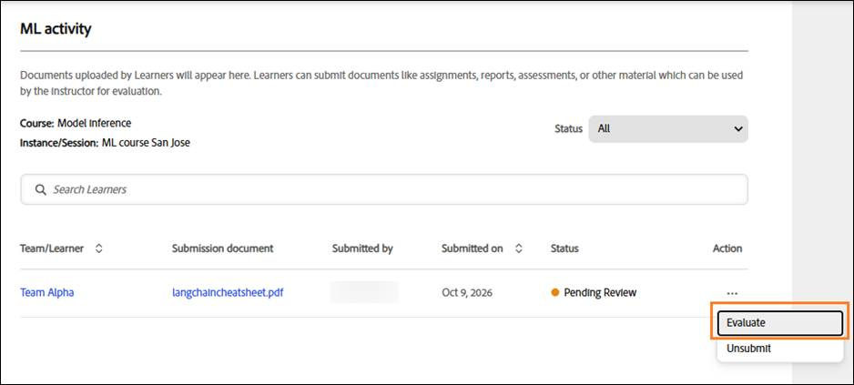
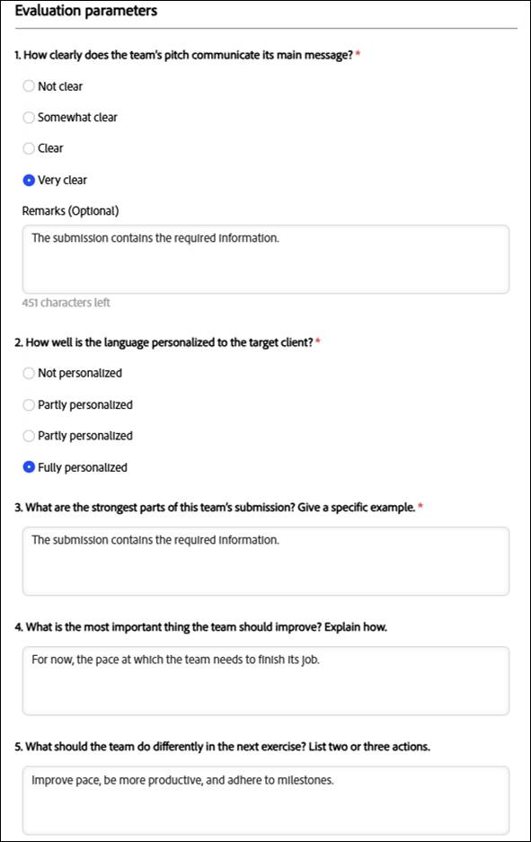
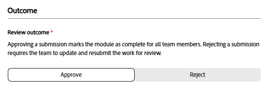
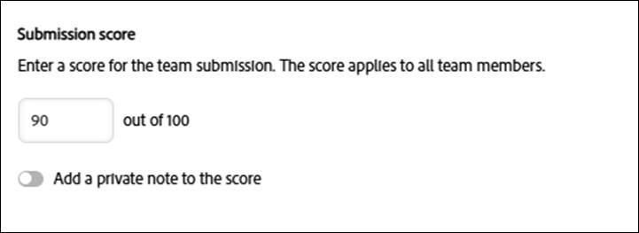
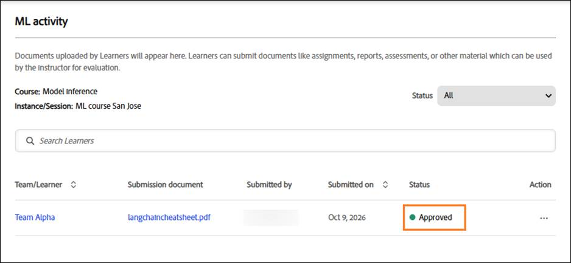
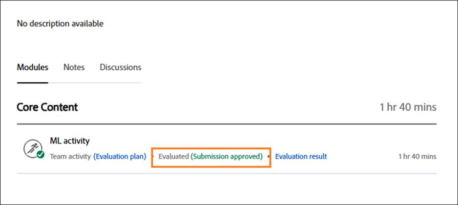
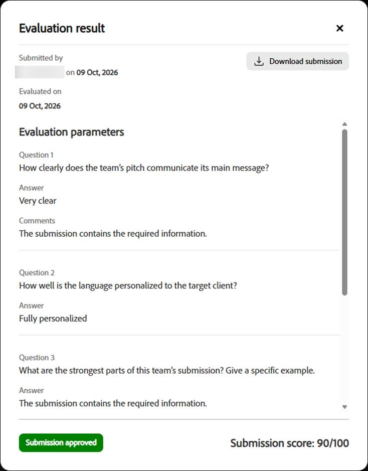
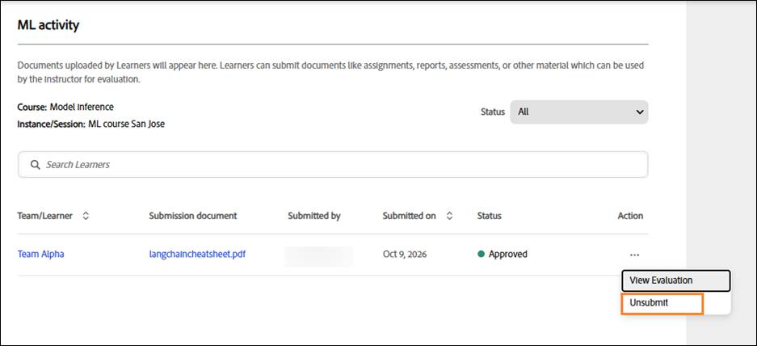
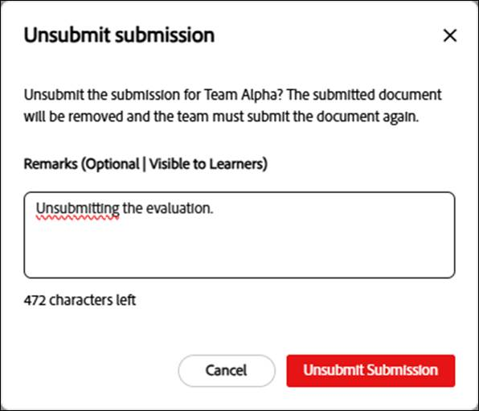

# Evaluate and unsubmit a team submission

Review a team's submitted file, complete the evaluation plan, approve or reject the work, or unsubmit it so the team can submit again.

When you evaluate a team submission, the outcome applies to every member of the team, and each member receives a notification. Only instructors assigned to the instance can evaluate. The steps are the same for individual submissions, except that individual submissions don't have team details. Make sure teams exist first. View [Create and manage teams](/help/migrated/instructors/feature-summary/learners.md#create-manage-teams).

Teams that were formed automatically can be edited the same way as manual teams.

## Find a submission

1. In the Instructor app, open the submissions area, and then select **Team submissions**. Select **Individual submissions** for single-learner modules.
2. To find a module, search by session or module name.
3. Select the module name.

   

4. To narrow the list, filter by status: **Pending submission**, **Pending review**, **Approved**, **Rejected**, or **Complete**.
5. To view the team members, expand the team. Names and email addresses are shown, and the learner who submitted the file has a **Submitter** tag.
6. To download the submitted file, select the download option for the team.

## Evaluate a submission

1. Find the team with the **Pending review** status.
2. Open the submitted file and review the content.
3. Select **Action** > **Evaluate**.

   

4. Complete the evaluation plan:

   * Answer every required question.
   * For objective questions, select an option. With criteria-based scoring, the score updates as you select.
   * For subjective questions, enter your response.
   * Where remarks are allowed, add remarks to the question or to the whole assessment.

   

5. If the module requires reviewer approval, select **Approve** or **Reject**. Add a comment when you reject, so the team knows what to fix.

   

6. If the module uses manual scoring, enter the overall score.

   

7. Submit the evaluation. Select **Submit**. The submission status changes to **Approved**.

   

Other instructors can also evaluate the same submission. A later evaluation replaces an earlier one until the submission is approved.

If the module doesn't require reviewer approval, the module completes for all team members when the team submits. You can evaluate once. Only the submit option appears, and you can't edit the score or remarks afterward.

After you approve or reject a team's submission, a learner can view the submission status and the evaluation result.

Selecting the evaluation result displays the evaluation parameters and comments from the instructor.

## Review or change an evaluation

1. Find a team with the **Rejected** status.
2. To open the completed evaluation, select **View evaluation**.
3. To evaluate again, select the re-evaluate option and submit your changes. You can do this only for rejected submissions. **Approved submissions can't be changed**.

## Unsubmit a submission

Unsubmit a submission when the team needs to submit again, when the evaluation needs to start over, or when you need to change a locked team. For an individual submission, you can also use this to correct an evaluation entered for the wrong learner.

1. Find a team or learner that has a submission.
2. Select **Unsubmit**.

   

3. Enter your remarks, and then select **Unsubmit submission**.

   

The submission is removed, and the status returns to **Pending submission**. The team unlocks, so you can edit its members. Team members receive a notification and an email. Any member can then submit again, and the new file replaces the earlier one. Your new evaluation replaces the earlier evaluation, and no history is kept.

You can't unsubmit after the course is complete for a team member, because completion can't be reversed.
