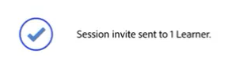

# Resend session invites

## Overview

>[!NOTE]
>
>Retriggering is available for virtual classroom (VC) sessions only. Other module types, such as classroom and self-paced (e-learning) modules aren't supported.

Learners can miss an invite for several reasons. With the Resend option, as an administrator who has permission to edit courses, you can open a VC session on the instance page, search for the learners, and send the session invite email. Learning Manager sends the email on demand, outside the enrollment event flow. The learner receives the session details and a calendar invite, and the enrollment state stays the same.

## Use cases

The following are the use cases where you would resend a session invite.

* **Recover a missed invite.** Resend the invite to a learner whose mailbox was full, whose email went to spam, or whose original email wasn't delivered.

* **Cover late enrollments.** Send the invite to learners who were enrolled after the initial invite batch went out.

* **Reduce no-shows.** Resend the session details and calendar invite right before the session, or on the day of the session.

* **Avoid enrollment workarounds.** Resend an invite without unenrolling and re-enrolling the learner, so the enrollment state and session registration stay intact.

* **Reduce support tickets.** Administrators resolve "missing invite" requests themselves, without involving the support team.

## Prerequisites

* The session is a VC session.

* The learner is enrolled in the target session. Learning Manager sends the invite only to learners who are enrolled in the session.

* The session already exists. This feature doesn't create or modify sessions.

* The existing Session Invite email template is used. This feature doesn't introduce a new email template.

## Supported configurations

| Item           | Support                                                                                               |
|--------------------|-----------------------------------------------------------------------------------------------------------|
| Roles              | Administrators with permission to edit the course. Instructors for the sessions that they're assigned to. |
| Catalog item types | Courses and learning paths                                                                                |
| Module type        | Virtual classroom (VC) sessions                                                                           |
| Sessions           | Current and future sessions. Past sessions aren't supported.                                              |
| VC providers       | All providers configured for the session, such as Zoom, Teams, and Adobe Connect                          |
| Email templates    | The templates configured for the learning object: a session details email and a calendar invite           |
| Recipients         | Individual learners that are enrolled in the session. User groups aren't supported.                       |
| Trigger            | Manual, from the Resend session invite action                                                             |

The Manager role doesn't have access to this feature in this release. The option is hidden from learners and managers.

## Access the Resend session invite action

The location of the action depends on your role.

| Role      | Where to find the action                                                                                                                                                                                    |
|---------------|-----------------------------------------------------------------------------------------------------------------------------------------------------------------------------------------------------------------|
| Administrator | Open the course or learning path in the catalog, go to Instances, and open the instance. In the Sessions section, find the VC session and select Resend session invite. You need permission to edit the course. |

## Resend dialog

The Resend Session Invites dialog contains the following elements.

| Element     | Description                                                                                                                                                                                                                                                                                                           |
|-----------------|---------------------------------------------------------------------------------------------------------------------------------------------------------------------------------------------------------------------------------------------------------------------------------------------------------------------------|
| Select Learners | A search field. Enter a learner's name or email address to find the learner, and then select the learner. You can select more than one learner. A note explains that each selected learner receives two emails: a session details email and a calendar invite, based on the templates configured for the learning object. |
| Cancel          | Closes the dialog without sending any emails.                                                                                                                                                                                                                                                                             |
| Resend          | Sends the emails to the selected learners. The button is disabled until you select at least one learner.                                                                                                                                                                                                                  |

>[!NOTE]
>
>The search matches individual learners only. You can't search for or select user groups.

## Resend a session invite

Complete the following steps as an administrator.

1. Log in as an administrator who has permission to edit the course.

1. Navigate to **Learning** > **Courses**.

   

1. Open the course whose instances you want to access.

   

1. Navigate to the instance whose session you want to access.

1. In the **Session Details** section below, select **Resend Session Invite**.

   

1. The **Resend Session Invite** pop-up opens.

   

1. Search for the learner or learners to whom you would like to resend the invite.

   

   

1. Select **Resend**. You'll see a message which says, "Session invite sent to "x" learners."

   

1. In case one of the learners selected is from another session, you will see a message which says, "X selected learner is not enrolled in this session and was skipped."

   

1. After a few minutes, the learner(s) will receive a mail with the session details including a link to join the session.

   

Learning Manager validates that each selected learner is enrolled in the target session, and then sends the existing session invite to the eligible learners.

When Learning Manager accepts the request, the dialog closes and a confirmation message appears: "Invite emails are being sent to learner(s) for the session. This may take some time to complete." The emails usually arrive within a few minutes.

## Email content

Each selected learner receives the session details email and the calendar invite for the session. The content includes the VC session join link, the date and time, and the session details. The email is the same as the original session invite, because Learning Manager uses the same template.

Learning Manager sends the email on demand through the email dispatch service. It doesn't use the bulk enrollment event pipeline that sends the original invites.

## Multi-enrollment behavior

Resending is specific to an instance. If a learner is enrolled in more than one instance, resending from one instance sends the invite only for that instance. It doesn't retrigger the invites for the learner's other instances.

| Learner enrollment                         | Action                                     | Result                                                                       |
|------------------------------------------------|------------------------------------------------|----------------------------------------------------------------------------------|
| Instance A and Instance B                      | Resend from Instance A                         | Only the Instance A invite is resent.                                            |
| Instance A only                                | Resend from Instance A                         | The Instance A invite is resent.                                                 |
| A different instance than the selected session | The learner appears in the course-level search | Learning Manager skips the learner for the selected session and shows a warning. |

## Behavior in specific scenarios

| Scenario                                           | Behavior                                                                                                                                                                                                                 |
|--------------------------------------------------------|------------------------------------------------------------------------------------------------------------------------------------------------------------------------------------------------------------------------------|
| The instance has no VC sessions                        | The Resend session invite action isn't available.                                                                                                                                                                            |
| The session has already occurred                       | The action isn't available. Learning Manager supports current and future sessions only.                                                                                                                                      |
| You select a learner who isn't enrolled in the session | The learner search covers the whole course, so you can find learners from other instances. Learning Manager skips learners who aren't enrolled in the selected session, sends the invite to the others, and shows a warning. |
| A learner is enrolled in multiple instances            | Learning Manager sends the invite only for the instance that you send it from. It doesn't send invites for the other instances.                                                                                              |
| A learning path instance is selected                   | The action works the same way as for a course instance.                                                                                                                                                                      |

## Error handling

If an error prevents Learning Manager from sending the emails, the dialog shows one of the following messages.

| Condition                         | Message                                                            |
|---------------------------------------|------------------------------------------------------------------------|
| The invite email template is disabled | Unable to send email: the invite email template is currently disabled. |
| Any other error                       | An error occurred while sending the email. Please try again later.     |

If you select learners who aren't enrolled in the session, Learning Manager shows a warning that the invite was skipped for those learners. It still sends the invite to the learners who are enrolled.

>[!NOTE]
>
>The email service reports delivery status to Learning Manager asynchronously, after the dialog has closed.

## Limitations

* You can resend invites for current and future sessions only.
* Only the templates that are configured for the learning object are used. You can't select a different template.
* You can resend invites for one session at a time. Resending across multiple instances at once isn't supported.
* You can't select user groups. You can select individual learners only.
* Learning Manager sends invites only to learners who are enrolled in the selected session.
* The dialog doesn't show the delivery status of the emails, and it doesn't offer a retry for individual learners.
* You can't schedule new sessions or edit existing session details from the dialog.

## Troubleshooting

| Symptom                                                         | Likely cause                                                                                                  | Action                                                                                                          |
|---------------------------------------------------------------------|-------------------------------------------------------------------------------------------------------------------|---------------------------------------------------------------------------------------------------------------------|
| The Resend session invite action isn't visible                      | The module isn't a VC session, the session has already occurred, or you don't have permission to edit the course. | Confirm that the session is a current or future VC session. Ask an administrator to verify your course permissions. |
| A warning appears after you send the emails                         | One or more selected learners aren't enrolled in the selected session.                                            | Check which learners are enrolled in the session, and resend the invite from the correct session or instance.       |
| The invite is sent for the wrong instance                           | The learner is enrolled in multiple instances, and you resent the invite from a different instance.               | Open the instance that the learner needs, and resend the invite from there.                                         |
| The error "the invite email template is currently disabled" appears | The invite email template is disabled for the learning object.                                                    | Ask an administrator to enable the template, and then resend the invite.                                            |
| The resent email looks the same as the original invite              | This is expected. Learning Manager reuses the existing Session Invite template.                                   | No action is required.                                                                                              |
| You need to resend invites across several instances at once         | This isn't supported.                                                                                             | Resend the invites from each instance separately.                                                                   |
| You need to resend an invite for a classroom or e-learning module   | This isn't supported. Retriggering is available for VC sessions only.                                             | No action is available for these module types.                                                                      |
| A learner says that the email didn't arrive                         | The email is still being processed, the learner's mailbox is full, or the email was filtered as spam.             | Wait a few minutes, ask the learner to check the spam folder and free up mailbox space, and then resend the invite. |
