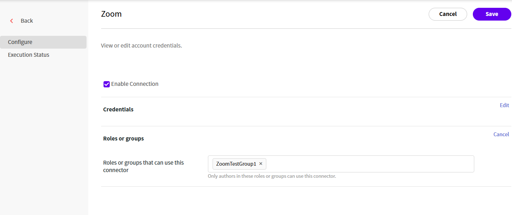

# Zoom connector in Adobe Learning Manager

## Introduction

The Zoom Connector in Adobe Learning Manager allows seamless integration with Zoom to deliver live virtual classroom sessions. With this integration, instructors can host Zoom meetings directly from Learning Manager, enroll learners, and track attendance and completion data. Learners receive automatic invites and can join sessions through their Adobe Learning Manager accounts. After the session, attendance and performance data are synced back to Adobe Learning Manager for reporting and tracking.

## Set up the Zoom connector

To configure the Zoom Connector:

1. Log in to Adobe Learning Manager as an integration administrator.
2. Hover over the **Zoom** tile.

    
    _Configure Zoom Connector in Adobe Learning Manager_

3. Select **Connect**. The Zoom connector setup page opens.
4. Type the following account details in the respective fields. You can get these credentials from your Zoom account administrator:

    * Connection Name
    * Zoom Account ID
    * Client Id
    * Client Secret
    * Super Admin Email address
    * Roles or groups that can use this connector (Optional)

    
    _Type the configuration details to set up the Zoom connector_
    
5. Select **Connect** to establish the integration.

>[!NOTE]
>
>When enabling the connector, **learners must use the same email address** for both their Zoom and Adobe Learning Manager accounts to ensure user data syncs correctly.

## Add multiple Zoom connections

You can add multiple Zoom connections to Adobe Learning Manager, with each connection linked to a different Zoom account. For example, you can create separate connections for different partners or teams and specify which roles or user groups can use each connection.

The number of connections you can add depends on your Adobe Learning Manager account tier:

|**Account tier**|**Maximum Zoom connections**|
|---|---|
|Prime|6|
|Ultimate|50|

## Create Zoom courses

Once the connection is established:

1. Log in as an **Author** and create a new Virtual Classroom course.
2. Select **Zoom** as the conferencing system, and then select the Zoom connection that you want to use from the list.
    >[!NOTE]
    >
    >The list shows only the connections that are available to your role or user group, and a session uses one connection at a time.
3. Assign learners to the course via administrators, managers, or through self-enrollment.
4. Upon enrollment, learners receive an email with course details.
5. Learners can log in to their Adobe Learning Manager account to access the course and join the Zoom session.

## Zoom connections available to Authors

When you create or edit a course session, you can select from the Zoom connections available to your role or user group. Integration Admin define which roles or user groups can access each Zoom connection.

For example, suppose an Integration Admin configures two Zoom connections, **Partner A Zoom** and **Partner B Zoom**, and assigns each connection to a different user group:

* If you belong to both the Partner A and Partner B groups, you can select either connection.
* If you belong only to the Partner A group, you can select **Partner A Zoom**.
* If you don’t belong to either group, these connections aren’t available for selection.

>[!NOTE]
>
>You can use only one Zoom connection for a session. If multiple connections are available to you, select the connection that you want to use for the session.

## Manage Zoom connections

The **Manage Connections** page displays the Zoom connections configured for your account. The **Visible to** column indicates the roles or user groups that can use each connection. From this page, you can edit, enable or disable, and delete existing Zoom connections.

### Edit a Zoom connection

To edit an existing Zoom connection:

1. Select the connection on the **Manage Connections** page that you want to edit.
1. On the Configure tab, update any of the following:

   1. To update the Zoom account credentials, select **Edit** next to **Credentials**, and update the required details.
   1. To change who can use the connection, update **Roles or groups** that can use this connector.

1. Select **Save**.

### Enable or disable a Zoom connection

New Zoom connections are enabled by default. You can disable a connection to prevent authors from using it without deleting the connection.

To disable a connection:

1. On the **Manage Connections** page, select the connection that you want to disable.
1. Toggle on the **Enable Connection**.
1. Select **Save**.

   The disabled connection is no longer available to users in the associated roles or groups.

To enable the connection again, select **Enable Connection**, and then select **Save**.

### Delete a Zoom connection

To delete a Zoom connection:

1. On the **Manage Connections** page, navigate to the connection that you want to delete.
1. Select the **Delete** icon next to the connection.
1. Select **Delete**.

## Track attendance and completion

After the virtual session ends:

* Adobe Learning Manager automatically receives the completion status from Zoom.
* Administrators can view attendance and scoring reports in Adobe Learning Manager to track learner participation and performance.

## Create a Zoom server-to-server OAuth app

To use the Zoom Connector with Adobe Learning Manager, you must create a Zoom Server-to-Server OAuth app and configure the required scopes.

### Required OAuth scopes

When creating the application in Zoom, ensure the following scopes are selected:

| What you want | Search this keyword | Then pick |
|---|---|---|
| View all user meetings | meeting | `meeting:read:meeting:admin, meeting:read:list_meetings:admin` |
| View/manage all user meetings | meeting | `meeting:update:meeting:admin, meeting:delete:meeting:admin, meeting:write:meeting:admin` |
| View report data | report | `report:read:meeting:admin, report:read:user:admin` (Pick the one matching your endpoint.) |
| View all user information | user | `user:read:user:admin, user:read:list_users:admin` |
| Manage users | user | `user:update:user:admin, user:write:user:admin` |
| Add a meeting registrant | registrant | `meeting:write:registrant:admin` |
| List all meeting registrants | registrant | `meeting:read:list_registrants:admin` |
| Sub-account meetings | meeting + look for :master | `meeting:write:meeting:master` |
| Meeting participants report | participant | `report:read:list_meeting_participants:admin` |

